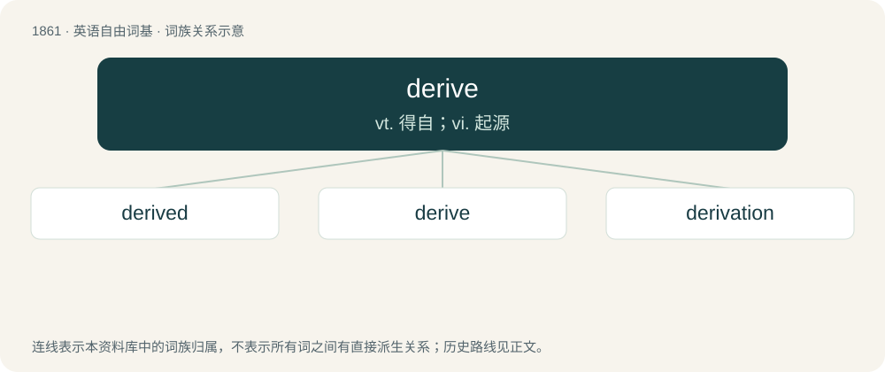

# 1968 · derive — vt. 得自；vi. 起源

[总目录](../00_总目录_按常用程度.md)

**类型**：英语自由词基　｜　**来源语言**：见词源记录

## 核心含义与来源

- 核心含义：vt. 得自；vi. 起源
- 英文含义：To obtain or receive (something) from something else.
- 词形：derive

**来源记录 1**（动词；To obtain or receive (something) from something else.）

From Middle English deriven, from Old French deriver, from Latin dērīvō (“to lead, turn, or draw off (a liquid), draw off, derive”), from dē (“away”) + rīvus (“a stream”); see rival. Unrelated to arrive.

## 词族图

## 单词速览（常用到不常用）

| 单词 | 音标 | 释义 |
|---|---|---|
| [derived](#w-1) | 英 /dɪˈɹaɪvd/ | a. 导出的；衍生的, 派生的 |
| [derive](#w-2) | 英 /dɪˈɹaɪv/ | vt. 得自；vi. 起源 |
| [derivation](#w-3) | /ˌdɛ.ɹɪˈveɪ.ʃ(ə)n/ | n. 推论, 推导, 来历；\[医\] 衍化, 诱导 |

## 逐词详解

### 1. derived

**词性**：形容词　｜　**音标**：英 /dɪˈɹaɪvd/

**中文释义**：a. 导出的；衍生的, 派生的

**英文义项**：Of, or pertaining to, conditions unique to the descendant species of a clade, and not found in earlier ancestral species. / A product of derivation.

**构词拆分**：From derive + -ed.

**词源与演化**：

From derive + -ed.

**例句**：

> The French language is derived from Latin.

该用例对应义项：A product of derivation.

### 2. derive

**词性**：动词　｜　**音标**：英 /dɪˈɹaɪv/

**中文释义**：vt. 得自；vi. 起源

**英文义项**：To obtain or receive (something) from something else. / To deduce (a conclusion) by reasoning.

**词源与演化**：

From Middle English deriven, from Old French deriver, from Latin dērīvō (“to lead, turn, or draw off (a liquid), draw off, derive”), from dē (“away”) + rīvus (“a stream”); see rival. Unrelated to arrive.

**例句**：

> Her excellent organisation skills derive from her time as a secretary in the army.

该用例对应义项：To originate or stem (from).

### 3. derivation

**词性**：名词　｜　**音标**：/ˌdɛ.ɹɪˈveɪ.ʃ(ə)n/

**中文释义**：n. 推论, 推导, 来历；\[医\] 衍化, 诱导

**英文义项**：A leading or drawing off of water from a stream or source. / The act of receiving anything from a source; the act of procuring an effect from a cause, means, or condition, as profits from capital, conclusions or opinions from evidence.

**构词拆分**：derive + -ation

**词源与演化**：

From Middle English derivacioun, borrowed from Middle French dérivation, from Latin dērīvātiō, dērīvātiōnem. Morphologically derive + -ation.

**用法示例／搭配（非完整句）**：

> the derivation of a word from an Indo-European root

该用例对应义项：The act of tracing origin or descent; an instance thereof (for example, an etymology).
