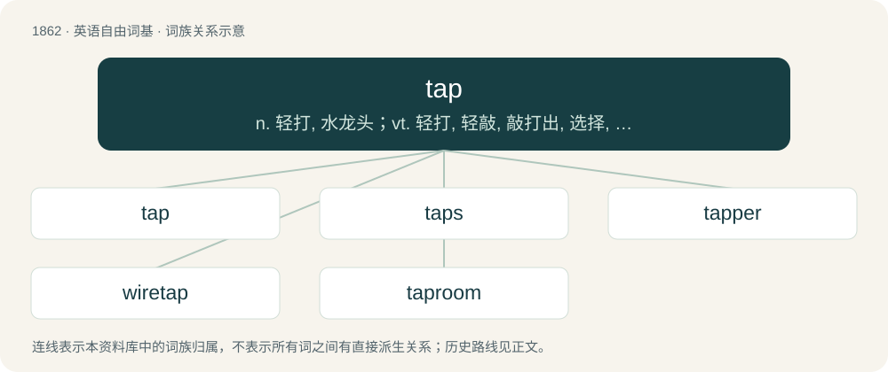

# 1969 · tap — n. 轻打, 水龙头；vt. 轻打, 轻敲, 敲打出, 选择, 装上嘴子, 使流出, 开发, 分接, 向...乞讨；vi. 轻叩, 轻拍, 啪塔啪塔地走

[总目录](../00_总目录_按常用程度.md)

**类型**：英语自由词基　｜　**来源语言**：见词源记录

## 核心含义与来源

- 核心含义：n. 轻打, 水龙头；vt. 轻打, 轻敲, 敲打出, 选择, 装上嘴子, 使流出, 开发, 分接, 向...乞讨；vi. 轻叩, 轻拍, 啪塔啪塔地走
- 英文含义：A conical peg or pin used to close and open the hole or vent in a container.
- 词形：tap

**多个词源／构词路径**：同一拼写可能有不同来源；以下按词性和含义分别列出。

**来源记录 1**（名词；A conical peg or pin used to close and open the hole or vent in a container.）

The noun is derived from Middle English tappe (“hollow device for controlling the flow of liquid from a hole, cock, faucet, spigot; hole through which the liquid flows; the liquid which thus flows”), from Old English tæppa, from Proto-West Germanic \*tappō, from Proto-Germanic \*tappô (“a plug, tap; peg; tapering stick”), from Proto-Indo-European \*deh₂p- (“to lose; to sacrifice”). Doublet of tapa. The verb is derived from Middle English tappen (“to obtain (liquid, chiefly liquor) from a tap; to obtain and sell (liquor)”), from Old English tæppian (“to provide (a container) with a stopper; to obtain (liquid) from a tap”), and then either: \* from Old English tæppa (see above) + -ian (suffix forming verbs); or \* from Proto-Germanic \*tappōną, from \*tappô (noun) (see above). Verb etymology 1, verb sense 1.3.5 (“to turn over (a playing card or playing piece) to remind players that it has already been used in that round”) alludes to the abilities or resources of the card or piece having been drawn on to the point of temporary exhaustion: see verb etymology 1, verb sense 1.3.2.

**来源记录 2**（动词；To strike (someone or something), chiefly lightly with a clear sound, but sometimes hard.）

The verb is derived from Middle English tappen, teppen (“to give (something) a knock or tap; to hit (something) lightly, pat, tap”), either: \* imitative of the making of a tapping sound; or \* from Old French tapper, taper (“to tap”) (modern French taper), from Frankish \*tappōn, \*dabbōn (“to strike”), or from Middle Low German tappen, tapen (“to rap, strike, tap”), or from Proto-Germanic \*tabōną (“to grope, to grapple, to claw”), maybe via a Old Norse \*tapa (“to strike”), as seen in the derivative tapsa (“to tap”) Doublet of dab and tave. Verb etymology 2, verb sense 1.1.1 (“to arrest (someone)”) and etymology 2, verb sense 1.6 (“to choose or designate (someone) for a duty, etc.”) allude to a police officer or other person tapping someone on their shoulder to catch their attention or to select them. The noun is derived from Middle English tap, tappe (“light blow or hit”), and then either: \* from Middle English tappen (verb) (see above); or \* from Old French tape (“light slap or touch, pat”) (modern French tape), from tapper, taper (verb) (see above). Cognates \* German tappen (“to fumble; to grope”) \* Icelandic tappa, tapsa, tæpta (“to tap”)

**来源记录 3**（名词；A malarial fever.）

From Persian or Urdu تب (tab, “malarial fever”), ultimately from Sanskrit ताप (tāpa, “fever; heat; pain, torment”).

## 词族图

## 单词速览（常用到不常用）

| 单词 | 音标 | 释义 |
|---|---|---|
| [tap](#w-1) | 英 /tæp/ | n. 轻打, 水龙头；vt. 轻打, 轻敲, 敲打出, 选择, 装上嘴子, 使流出, 开发, 分接, 向...乞讨；vi. 轻叩, 轻拍, 啪塔啪塔地走 |
| [taps](#w-2) | 英 /tæps/ | n. (美军)熄灯号, 熄灯鼓 |
| [tapper](#w-3) | /ˈtæpə/ | n. 轻敲者, 电报键；\[机\] 攻螺丝机 |
| [wiretap](#w-4) | 英 /ˈwaɪətæp/；美 /ˈwaɪɚtæp/ | v. 搭线窃听；n. 窃听 |
| [taproom](#w-5) | 美 /ˈtæpˌɹum/ | n. 酒吧间 |

## 逐词详解

### 1. tap

**词性**：名词　｜　**音标**：英 /tæp/

**中文释义**：n. 轻打, 水龙头；vt. 轻打, 轻敲, 敲打出, 选择, 装上嘴子, 使流出, 开发, 分接, 向...乞讨；vi. 轻叩, 轻拍, 啪塔啪塔地走

**英文义项**：A conical peg or pin used to close and open the hole or vent in a container. / An object with a tapering conical form like a tap (etymology 1, noun sense 1); specifically, ellipsis of taproot (“long, tapering root of a plant”).

**词源与演化**：

The noun is derived from Middle English tappe (“hollow device for controlling the flow of liquid from a hole, cock, faucet, spigot; hole through which the liquid flows; the liquid which thus flows”), from Old English tæppa, from Proto-West Germanic \*tappō, from Proto-Germanic \*tappô (“a plug, tap; peg; tapering stick”), from Proto-Indo-European \*deh₂p- (“to lose; to sacrifice”). Doublet of tapa. The verb is derived from Middle English tappen (“to obtain (liquid, chiefly liquor) from a tap; to obtain and sell (liquor)”), from Old English tæppian (“to provide (a container) with a stopper; to obtain (liquid) from a tap”), and then either: \* from Old English tæppa (see above) + -ian (suffix forming verbs); or \* from Proto-Germanic \*tappōną, from \*tappô (noun) (see above). Verb etymology 1, verb sense 1.3.5 (“to turn over (a playing card or playing piece) to remind players that it has already been used in that round”) alludes to the abilities or resources of the card or piece having been drawn on to the point of temporary exhaustion: see verb etymology 1, verb sense 1.3.2.

**例句**：

> We drilled a hole and then cut the threads with the proper tap to match the valve’s thread.

该用例对应义项：A cylindrical tool used to cut an internal screw thread in a hole, with cutting edges around the lower end and an upper end to which a handle is fitted to turn the tool.

### 2. taps

**词性**：名词　｜　**音标**：英 /tæps/

**中文释义**：n. (美军)熄灯号, 熄灯鼓

**英文义项**：A signal, by drum or trumpet, for extinguishing all lights in soldiers' quarters and retiring to bed, usually given about a quarter of an hour after tattoo; the signal is sometimes also given during the funeral of a soldier.

**构词拆分**：tap (noun) + -s

**词源与演化**：

From tap (noun) + -s. Noun 1 sense 1 (“signal for extinguishing all lights in soldiers’ quarters and retiring to bed”) is from the fact that the signal was originally made using a drum.

**例句**：

> Using the taps is worth it and releasing the vents is not.

### 3. tapper

**词性**：名词　｜　**音标**：/ˈtæpə/

**中文释义**：n. 轻敲者, 电报键；\[机\] 攻螺丝机

**英文义项**：One who makes a tapping noise. / A tap-dancer.

**构词拆分**：From tap + -er.

**词源与演化**：

From tap + -er.

### 4. wiretap

**词性**：名词　｜　**音标**：英 /ˈwaɪətæp/；美 /ˈwaɪɚtæp/

**中文释义**：v. 搭线窃听；n. 窃听

**英文义项**：A connection installed on a telephone line or other communications system in order to allow a third party to conduct covert surveillance of conversations.

**构词拆分**：wire + tap

**词源与演化**：

Back-formation from wiretapper; or else wire + tap

### 5. taproom

**词性**：名词　｜　**音标**：美 /ˈtæpˌɹum/

**中文释义**：n. 酒吧间

**英文义项**：A room where alcoholic beverages are served on tap; a bar or barroom.

**构词拆分**：tap + room

**词源与演化**：

From tap + room.

**例句**：

> Dusty left the taproom of the tavern and wandered into the small arcade in back.

该用例对应义项：A room where alcoholic beverages are served on tap; a bar or barroom.
