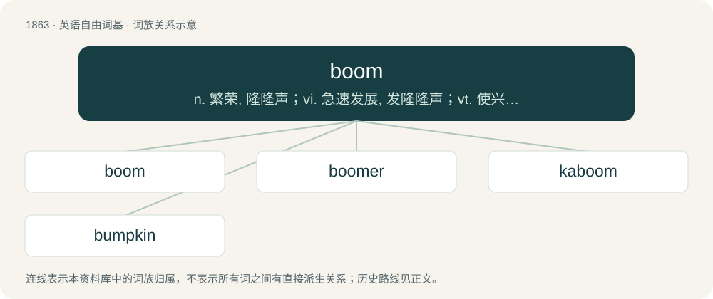

# 1970 · boom — n. 繁荣, 隆隆声；vi. 急速发展, 发隆隆声；vt. 使兴旺, 发隆隆声

[总目录](../00_总目录_按常用程度.md)

**类型**：英语自由词基　｜　**来源语言**：见词源记录

## 核心含义与来源

- 核心含义：n. 繁荣, 隆隆声；vi. 急速发展, 发隆隆声；vt. 使兴旺, 发隆隆声
- 英文含义：To make a loud, hollow, resonant sound.
- 词形：boom

**多个词源／构词路径**：同一拼写可能有不同来源；以下按词性和含义分别列出。

**来源记录 1**（动词；To make a loud, hollow, resonant sound.）

Onomatopoeic, perhaps borrowed; compare German bummen, Dutch bommen (“to hum, buzz”). The sense "a period of economic growth" is generally taken to derive from the sense "a rapid expansion", although other origins have also been suggested.

**来源记录 2**（名词；A spar extending the foot of a sail; a spar rigged outboard from a ship's side to which boats are secured in harbour.）

Borrowed from Dutch boom (“tree; pole”). Doublet of beam.

## 词族图

## 单词速览（常用到不常用）

| 单词 | 音标 | 释义 |
|---|---|---|
| [boom](#w-1) | 英 /buːm/；美 /bum/ | n. 繁荣, 隆隆声；vi. 急速发展, 发隆隆声；vt. 使兴旺, 发隆隆声 |
| [boomer](#w-2) | 英 /ˈbuː.mə/；美 /ˈbu.mɚ/ | n. 往来无定的临时工 |
| [kaboom](#w-3) | /kəˈbuːm/ | 【英文】The sound of an explosion, typically seen in comic strips or heard in a light-hearted conversation. |
| [bumpkin](#w-4) | /ˈbʌmpkɪn/ | n. 乡下人, 土佬儿 |

## 逐词详解

### 1. boom

**词性**：动词　｜　**音标**：英 /buːm/；美 /bum/

**中文释义**：n. 繁荣, 隆隆声；vi. 急速发展, 发隆隆声；vt. 使兴旺, 发隆隆声

**英文义项**：To make a loud, hollow, resonant sound. / To exclaim with force, to shout, to thunder.

**词源与演化**：

Onomatopoeic, perhaps borrowed; compare German bummen, Dutch bommen (“to hum, buzz”). The sense "a period of economic growth" is generally taken to derive from the sense "a rapid expansion", although other origins have also been suggested.

**例句**：

> Thunder boomed in the distance and lightning flashes lit up the horizon.

该用例对应义项：To make a loud, hollow, resonant sound.

### 2. boomer

**词性**：名词　｜　**音标**：英 /ˈbuː.mə/；美 /ˈbu.mɚ/

**中文释义**：n. 往来无定的临时工

**英文义项**：Something that makes a booming sound. / A device used to bind or tighten chain.

**构词拆分**：boom + -er

**词源与演化**：

From boom + -er.

**例句**：

> I don't have cable because I'm not a boomer.

### 3. kaboom

**词性**：名词　｜　**音标**：/kəˈbuːm/

**英文义项**：The sound of an explosion, typically seen in comic strips or heard in a light-hearted conversation. / An explosion itself.

**构词拆分**：ka- + boom

**词源与演化**：

From ka- + boom. Compare kerboom. Consider Italian tapum.

### 4. bumpkin

**词性**：名词　｜　**音标**：/ˈbʌmpkɪn/

**中文释义**：n. 乡下人, 土佬儿

**英文义项**：A clumsy, unsophisticated person; a yokel. / A short boom or spar used to extend a sail or secure a stay.

**构词拆分**：boom + -kin

**词源与演化**：

From Dutch boomken (“shrub, little tree”), equivalent to boom + -kin. Note that the English word boom is etymologically related to the aforementioned in the sense of "large stem", or "big tree". Compare German Baumke, Bäumchen.

**例句**：

> The little bumpkin bought a big pumpkin.
