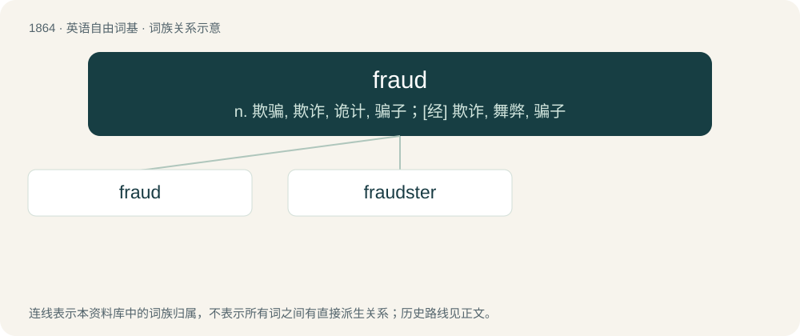

# 1971 · fraud — n. 欺骗, 欺诈, 诡计, 骗子；\[经\] 欺诈, 舞弊, 骗子

[总目录](../00_总目录_按常用程度.md)

**类型**：英语自由词基　｜　**来源语言**：见词源记录

## 核心含义与来源

- 核心含义：n. 欺骗, 欺诈, 诡计, 骗子；\[经\] 欺诈, 舞弊, 骗子
- 英文含义：The crime of stealing or otherwise illegally obtaining money by use of deception tactics.
- 词形：fraud

**来源记录 1**（名词；The crime of stealing or otherwise illegally obtaining money by use of deception tactics.）

Inherited from Middle English fraude (recorded since 1345), from Old French fraude, a borrowing from Latin fraus (“deceit, injury, offence”).

## 词族图

## 单词速览（常用到不常用）

| 单词 | 音标 | 释义 |
|---|---|---|
| [fraud](#w-1) | 英 /ˈfɹɔːd/；/ˈfɹɔd/ | n. 欺骗, 欺诈, 诡计, 骗子；\[经\] 欺诈, 舞弊, 骗子 |
| [fraudster](#w-2) | 英 /ˈfɹɔːdstə/；美 /ˈfɹɔdstɚ/ | n. 行骗者 |

## 逐词详解

### 1. fraud

**词性**：名词　｜　**音标**：英 /ˈfɹɔːd/；/ˈfɹɔd/

**中文释义**：n. 欺骗, 欺诈, 诡计, 骗子；\[经\] 欺诈, 舞弊, 骗子

**英文义项**：The crime of stealing or otherwise illegally obtaining money by use of deception tactics. / Any act of deception carried out for the purpose of unfair, undeserved or unlawful gain.

**词源与演化**：

Inherited from Middle English fraude (recorded since 1345), from Old French fraude, a borrowing from Latin fraus (“deceit, injury, offence”).

**例句**：

> As far as I know, he wasn't involved in that fraud scheme.

### 2. fraudster

**词性**：名词　｜　**音标**：英 /ˈfɹɔːdstə/；美 /ˈfɹɔdstɚ/

**中文释义**：n. 行骗者

**英文义项**：A person who carries out fraud; a swindler.

**构词拆分**：fraud + -ster

**词源与演化**：

From fraud + -ster.
