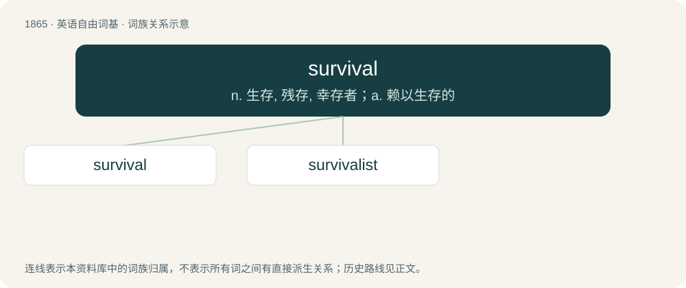

# 1972 · survival — n. 生存, 残存, 幸存者；a. 赖以生存的

[总目录](../00_总目录_按常用程度.md)

**类型**：英语自由词基　｜　**来源语言**：见词源记录

## 核心含义与来源

- 核心含义：n. 生存, 残存, 幸存者；a. 赖以生存的
- 英文含义：The fact or act of surviving; continued existence or life.
- 词形：survival

**来源记录 1**（名词；The fact or act of surviving; continued existence or life.）

From survive + -al.

## 词族图

## 单词速览（常用到不常用）

| 单词 | 音标 | 释义 |
|---|---|---|
| [survival](#w-1) | 英 /səˈvaɪ.vəl/；美 /sɚˈvaɪ.vəl/ | n. 生存, 残存, 幸存者；a. 赖以生存的 |
| [survivalist](#w-2) | /səˈvaivəlist/ | n. 成功地活下来的人,活命主义者 |

## 逐词详解

### 1. survival

**词性**：名词　｜　**音标**：英 /səˈvaɪ.vəl/；美 /sɚˈvaɪ.vəl/

**中文释义**：n. 生存, 残存, 幸存者；a. 赖以生存的

**英文义项**：The fact or act of surviving; continued existence or life. / Of, relating to or aiding survival.

**构词拆分**：survive + -al

**词源与演化**：

From survive + -al.

**例句**：

> His survival in the open ocean was a miracle; he had fully expected to die.

该用例对应义项：The fact or act of surviving; continued existence or life.

### 2. survivalist

**词性**：名词　｜　**音标**：/səˈvaivəlist/

**中文释义**：n. 成功地活下来的人,活命主义者

**英文义项**：A person who believes in being prepared to survive and is actively preparing for possible future emergencies and disruptions in local, regional, national, or international social or political order.

**构词拆分**：survival + -ist

**词源与演化**：

From survival + -ist.

**例句**：

> What's the difference between a prepper and a survivalist?
