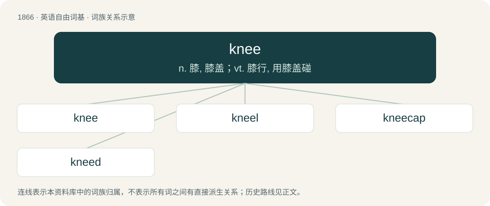

# 1974 · knee — n. 膝, 膝盖；vt. 膝行, 用膝盖碰

[总目录](../00_总目录_按常用程度.md)

**类型**：英语自由词基　｜　**来源语言**：见词源记录

## 核心含义与来源

- 核心含义：n. 膝, 膝盖；vt. 膝行, 用膝盖碰
- 英文含义：In humans, the joint or the region of the joint in the middle part of the leg between the thigh and the shank.
- 词形：knee

**来源记录 1**（名词；In humans, the joint or the region of the joint in the middle part of the leg between the thigh and the shank.）

Inherited from Middle English kne, from Old English cnēow, from Proto-West Germanic \*kneu, from Proto-Germanic \*knewą, from Proto-Indo-European \*ǵnéw-o-m, a thematic derivative of \*ǵónu. See also West Frisian knibbel, Low German Knee, Knie, Dutch knie, German Knie, Danish knæ, Norwegian Bokmål and Norwegian Nynorsk kne, Swedish knä; also Hittite 𒄀𒉡 (genu), Latin genū, Tocharian A kanweṃ (dual), Tocharian B kenī, Ancient Greek γόνυ (gónu, “knee”), γωνία (gōnía, “corner, angle”), Welsh glin (“knee”), Old Armenian ծունր (cunr), Avestan 𐬲𐬥𐬎𐬨 (žnum), Sanskrit जानु (jā́nu). The obsolete plural kneen is from Middle English kneen, knen, kneon, kneuwene.

## 词族图

## 单词速览（常用到不常用）

| 单词 | 音标 | 释义 |
|---|---|---|
| [knee](#w-1) | 英 /niː/；美 /ni/ | n. 膝, 膝盖；vt. 膝行, 用膝盖碰 |
| [kneel](#w-2) | /niːl/ | vi. 跪下 |
| [kneecap](#w-3) | /ˈniːˌkæp/ | n. 膝盖骨, 护膝 |
| [kneed](#w-4) | /niːd/ | a. 有膝一般的关节的, 有节的 |

## 逐词详解

### 1. knee

**词性**：名词　｜　**音标**：英 /niː/；美 /ni/

**中文释义**：n. 膝, 膝盖；vt. 膝行, 用膝盖碰

**英文义项**：In humans, the joint or the region of the joint in the middle part of the leg between the thigh and the shank. / In the horse and allied animals, the carpal joint, corresponding to the wrist in humans.

**词源与演化**：

Inherited from Middle English kne, from Old English cnēow, from Proto-West Germanic \*kneu, from Proto-Germanic \*knewą, from Proto-Indo-European \*ǵnéw-o-m, a thematic derivative of \*ǵónu. See also West Frisian knibbel, Low German Knee, Knie, Dutch knie, German Knie, Danish knæ, Norwegian Bokmål and Norwegian Nynorsk kne, Swedish knä; also Hittite 𒄀𒉡 (genu), Latin genū, Tocharian A kanweṃ (dual), Tocharian B kenī, Ancient Greek γόνυ (gónu, “knee”), γωνία (gōnía, “corner, angle”), Welsh glin (“knee”), Old Armenian ծունր (cunr), Avestan 𐬲𐬥𐬎𐬨 (žnum), Sanskrit जानु (jā́nu). The obsolete plural kneen is from Middle English kneen, knen, kneon, kneuwene.

**例句**：

> Penny was wearing a miniskirt, so she skinned her exposed knees when she fell.

该用例对应义项：In humans, the joint or the region of the joint in the middle part of the leg between the thigh and the shank.

### 2. kneel

**词性**：动词　｜　**音标**：/niːl/

**中文释义**：vi. 跪下

**英文义项**：To rest on one's bent knees, sometimes only one; to move to such a position. / To sink down so that the entrance is level with the pavement, making it easier for passengers to enter.

**构词拆分**：knee + -le

**词源与演化**：

From Middle English knelen, from Old English cnēowlian (“to kneel”), equivalent to knee + -le. Cognate with Dutch knielen, Low German knelen, dialectal German knielen, Alemannic German chnüle, Danish knæle, all meaning “to kneel”.

**例句**：

> In church you have to kneel during parts of the service.

该用例对应义项：rest one's weight on one's knees

### 3. kneecap

**词性**：名词　｜　**音标**：/ˈniːˌkæp/

**中文释义**：n. 膝盖骨, 护膝

**英文义项**：The flat, roundish bone in the knee. / A metal cover trim that fits over a panel rib after it has been cut and bent.

**构词拆分**：knee + cap

**词源与演化**：

From knee + cap.

**例句**：

> If these muscles are weak, they cannot hold the kneecap in the correct position.

### 4. kneed

**词性**：形容词　｜　**音标**：/niːd/

**中文释义**：a. 有膝一般的关节的, 有节的

**英文义项**：Having a knee or knees, or, in combination, the stated type of knee or knees. / Having angular joints like the knee.

**构词拆分**：knee + -ed

**词源与演化**：

From knee + -ed.

**用法示例／搭配（非完整句）**：

> a kneed biped; a knobbly-kneed boy

该用例对应义项：Having a knee or knees, or, in combination, the stated type of knee or knees.
