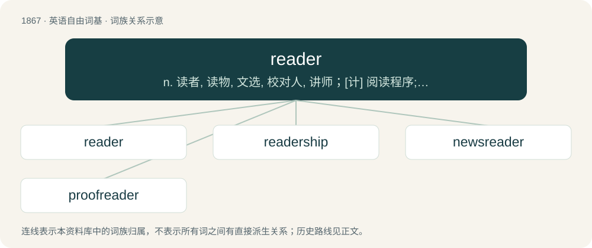

# 1975 · reader — n. 读者, 读物, 文选, 校对人, 讲师；\[计\] 阅读程序; 阅读器

[总目录](../00_总目录_按常用程度.md)

**类型**：英语自由词基　｜　**来源语言**：见词源记录

## 核心含义与来源

- 核心含义：n. 读者, 读物, 文选, 校对人, 讲师；\[计\] 阅读程序; 阅读器
- 英文含义：A person who reads.
- 词形：reader

**来源记录 1**（名词；A person who reads.）

From Middle English reder, redar, redere, redare, from Old English rēdere, rǣdere (“a reader; scholar; diviner”), from Proto-West Germanic \*rādāri, equivalent to read + -er. Cognate with Saterland Frisian Räider (“advisor”), Dutch rader (“advisor”), German Rater (“advisor”).

## 词族图

## 单词速览（常用到不常用）

| 单词 | 音标 | 释义 |
|---|---|---|
| [reader](#w-1) | 英 /ˈɹiː.də/；美 /ˈɹi.dɚ/ | n. 读者, 读物, 文选, 校对人, 讲师；\[计\] 阅读程序; 阅读器 |
| [readership](#w-2) | /ˈriːdəʃip/ | n. 读者, 读者人数 |
| [newsreader](#w-3) | /ˈnjuːzriːdə/ | n. 新闻广播员；\[计\] 新闻阅读器 |
| [proofreader](#w-4) | /ˈpruːfriːdə/ | n. 校对者 |

## 逐词详解

### 1. reader

**词性**：名词　｜　**音标**：英 /ˈɹiː.də/；美 /ˈɹi.dɚ/

**中文释义**：n. 读者, 读物, 文选, 校对人, 讲师；\[计\] 阅读程序; 阅读器

**英文义项**：A person who reads. / A person who reads a publication.

**构词拆分**：read + -er

**词源与演化**：

From Middle English reder, redar, redere, redare, from Old English rēdere, rǣdere (“a reader; scholar; diviner”), from Proto-West Germanic \*rādāri, equivalent to read + -er. Cognate with Saterland Frisian Räider (“advisor”), Dutch rader (“advisor”), German Rater (“advisor”).

**用法示例／搭配（非完整句）**：

> an early reader, a talented reader

该用例对应义项：A person who reads.

### 2. readership

**词性**：名词　｜　**音标**：/ˈriːdəʃip/

**中文释义**：n. 读者, 读者人数

**英文义项**：The collected readers of a publication. / The role or office of a reader.

**构词拆分**：reader + -ship

**词源与演化**：

From reader + -ship.

**例句**：

> The village newspaper has a readership of only 200 people.

该用例对应义项：The collected readers of a publication.

### 3. newsreader

**词性**：名词　｜　**音标**：/ˈnjuːzriːdə/

**中文释义**：n. 新闻广播员；\[计\] 新闻阅读器

**英文义项**：An anchorman in a news program, a news anchor, newscaster. / A program for reading and posting to newsgroups.

**构词拆分**：news + reader

**词源与演化**：

From news + reader.

**例句**：

> Then, as the newsreader began a live interview, the channel was pulled from the airwaves.

### 4. proofreader

**词性**：名词　｜　**音标**：/ˈpruːfriːdə/

**中文释义**：n. 校对者

**英文义项**：A person who proofreads. / A person whose occupation is to proofread.

**构词拆分**：proof + reader

**词源与演化**：

From proof + reader.

**例句**：

> If Esperanto were an easy language I wouldn't need a proofreader.
