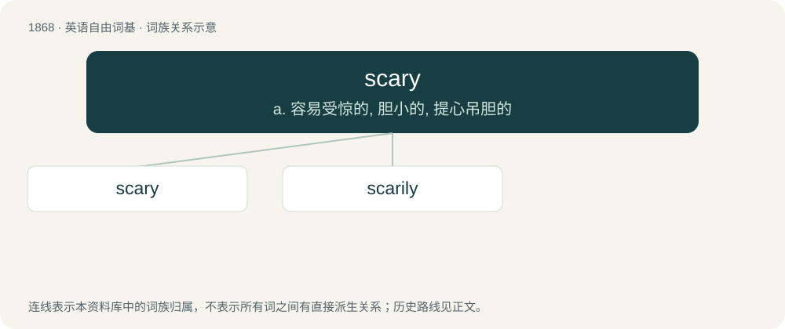

# 1977 · scary — a. 容易受惊的, 胆小的, 提心吊胆的

[总目录](../00_总目录_按常用程度.md)

**类型**：英语自由词基　｜　**来源语言**：见词源记录

## 核心含义与来源

- 核心含义：a. 容易受惊的, 胆小的, 提心吊胆的
- 英文含义：Causing fear or anxiety
- 词形：scary

**多个词源／构词路径**：同一拼写可能有不同来源；以下按词性和含义分别列出。

**来源记录 1**（形容词；Causing fear or anxiety）

From scare + -y.

**来源记录 2**（名词；Barren land having only a thin coat of grass.）

From dialectal English scare (“scraggy”).

## 词族图

## 单词速览（常用到不常用）

| 单词 | 音标 | 释义 |
|---|---|---|
| [scary](#w-1) | 英 /ˈskɛə.ɹi/；美 /ˈskɛə.ɹi/ | a. 容易受惊的, 胆小的, 提心吊胆的 |
| [scarily](#w-2) |  | 可怕地；容易受惊地 |

## 逐词详解

### 1. scary

**词性**：形容词　｜　**音标**：英 /ˈskɛə.ɹi/；美 /ˈskɛə.ɹi/

**中文释义**：a. 容易受惊的, 胆小的, 提心吊胆的

**英文义项**：Causing fear or anxiety / Uncannily striking or surprising.

**构词拆分**：scare + -y

**词源与演化**：

From scare + -y.

**例句**：

> Linda changed her hair, and it’s scary how much she looks like her mother.

该用例对应义项：Uncannily striking or surprising.

### 2. scarily

**词性**：副词

**中文释义**：可怕地；容易受惊地

**英文义项**：In a scary manner.

**构词拆分**：scary + -ly

**词源与演化**：

From scary + -ly.
