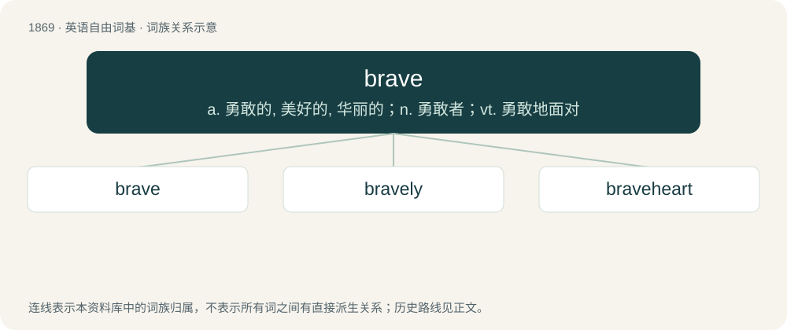

# 1978 · brave — a. 勇敢的, 美好的, 华丽的；n. 勇敢者；vt. 勇敢地面对

[总目录](../00_总目录_按常用程度.md)

**类型**：英语自由词基　｜　**来源语言**：见词源记录

## 核心含义与来源

- 核心含义：a. 勇敢的, 美好的, 华丽的；n. 勇敢者；vt. 勇敢地面对
- 英文含义：Strong in the face of fear; courageous.
- 词形：brave

**多个词源／构词路径**：同一拼写可能有不同来源；以下按词性和含义分别列出。

**来源记录 1**（形容词；Strong in the face of fear; courageous.）

From Middle French brave, borrowed from Italian bravo, itself of uncertain origin (see there). Doublet of bravo.

**来源记录 2**（动词；To encounter or withstand with courage and fortitude, to defy, to provoke.）

From Middle French braver, from brave.

## 词族图

## 单词速览（常用到不常用）

| 单词 | 音标 | 释义 |
|---|---|---|
| [brave](#w-1) | 英 /bɹeɪv/ | a. 勇敢的, 美好的, 华丽的；n. 勇敢者；vt. 勇敢地面对 |
| [bravely](#w-2) | /ˈbɹeɪvli/ | adv. 勇敢地 |
| [braveheart](#w-3) |  | 【英文】brave |

## 逐词详解

### 1. brave

**词性**：形容词　｜　**音标**：英 /bɹeɪv/

**中文释义**：a. 勇敢的, 美好的, 华丽的；n. 勇敢者；vt. 勇敢地面对

**英文义项**：Strong in the face of fear; courageous. / Making a fine show or display.

**词源与演化**：

From Middle French brave, borrowed from Italian bravo, itself of uncertain origin (see there). Doublet of bravo.

**例句**：

> Familiarity with danger makes a brave man braver but less daring.

该用例对应义项：possessing or displaying courage; able to face and deal with danger or fear without flinching

### 2. bravely

**词性**：副词　｜　**音标**：/ˈbɹeɪvli/

**中文释义**：adv. 勇敢地

**英文义项**：In a brave manner.

**构词拆分**：brave + -ly

**词源与演化**：

From brave + -ly.

**例句**：

> The soldiers faced the enemy bravely.

该用例对应义项：In a brave manner.

### 3. braveheart

**词性**：形容词

**英文义项**：brave

**构词拆分**：brave + heart

**词源与演化**：

From brave + heart.

**例句**：

> The West is championing itself as the Braveheart of democracy.
