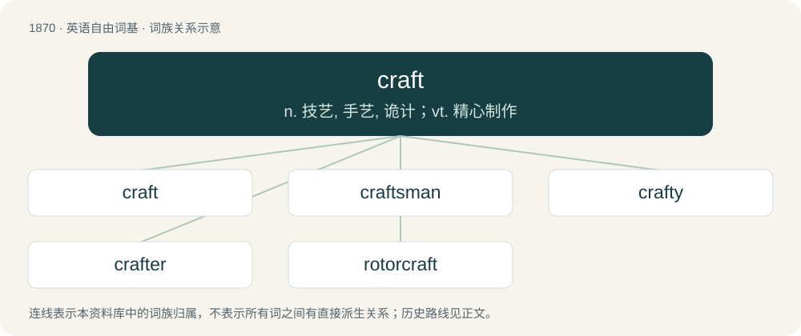

# 1979 · craft — n. 技艺, 手艺, 诡计；vt. 精心制作

[总目录](../00_总目录_按常用程度.md)

**类型**：英语自由词基　｜　**来源语言**：见词源记录

## 核心含义与来源

- 核心含义：n. 技艺, 手艺, 诡计；vt. 精心制作
- 英文含义：Ability, skillfulness, especially skill in making plans and carrying them into execution; dexterity in managing affairs, adroitness, practical cunning; ingenuity in constructing, dexterity .
- 词形：craft

**来源记录 1**（名词；Ability, skillfulness, especially skill in making plans and carrying them into execution; dexterity in managing affairs, adroitness, practical cunning; ingenuity in constructing, dexterity .）

Inherited from Middle English craft (“strength, skill”), from Old English cræft (“strength, skill”), from Proto-West Germanic \*kraftu, from Proto-Germanic \*kraftuz (“strength, power”); further origin obscure. Cognate with Dutch kracht (“strength, power, force”), German Kraft (“strength, power, force, energy, employee”), Danish, Norwegian Bokmål, Norwegian Nynorsk, and Swedish kraft (“strength, power, force”), Faroese and Icelandic kraftur (“strength”).

## 词族图

## 单词速览（常用到不常用）

| 单词 | 音标 | 释义 |
|---|---|---|
| [craft](#w-1) | 英 /ˈkɹɑːft/；美 /ˈkɹæft/ | n. 技艺, 手艺, 诡计；vt. 精心制作 |
| [craftsman](#w-2) | 英 /ˈkɹɑːftsmən/；美 /ˈkɹæftsmən/ | n. 工匠, 技工, 手艺人 |
| [crafty](#w-3) | 英 /ˈkɹɑːfti/；美 /ˈkɹæfti/ | a. 狡诈的, 诡计多端的, 巧妙的 |
| [crafter](#w-4) |  | n. 工匠；气泡孔；焊弧坑；手工者；针眼纸病 |
| [rotorcraft](#w-5) | /ˈrəjtəkrɑːft; -kræft/ | n. 旋翼飞机 |

## 逐词详解

### 1. craft

**词性**：名词　｜　**音标**：英 /ˈkɹɑːft/；美 /ˈkɹæft/

**中文释义**：n. 技艺, 手艺, 诡计；vt. 精心制作

**英文义项**：Ability, skillfulness, especially skill in making plans and carrying them into execution; dexterity in managing affairs, adroitness, practical cunning; ingenuity in constructing, dexterity . / Cunning, art, skill, or dexterity applied to bad purposes; artifice; guile; subtlety; shrewdness as demonstrated by being skilled in deception .

**词源与演化**：

Inherited from Middle English craft (“strength, skill”), from Old English cræft (“strength, skill”), from Proto-West Germanic \*kraftu, from Proto-Germanic \*kraftuz (“strength, power”); further origin obscure. Cognate with Dutch kracht (“strength, power, force”), German Kraft (“strength, power, force, energy, employee”), Danish, Norwegian Bokmål, Norwegian Nynorsk, and Swedish kraft (“strength, power, force”), Faroese and Icelandic kraftur (“strength”).

**例句**：

> He learned his craft as an apprentice.

该用例对应义项：A branch of skilled work or trade, especially one requiring manual dexterity or artistic skill, but sometimes applied equally to any business, calling or profession; the skilled practice of a practical occupation .

### 2. craftsman

**词性**：名词　｜　**音标**：英 /ˈkɹɑːftsmən/；美 /ˈkɹæftsmən/

**中文释义**：n. 工匠, 技工, 手艺人

**英文义项**：One who is highly skilled at one's trade; an artisan or artificer. / A person who makes or creates material objects partly or entirely by hand.

**构词拆分**：craft + -s- + -man

**词源与演化**：

From craft + -s- + -man.

**例句**：

> Tom composed sentences like a master craftsman building furniture for a king.

### 3. crafty

**词性**：形容词　｜　**音标**：英 /ˈkɹɑːfti/；美 /ˈkɹæfti/

**中文释义**：a. 狡诈的, 诡计多端的, 巧妙的

**英文义项**：Skillful at deceiving others. / Sneaky; surreptitious.

**构词拆分**：craft + -y

**词源与演化**：

From Middle English crafty, crefty, craftiȝ, from Old English cræftiġ (“ingenious; skilful; crafty; cunning; virtuous; powerful”), from Proto-West Germanic \*kraftag, \*kraftīg, \*kraftug, from Proto-Germanic \*kraftugaz (“powerful”), equivalent to craft + -y. Cognate with Saterland Frisian kräftich, krääftig, West Frisian krêftich, Dutch krachtig, German Low German krachtig, German kräftig.

**例句**：

> I took a crafty look at his hand of cards while he was out of the room.

该用例对应义项：Sneaky; surreptitious.

### 4. crafter

**词性**：名词

**中文释义**：n. 工匠；气泡孔；焊弧坑；手工者；针眼纸病

**英文义项**：Someone who participates in a particular handicraft, either as a hobby or as a small business / Someone or something that crafts.

**构词拆分**：craft + -er

**词源与演化**：

From craft + -er.

**例句**：

> There are a number of crafters around here who make quilts.

该用例对应义项：Someone who participates in a particular handicraft, either as a hobby or as a small business

### 5. rotorcraft

**词性**：名词　｜　**音标**：/ˈrəjtəkrɑːft; -kræft/

**中文释义**：n. 旋翼飞机

**英文义项**：Any aircraft that obtains its lift from rotors (usually either a helicopter or an aerial drone with rotors).

**构词拆分**：rotor + craft

**词源与演化**：

From rotor + craft.

**例句**：

> Dragonfly is a drone-like rotorcraft that would explore the prebiotic chemistry and habitability of dozens of sites on Saturn’s moon Titan.
