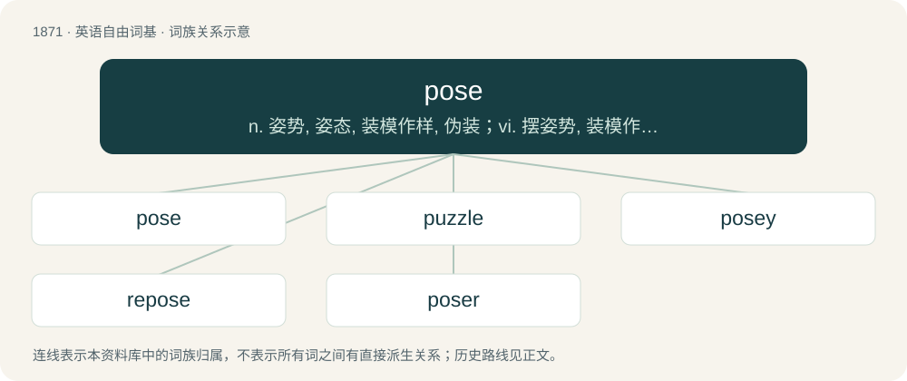

# 1980 · pose — n. 姿势, 姿态, 装模作样, 伪装；vi. 摆姿势, 装模作样, 假装；vt. 使摆好姿势, 提出, 造成

[总目录](../00_总目录_按常用程度.md)

**类型**：英语自由词基　｜　**来源语言**：见词源记录

## 核心含义与来源

- 核心含义：n. 姿势, 姿态, 装模作样, 伪装；vi. 摆姿势, 装模作样, 假装；vt. 使摆好姿势, 提出, 造成
- 英文含义：To place in an attitude or fixed position, for the sake of effect.
- 词形：pose

**来源记录 1**（动词；To place in an attitude or fixed position, for the sake of effect.）

From Middle English posen, from Old French poser (“to put, place, stell, settle, lodge”), from Vulgar Latin pausāre (“to blin, cease, pause”), from Latin pausa (“pause”), from Ancient Greek παῦσις (paûsis); influenced by Latin pōnere. Doublet of pause.

## 词族图

## 单词速览（常用到不常用）

| 单词 | 音标 | 释义 |
|---|---|---|
| [pose](#w-1) | 英 /pəʊz/；美 /poʊz/ | n. 姿势, 姿态, 装模作样, 伪装；vi. 摆姿势, 装模作样, 假装；vt. 使摆好姿势, 提出, 造成 |
| [puzzle](#w-2) | 英 /ˈpʌzəl/ | n. 难题, 迷惑；vt. 使困惑, 使为难；vi. 迷惑, 苦思 |
| [posey](#w-3) | /ˈpəusiː/ | a. 装门面的；矫揉造作的；自命不凡的 |
| [repose](#w-4) | /riˈpəuz/ | 【英文】To pose (oneself or someone, or something) again. |
| [poser](#w-5) | 英 /ˈpəʊzə(ɹ)/；美 /ˈpoʊzɚ/ | n. 装腔作势者, 难题 |

## 逐词详解

### 1. pose

**词性**：动词　｜　**音标**：英 /pəʊz/；美 /poʊz/

**中文释义**：n. 姿势, 姿态, 装模作样, 伪装；vi. 摆姿势, 装模作样, 假装；vt. 使摆好姿势, 提出, 造成

**英文义项**：To place in an attitude or fixed position, for the sake of effect. / To ask; to set (a test, quiz, riddle, etc.).

**词源与演化**：

From Middle English posen, from Old French poser (“to put, place, stell, settle, lodge”), from Vulgar Latin pausāre (“to blin, cease, pause”), from Latin pausa (“pause”), from Ancient Greek παῦσις (paûsis); influenced by Latin pōnere. Doublet of pause.

**例句**：

> To pose a model for a picture.

该用例对应义项：To place in an attitude or fixed position, for the sake of effect.

### 2. puzzle

**词性**：名词　｜　**音标**：英 /ˈpʌzəl/

**中文释义**：n. 难题, 迷惑；vt. 使困惑, 使为难；vi. 迷惑, 苦思

**英文义项**：The state of feeling confused or mystified because one cannot understand a complicated matter, a problem, etc.; bewilderment, confusion; (countable) often in in a puzzle: an instance of this. / A thing such as a complicated matter or a problem which is difficult to make sense of or understand; also, a person who is difficult to make sense of or understand; an enigma.

**构词拆分**：pose (“(obsolete) to interrogate, question”) + -le (frequentative suffix)

**词源与演化**：

The verb, of uncertain origin, is attested first. Apparently cognate with Scots pousle, pouzle, poozle (“to trifle; poke or potter around aimlessly; search about with uncertainty”), Saterland Frisian puzelje (“to work hard and continuously”), West Frisian peuzelje (“to trifle, work slowly; eat slowly and daintifully, snack”), Dutch peuzelen (“to perform insignificant work, dawdle; pick at, eat with relish in small pieces, snack”), German Low German pusseln (“to tinker, fiddle; trifle”) and pöseln (“to work hard, toil; to slave away; suffer at work; work slowly and ineffectively”), German posseln, bosseln (“to perform trivial work, tinker”), Danish pusle (“to busy oneself with light work or chores; to be occupied with a task requiring ingenuity, care, and patience; to tinker”), Swedish pyssla (“to do light work; tinker; putter or potter around”), Norwegian Nynorsk pusla, putla (“to potter about”), Faroese putla (“to trifle; potter about; do one's work slowly; be dilatory”), Faroese puss (“damage, trick”). \* An early form of the word is pusle, which is similar to Old English puslian (“to pick out the best bits, carefully select, cull”). It is possible that the meaning of the word evolved from “to pick out the best bits”, to “to think long and carefully in bewilderment while choosing what to pick out”, to “to think long and carefully in bewilderment”. However, there is no evidence in Middle English or modern English of any intermediate words with these meanings. \* Alternatively, it has been suggested that the word is from pose (“(obsolete) to interrogate, question”) + -le (frequentative suffix). However, the Oxford English Dictionary notes that early forms of the word are all spelled with -u-, and that a sound change in Middle English from ō to u “is not easily accounted for”. \* Finally, it has been suggested that the past participle form of the word is attested by Middle English poselet. This is thought to be unlikely by the Oxford English Dictionary as poselet is attested in only one quotation with the meaning “jostled, pushed”, which does not have any connection with the current senses of the word. The noun appears to be derived from the verb.

**例句**：

> Where he went after he left the house is a puzzle.

该用例对应义项：A thing such as a complicated matter or a problem which is difficult to make sense of or understand; also, a person who is difficult to make sense of or understand; an enigma.

### 3. posey

**词性**：形容词　｜　**音标**：/ˈpəusiː/

**中文释义**：a. 装门面的；矫揉造作的；自命不凡的

**英文义项**：Pretentious; posturing.

**构词拆分**：pose + -y

**词源与演化**：

From pose + -y.

### 4. repose

**词性**：动词　｜　**音标**：/riˈpəuz/

**英文义项**：To pose (oneself or someone, or something) again.

**构词拆分**：re- + pose

**词源与演化**：

From re- + pose.

### 5. poser

**词性**：名词　｜　**音标**：英 /ˈpəʊzə(ɹ)/；美 /ˈpoʊzɚ/

**中文释义**：n. 装腔作势者, 难题

**英文义项**：A particularly difficult question or puzzle. / Someone who asks a question or sets a problem.

**构词拆分**：pose + -er

**词源与演化**：

From pose + -er.

**例句**：

> Even as a child, she was a habitual poser of difficult questions.

该用例对应义项：Someone who asks a question or sets a problem.
