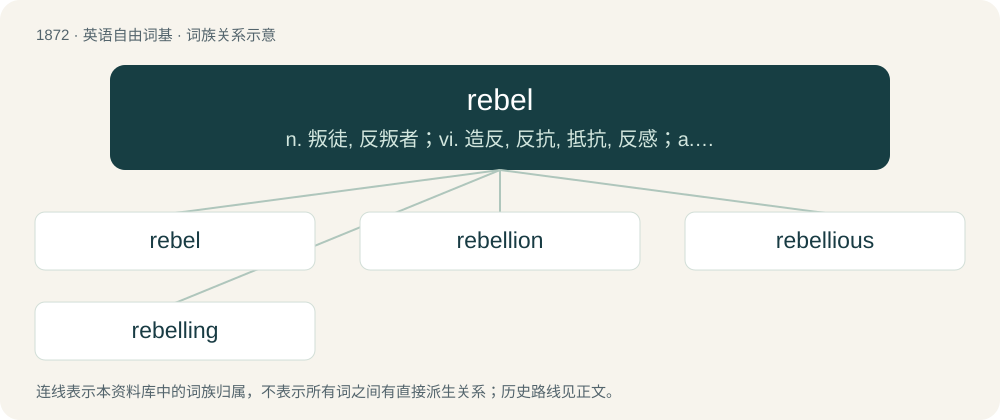

# 1981 · rebel — n. 叛徒, 反叛者；vi. 造反, 反抗, 抵抗, 反感；a. 造反的, 反抗的

[总目录](../00_总目录_按常用程度.md)

**类型**：英语自由词基　｜　**来源语言**：见词源记录

## 核心含义与来源

- 核心含义：n. 叛徒, 反叛者；vi. 造反, 反抗, 抵抗, 反感；a. 造反的, 反抗的
- 英文含义：A person who resists an established authority, often violently.
- 词形：rebel

**多个词源／构词路径**：同一拼写可能有不同来源；以下按词性和含义分别列出。

**来源记录 1**（名词；A person who resists an established authority, often violently.）

From Middle English rebel, rebell, from Old French rebelle, from Latin rebellis (“waging war again; insurgent”), from rebellō (“to wage war again, fight back”), from re- (“again, back”) + bellō (“to wage war”).

**来源记录 2**（动词；To resist or become defiant toward an authority.）

From Middle English rebellen, from Old French rebeller, from Latin rebellō (“to wage war again, fight back”), from re- (“again, back”) + bellō (“to wage war”). Doublet of revel.

## 词族图

## 单词速览（常用到不常用）

| 单词 | 音标 | 释义 |
|---|---|---|
| [rebel](#w-1) | /ˈɹɛb.əl/ | n. 叛徒, 反叛者；vi. 造反, 反抗, 抵抗, 反感；a. 造反的, 反抗的 |
| [rebellion](#w-2) | /ɹɪˈbɛl.i.ən/ | n. 谋反, 叛乱, 反抗；\[法\] 造反, 反叛, 叛乱 |
| [rebellious](#w-3) | /ɹəˈbɛliəs/ | a. 造反的, 反抗的；\[法\] 造反的, 反抗的, 反判的 |
| [rebelling](#w-4) | /ˈrebəlɪŋ/ | a. 叛逆性的；v. 反抗政府( rebel的现在分词 ); 反抗权威 |

## 逐词详解

### 1. rebel

**词性**：名词　｜　**音标**：/ˈɹɛb.əl/

**中文释义**：n. 叛徒, 反叛者；vi. 造反, 反抗, 抵抗, 反感；a. 造反的, 反抗的

**英文义项**：A person who resists an established authority, often violently.

**词源与演化**：

From Middle English rebel, rebell, from Old French rebelle, from Latin rebellis (“waging war again; insurgent”), from rebellō (“to wage war again, fight back”), from re- (“again, back”) + bellō (“to wage war”).

**例句**：

> A group of rebels defied the general's orders and split off from the main army.

该用例对应义项：A person who resists an established authority, often violently.

### 2. rebellion

**词性**：名词　｜　**音标**：/ɹɪˈbɛl.i.ən/

**中文释义**：n. 谋反, 叛乱, 反抗；\[法\] 造反, 反叛, 叛乱

**英文义项**：Armed resistance to an established government or ruler. / Defiance of authority or control; the act of rebelling.

**构词拆分**：rebel + -ion

**词源与演化**：

From Middle English rebellioun, rebellion, from Old French rebellion, from Latin rebelliō. Equivalent for rebel + -ion.

**例句**：

> The army general led a successful rebellion and became president of the country.

该用例对应义项：An organized, forceful subversion of the law of the land in an attempt to replace it with another form of government.

### 3. rebellious

**词性**：形容词　｜　**音标**：/ɹəˈbɛliəs/

**中文释义**：a. 造反的, 反抗的；\[法\] 造反的, 反抗的, 反判的

**英文义项**：Showing rebellion.

**构词拆分**：rebel + -ious

**词源与演化**：

From Middle English rebellious; equivalent to rebel + -ious.

**例句**：

> All I remember about him is that he was a rebellious teen.

### 4. rebelling

**词性**：名词　｜　**音标**：/ˈrebəlɪŋ/

**中文释义**：a. 叛逆性的；v. 反抗政府( rebel的现在分词 ); 反抗权威

**英文义项**：An act or feeling of rebellion.

**构词拆分**：rebel + -ing

**词源与演化**：

From Middle English rebellyng; equivalent to rebel + -ing.

**例句**：

> Lately he's been rebelling against his parents.
