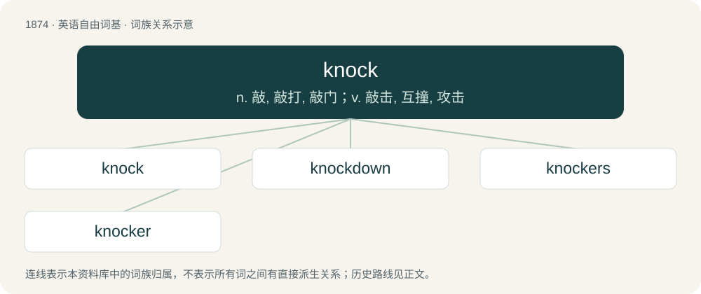

# 1982 · knock — n. 敲, 敲打, 敲门；v. 敲击, 互撞, 攻击

[总目录](../00_总目录_按常用程度.md)

**类型**：英语自由词基　｜　**来源语言**：见词源记录

## 核心含义与来源

- 核心含义：n. 敲, 敲打, 敲门；v. 敲击, 互撞, 攻击
- 英文含义：An abrupt rapping sound, as from an impact of a hard object against wood.
- 词形：knock

**来源记录 1**（名词；An abrupt rapping sound, as from an impact of a hard object against wood.）

From Middle English knokken, from Old English cnocian, ġecnocian, ġecnucian, cnucian (“to knock, pound on, beat”), from Proto-West Germanic \*knokōn, from Proto-Germanic \*knukōną (“to knock”), a suffixed form of \*knu-, \*knew- (“to pound on, beat”), from Proto-Indo-European \*gnew-, \*gen- (“to squeeze, pinch, kink, ball up, concentrate”). The English word is cognate with Middle High German knochen (“to hit”), Old English cnuian, cnuwian (“to pound, knock”), Old Norse knoka (compare Danish knuge (“to squeeze”), Swedish knocka (“to hug”)). More at knuckle.

## 词族图

## 单词速览（常用到不常用）

| 单词 | 音标 | 释义 |
|---|---|---|
| [knock](#w-1) | 英 /nɒk/；美 /nɑk/ | n. 敲, 敲打, 敲门；v. 敲击, 互撞, 攻击 |
| [knockdown](#w-2) | /ˈnɒkdaun/ | a. 击倒的, 可拆卸的, 廉价的；n. 压倒, 可拆卸家具 |
| [knockers](#w-3) | /ˈnɒkəz/ | n. &lt;俚&gt;（女人的）一对乳房（用此词会冒犯女性）; 门环( knocker的复数形式 ); 吹毛求疵的人 |
| [knocker](#w-4) | 英 /ˈnɒk.ə/；美 /ˈnɑk.ɚ/ | n. 敲击者(或物), 敲门者, 门环；\[电\] 开锤 |

## 逐词详解

### 1. knock

**词性**：名词　｜　**音标**：英 /nɒk/；美 /nɑk/

**中文释义**：n. 敲, 敲打, 敲门；v. 敲击, 互撞, 攻击

**英文义项**：An abrupt rapping sound, as from an impact of a hard object against wood. / A sharp impact.

**词源与演化**：

From Middle English knokken, from Old English cnocian, ġecnocian, ġecnucian, cnucian (“to knock, pound on, beat”), from Proto-West Germanic \*knokōn, from Proto-Germanic \*knukōną (“to knock”), a suffixed form of \*knu-, \*knew- (“to pound on, beat”), from Proto-Indo-European \*gnew-, \*gen- (“to squeeze, pinch, kink, ball up, concentrate”). The English word is cognate with Middle High German knochen (“to hit”), Old English cnuian, cnuwian (“to pound, knock”), Old Norse knoka (compare Danish knuge (“to squeeze”), Swedish knocka (“to hug”)). More at knuckle.

**例句**：

> He played a slow but sure knock of 35.

该用例对应义项：A ball hit into play, especially one that becomes a hit.

### 2. knockdown

**词性**：名词　｜　**音标**：/ˈnɒkdaun/

**中文释义**：a. 击倒的, 可拆卸的, 廉价的；n. 压倒, 可拆卸家具

**英文义项**：An act of knocking down or the condition of being knocked down. / An overwhelming blow.

**构词拆分**：knock + down

**词源与演化**：

From knock + down.

### 3. knockers

**词性**：名词　｜　**音标**：/ˈnɒkəz/

**中文释义**：n. &lt;俚&gt;（女人的）一对乳房（用此词会冒犯女性）; 门环( knocker的复数形式 ); 吹毛求疵的人

**英文义项**：A woman's breasts.

**构词拆分**：knock + -er

**词源与演化**：

From the verb knock + -er, an agentive suffix. The slang term for breasts is attested since the 1940s. For fuller etymology see knock.

### 4. knocker

**词性**：名词　｜　**音标**：英 /ˈnɒk.ə/；美 /ˈnɑk.ɚ/

**中文释义**：n. 敲击者(或物), 敲门者, 门环；\[电\] 开锤

**英文义项**：A device, usually hinged with a striking plate, used for knocking on a door. / A person who knocks.

**构词拆分**：knock + -er

**词源与演化**：

From knock + -er.

**例句**：

> Open the door and see who the knocker is.

该用例对应义项：a person who knocks (as seeking to gain admittance)
