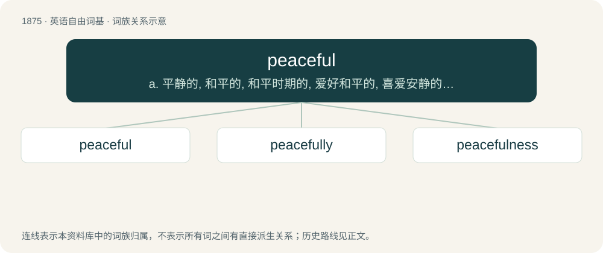

# 1983 · peaceful — a. 平静的, 和平的, 和平时期的, 爱好和平的, 喜爱安静的；\[法\] 和平的, 爱好和平的, 和平时期的

[总目录](../00_总目录_按常用程度.md)

**类型**：英语自由词基　｜　**来源语言**：见词源记录

## 核心含义与来源

- 核心含义：a. 平静的, 和平的, 和平时期的, 爱好和平的, 喜爱安静的；\[法\] 和平的, 爱好和平的, 和平时期的
- 英文含义：Not at war; not disturbed by strife or turmoil.
- 词形：peaceful

**多个词源／构词路径**：同一拼写可能有不同来源；以下按词性和含义分别列出。

**来源记录 1**（形容词；Not at war; not disturbed by strife or turmoil.）

From Middle English peesful, pesful, paisful, pesefull. By surface analysis, peace + -ful. Displaced native Old English friþsum.

**来源记录 2**（名词；A non-player character who is not hostile to the player.）

Derived from the derogatory term religion of peace, which is used against Islam itself for its association with violent attacks by Islamic extremists, and alleged support and lack of condemnation against them by certain Muslim communities.

## 词族图

## 单词速览（常用到不常用）

| 单词 | 音标 | 释义 |
|---|---|---|
| [peaceful](#w-1) | /ˈpiːsfl̩/ | a. 平静的, 和平的, 和平时期的, 爱好和平的, 喜爱安静的；\[法\] 和平的, 爱好和平的, 和平时期的 |
| [peacefully](#w-2) | /ˈpiːsfəli/ | adv. 平静地 |
| [peacefulness](#w-3) | /ˈpiːsflnəs/ | n. 平静, 宁静, 平和 |

## 逐词详解

### 1. peaceful

**词性**：形容词　｜　**音标**：/ˈpiːsfl̩/

**中文释义**：a. 平静的, 和平的, 和平时期的, 爱好和平的, 喜爱安静的；\[法\] 和平的, 爱好和平的, 和平时期的

**英文义项**：Not at war; not disturbed by strife or turmoil. / Inclined to peace.

**词源与演化**：

From Middle English peesful, pesful, paisful, pesefull. By surface analysis, peace + -ful. Displaced native Old English friþsum.

**用法示例／搭配（非完整句）**：

> peaceful protest

该用例对应义项：Not at war; not disturbed by strife or turmoil.

### 2. peacefully

**词性**：副词　｜　**音标**：/ˈpiːsfəli/

**中文释义**：adv. 平静地

**英文义项**：In a peaceful manner.

**构词拆分**：peaceful + -ly

**词源与演化**：

From Middle English peesfully, peasfullie, paisfulike, paisfullic, equivalent to peaceful + -ly.

**例句**：

> The hen settled herself on the nest most peacefully.

该用例对应义项：in a peaceful manner

### 3. peacefulness

**词性**：名词　｜　**音标**：/ˈpiːsflnəs/

**中文释义**：n. 平静, 宁静, 平和

**英文义项**：The state of being peaceful.

**构词拆分**：peaceful + -ness

**词源与演化**：

From peaceful + -ness.

**例句**：

> As the night fell, Matthew marveled at the stars and the peacefulness of the wilderness.
