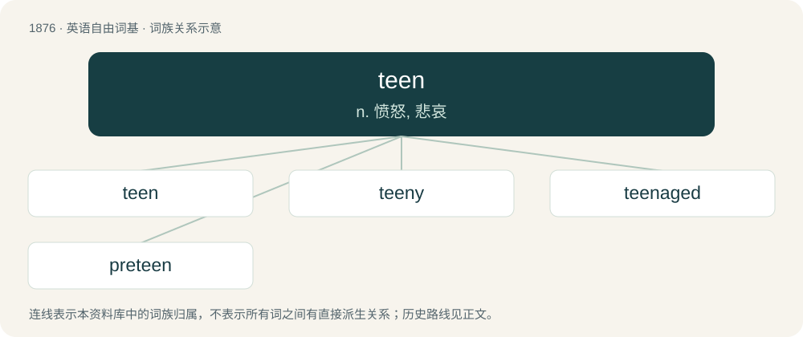

# 1985 · teen — n. 愤怒, 悲哀

[总目录](../00_总目录_按常用程度.md)

**类型**：英语自由词基　｜　**来源语言**：见词源记录

## 核心含义与来源

- 核心含义：n. 愤怒, 悲哀
- 英文含义：Synonym of teenager: a person between 13 and 19 years old (inclusive).
- 词形：teen

**来源记录 1**（名词；Synonym of teenager: a person between 13 and 19 years old (inclusive).）

Clipping of teenager. For more synonyms see at Thesaurus:teenager.

## 词族图

## 单词速览（常用到不常用）

| 单词 | 音标 | 释义 |
|---|---|---|
| [teen](#w-1) | /ˈtiːn/ | n. 愤怒, 悲哀 |
| [teeny](#w-2) | 英 /ˈtiː.ni/；美 /ˈti.ni/ | 【英文】A teenager; a teenybopper. |
| [teenaged](#w-3) | /ˈtiːneɪd͡ʒd/ | a. 青少年的, 十几岁的少年的 |
| [preteen](#w-4) | /ˈpriːˈtiːn/ | a. 青春期前的；n. 青春期前的孩子 |

## 逐词详解

### 1. teen

**词性**：名词　｜　**音标**：/ˈtiːn/

**中文释义**：n. 愤怒, 悲哀

**英文义项**：Synonym of teenager: a person between 13 and 19 years old (inclusive). / A black teenager or a young black person.

**词源与演化**：

Clipping of teenager. For more synonyms see at Thesaurus:teenager.

**例句**：

> In the safety alert, the NTSB educates parents on the risks and outlines what they can do to protect their teens against marijuana-impaired driving.

该用例对应义项：Synonym of teenager: a person between 13 and 19 years old (inclusive).

### 2. teeny

**词性**：名词　｜　**音标**：英 /ˈtiː.ni/；美 /ˈti.ni/

**英文义项**：A teenager; a teenybopper.

**构词拆分**：teen + -y

**词源与演化**：

From teen + -y or a clipping of teenybopper.

### 3. teenaged

**词性**：形容词　｜　**音标**：/ˈtiːneɪd͡ʒd/

**中文释义**：a. 青少年的, 十几岁的少年的

**英文义项**：Aged between thirteen and nineteen inclusive; teenage.

**构词拆分**：From teen + aged.

**词源与演化**：

From teen + aged.

**用法示例／搭配（非完整句）**：

> a teenaged girl

该用例对应义项：Aged between thirteen and nineteen inclusive; teenage.

### 4. preteen

**词性**：形容词　｜　**音标**：/ˈpriːˈtiːn/

**中文释义**：a. 青春期前的；n. 青春期前的孩子

**英文义项**：Of, relating to, or designed for, or being children between the ages of approximately 10 and 12.

**构词拆分**：pre- + teen

**词源与演化**：

From pre- + teen.

**例句**：

> Yanni is a pedo. He was caught following preteen boys around the resort.
