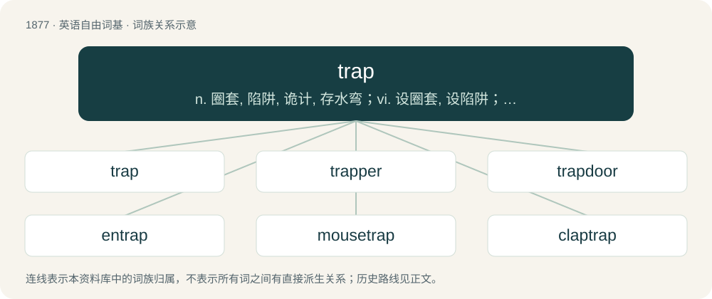

# 1986 · trap — n. 圈套, 陷阱, 诡计, 存水弯；vi. 设圈套, 设陷阱；vt. 诱捕, 诱骗, 抓住, 使受限制

[总目录](../00_总目录_按常用程度.md)

**类型**：英语自由词基　｜　**来源语言**：见词源记录

## 核心含义与来源

- 核心含义：n. 圈套, 陷阱, 诡计, 存水弯；vi. 设圈套, 设陷阱；vt. 诱捕, 诱骗, 抓住, 使受限制
- 英文含义：A machine or other device designed to catch (and sometimes kill) animals, either by holding them in a container, or by catching hold of part of the body.
- 词形：trap

**多个词源／构词路径**：同一拼写可能有不同来源；以下按词性和含义分别列出。

**来源记录 1**（名词；A machine or other device designed to catch (and sometimes kill) animals, either by holding them in a container, or by catching hold of part of the body.）

From Middle English trappe, from Old English træppe, treppe (“trap, snare”) (also in betræppan (“to trap”)) from Proto-West Germanic \*trappjā (“trap, snare”), from Proto-West Germanic \*trappjan (“to step”), from Proto-Germanic \*trapjaną (“to tread, stamp”), from Proto-Indo-European \*drebʰ- (“to step, trip, trample”). Cognate with Dutch trap (“step, stair”), German Low German Trapp (“step, stair”). Akin also to West Frisian traap (“stepping, treading, stairway”), German Treppe (“step, stair”), Old English træppan (“to step, tread”). Connection to "step" is "that upon which one steps". French trappe and Spanish trampa are ultimately borrowings from Germanic.

**来源记录 2**（名词；A dark coloured igneous rock; (now usually) any nongranitic igneous rock.）

Borrowed from Swedish trapp (“step, stair, stairway”), from Middle Low German trappe (“stair, step”).

**来源记录 3**（动词；To dress with ornaments; to adorn (especially said of horses).）

Akin to Middle English trappe (“trappings, gear”), and perhaps from Old Northern French trape, a byform of Old French drap, a word of the same origin as English drab (“a kind of cloth”).

**来源记录 4**（名词；The trapezius muscle.）

Clipping of trapezius.

## 词族图

## 单词速览（常用到不常用）

| 单词 | 音标 | 释义 |
|---|---|---|
| [trap](#w-1) | /tɹæp/ | n. 圈套, 陷阱, 诡计, 存水弯；vi. 设圈套, 设陷阱；vt. 诱捕, 诱骗, 抓住, 使受限制 |
| [trapper](#w-2) | 美 /ˈtɹæpɚ/ | n. 设陷阱捕兽者, 设陷阱猎兽者, 看门工 |
| [trapdoor](#w-3) | 英 /ˈtræpdɔː/；美 /ˈtræpdoɹ/ | n. 地板门, 活板门, 活动天窗 |
| [entrap](#w-4) | /ɪnˈtɹæp/ | vt. 骗入, 诱捕, 使陷入 |
| [mousetrap](#w-5) | /ˈmaʊsˌtɹæp/ | n. 捕鼠器, 诡计；vt. 诱捕 |
| [claptrap](#w-6) | 英 /ˈklæpˌtɹæp/ | n. 哗众取宠的空话(花招)；a. 哗众取宠的 |
| [deathtrap](#w-7) | 英 /ˈdɛθtɹæp/ | n. 危险地方, 危险建筑物 |
| [flytrap](#w-8) | /ˈflaitræp/ | n. 捕蝇器, 捕蝇草 |

## 逐词详解

### 1. trap

**词性**：名词　｜　**音标**：/tɹæp/

**中文释义**：n. 圈套, 陷阱, 诡计, 存水弯；vi. 设圈套, 设陷阱；vt. 诱捕, 诱骗, 抓住, 使受限制

**英文义项**：A machine or other device designed to catch (and sometimes kill) animals, either by holding them in a container, or by catching hold of part of the body. / A trick or arrangement designed to catch someone in a more general sense; a snare.

**词源与演化**：

From Middle English trappe, from Old English træppe, treppe (“trap, snare”) (also in betræppan (“to trap”)) from Proto-West Germanic \*trappjā (“trap, snare”), from Proto-West Germanic \*trappjan (“to step”), from Proto-Germanic \*trapjaną (“to tread, stamp”), from Proto-Indo-European \*drebʰ- (“to step, trip, trample”). Cognate with Dutch trap (“step, stair”), German Low German Trapp (“step, stair”). Akin also to West Frisian traap (“stepping, treading, stairway”), German Treppe (“step, stair”), Old English træppan (“to step, tread”). Connection to "step" is "that upon which one steps". French trappe and Spanish trampa are ultimately borrowings from Germanic.

**例句**：

> I put down some traps in my apartment to try and deal with the mouse problem.

该用例对应义项：A machine or other device designed to catch (and sometimes kill) animals, either by holding them in a container, or by catching hold of part of the body.

### 2. trapper

**词性**：名词　｜　**音标**：美 /ˈtɹæpɚ/

**中文释义**：n. 设陷阱捕兽者, 设陷阱猎兽者, 看门工

**英文义项**：One who traps animals; one who makes a business of trapping animals, for their pelts, meat, etc. / An ornamental covering for a horse. See trapping and caparison.

**构词拆分**：trap + -er

**词源与演化**：

From trap + -er, compare french trappeur.

**例句**：

> The Sacramento Chronicle writes frequently about that old trapper.

### 3. trapdoor

**词性**：名词　｜　**音标**：英 /ˈtræpdɔː/；美 /ˈtræpdoɹ/

**中文释义**：n. 地板门, 活板门, 活动天窗

**英文义项**：A hinged or sliding door set into a floor or ceiling. / Such a trap set into the floor of a stage to allow fast exits and entrances.

**构词拆分**：trap + door

**词源与演化**：

From trap + door.

**例句**：

> Hey, damned children! Beware the trap, the trapdoor, and the dog!

### 4. entrap

**词性**：动词　｜　**音标**：/ɪnˈtɹæp/

**中文释义**：vt. 骗入, 诱捕, 使陷入

**英文义项**：To catch in a trap or snare. / To lure (someone), either into a dangerous situation, or into performing an illegal act.

**构词拆分**：en- + trap

**词源与演化**：

From Middle French entrapper, entraper, from Old French entraper, antraper (“catch in a trap”), equivalent to en- + trap. Compare Middle English bitrappen, from Old English betræppan (“to catch in a trap, entrap”), from the same West Germanic source (see Modern English betrap).

**例句**：

> The cops were trying to entrap Tom.

### 5. mousetrap

**词性**：名词　｜　**音标**：/ˈmaʊsˌtɹæp/

**中文释义**：n. 捕鼠器, 诡计；vt. 诱捕

**英文义项**：A device for capturing or killing mice and other rodents. / A website designed to open another copy of itself when the user tries to close the webpage.

**构词拆分**：mouse + trap

**词源与演化**：

From Middle English mouse-trappe, mous trappe, mouse trape, equivalent to mouse + trap. Cognate with Dutch muizetrap, muizentrap (“mousetrap”), German Low German Muustrappe, Muustrapp (“mousetrap”). In the Internet sense, refers to a computer mouse.

**例句**：

> You can't legally set a mousetrap in California without a hunting license.

### 6. claptrap

**词性**：名词　｜　**音标**：英 /ˈklæpˌtɹæp/

**中文释义**：n. 哗众取宠的空话(花招)；a. 哗众取宠的

**英文义项**：Empty verbiage or nonsense. / A device or trick to gain applause; a humbug.

**构词拆分**：clap + trap

**词源与演化**：

Theater slang, c. 1730, from clap + trap, referring to theatrical techniques or gags used to incite applause.

**例句**：

> The mayor and his companion have been uttering a lot of claptrap to the citizens for a long time.

### 7. deathtrap

**词性**：名词　｜　**音标**：英 /ˈdɛθtɹæp/

**中文释义**：n. 危险地方, 危险建筑物

**英文义项**：An extremely dangerous location, structure, or device. / A plot device where a villain in a story puts a hero in an elaborate dangerous situation for the purposes of attempting a sadistic murder.

**构词拆分**：From death + trap.

**词源与演化**：

From death + trap.

**例句**：

> Dude, your car is a deathtrap! Get the brakes and the steering fixed.

该用例对应义项：An extremely dangerous location, structure, or device.

### 8. flytrap

**词性**：名词　｜　**音标**：/ˈflaitræp/

**中文释义**：n. 捕蝇器, 捕蝇草

**英文义项**：A trap built to catch flies. / The Venus flytrap, an insectivorous plant.

**构词拆分**：fly + trap

**词源与演化**：

From fly + trap.
