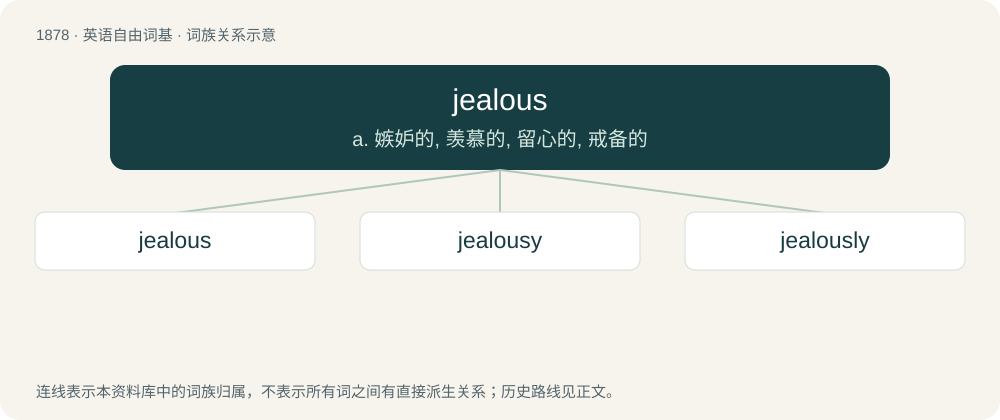

# 1987 · jealous — a. 嫉妒的, 羡慕的, 留心的, 戒备的

[总目录](../00_总目录_按常用程度.md)

**类型**：英语自由词基　｜　**来源语言**：见词源记录

## 核心含义与来源

- 核心含义：a. 嫉妒的, 羡慕的, 留心的, 戒备的
- 英文含义：Suspecting rivalry in love; troubled by worries that one might have been replaced in someone's affections; suspicious of a lover's or spouse's fidelity.
- 词形：jealous

**来源记录 1**（形容词；Suspecting rivalry in love; troubled by worries that one might have been replaced in someone's affections; suspicious of a lover's or spouse's fidelity.）

First attested in 1382. From Middle English jelous, gelous, gelus, from Old French jalous, from Late Latin zelosus, from Ancient Greek ζῆλος (zêlos, “zeal, jealousy”). Doublet of zealous.

## 词族图

## 单词速览（常用到不常用）

| 单词 | 音标 | 释义 |
|---|---|---|
| [jealous](#w-1) | 英 /ˈd͡ʒɛl.əs/ | a. 嫉妒的, 羡慕的, 留心的, 戒备的 |
| [jealousy](#w-2) | /ˈd͡ʒɛl.ə.si/ | n. 妒忌, 猜忌, 羡慕；\[法\] 妒忌, 嫉妒, 猜忌 |
| [jealously](#w-3) |  | adv. 嫉妒, 羡慕, 留心, 戒备 |

## 逐词详解

### 1. jealous

**词性**：形容词　｜　**音标**：英 /ˈd͡ʒɛl.əs/

**中文释义**：a. 嫉妒的, 羡慕的, 留心的, 戒备的

**英文义项**：Suspecting rivalry in love; troubled by worries that one might have been replaced in someone's affections; suspicious of a lover's or spouse's fidelity. / Protective; zealously guarding; careful in the protection of something (or someone) one has or appreciates, especially one's spouse or lover.

**词源与演化**：

First attested in 1382. From Middle English jelous, gelous, gelus, from Old French jalous, from Late Latin zelosus, from Ancient Greek ζῆλος (zêlos, “zeal, jealousy”). Doublet of zealous.

**例句**：

> He was jealous of his friend’s success.

该用例对应义项：Envious; feeling resentful or angered toward someone for a perceived advantage or success, material or otherwise.

### 2. jealousy

**词性**：名词　｜　**音标**：/ˈd͡ʒɛl.ə.si/

**中文释义**：n. 妒忌, 猜忌, 羡慕；\[法\] 妒忌, 嫉妒, 猜忌

**英文义项**：A state of being jealous; a jealous attitude.

**构词拆分**：jealous + -y

**词源与演化**：

From Middle English jalousie, from Old French jalousie, equivalent to jealous + -y. Doublet of jalousie. Related also to zeal, zealous. Displaced native Old English æfest and Old English nīþ.

**例句**：

> She was mad with jealousy.

该用例对应义项：A state of being jealous; a jealous attitude.

### 3. jealously

**词性**：副词

**中文释义**：adv. 嫉妒, 羡慕, 留心, 戒备

**英文义项**：In a jealous manner.

**构词拆分**：jealous + -ly

**词源与演化**：

From jealous + -ly.

**例句**：

> He looked at his friend's new car jealously.

该用例对应义项：with jealousy; in an envious manner
