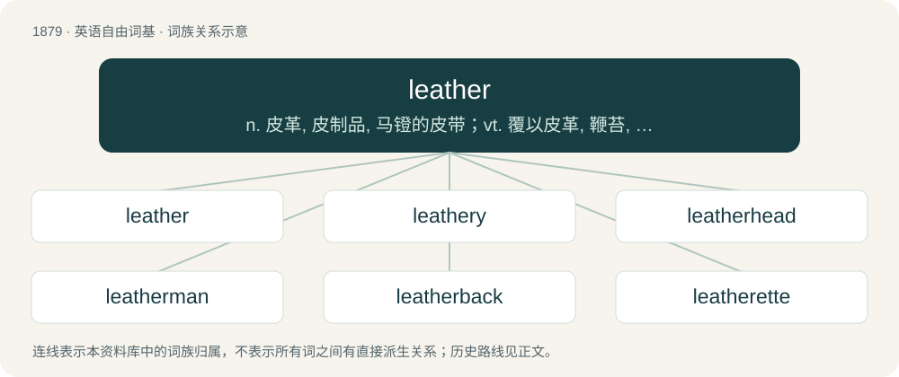

# 1988 · leather — n. 皮革, 皮制品, 马镫的皮带；vt. 覆以皮革, 鞭苔, 抽打；a. 皮革的, 皮制的

[总目录](../00_总目录_按常用程度.md)

**类型**：英语自由词基　｜　**来源语言**：见词源记录

## 核心含义与来源

- 核心含义：n. 皮革, 皮制品, 马镫的皮带；vt. 覆以皮革, 鞭苔, 抽打；a. 皮革的, 皮制的
- 英文含义：A tough material produced from the skin of animals, by tanning or similar process, used e.g. for clothing; often denotes leather from cattle when no qualifier specifies otherwise.
- 词形：leather

**来源记录 1**（名词；A tough material produced from the skin of animals, by tanning or similar process, used e.g. for clothing; often denotes leather from cattle when no qualifier specifies otherwise.）

From Middle English lether, from Old English leþer (“leather”), from Proto-West Germanic \*leþr, from Proto-Germanic \*leþrą (“leather”), possibly borrowed from Proto-Celtic \*ɸlitrom, \*letros, from Proto-Indo-European \*pl̥tro- (“skin, hide”). Cognate with Saterland Frisian Leder (“leather”), West Frisian leare (“leather”), Low German Leder (“leather”), Dutch leder, leer (“leather”), German Leder (“leather”), Danish læder (“leather”), Swedish läder (“leather”), Icelandic leður (“leather”). Compare also English fell (“skin, hide, pelt”), film.

## 词族图

## 单词速览（常用到不常用）

| 单词 | 音标 | 释义 |
|---|---|---|
| [leather](#w-1) | 英 /ˈlɛðə/；美 /ˈlɛðɚ/ | n. 皮革, 皮制品, 马镫的皮带；vt. 覆以皮革, 鞭苔, 抽打；a. 皮革的, 皮制的 |
| [leathery](#w-2) | /ˈlɛðəɹi/ | a. 皮似的, 皮质的, 皮般吞坚韧的 |
| [leatherhead](#w-3) | /ˈleðəhed/ | n. 呆头, 更夫 |
| [leatherman](#w-4) |  | \[人名\] 莱瑟曼 |
| [leatherback](#w-5) | /ˈlɛ.ðɚ.bæk/ | n. 棱皮龟 |
| [leatherette](#w-6) | 英 /ˌlɛðəˈɹɛt/ | n. 人造革；\[化\] 人造革 |

## 逐词详解

### 1. leather

**词性**：名词　｜　**音标**：英 /ˈlɛðə/；美 /ˈlɛðɚ/

**中文释义**：n. 皮革, 皮制品, 马镫的皮带；vt. 覆以皮革, 鞭苔, 抽打；a. 皮革的, 皮制的

**英文义项**：A tough material produced from the skin of animals, by tanning or similar process, used e.g. for clothing; often denotes leather from cattle when no qualifier specifies otherwise. / A piece of the above used for polishing.

**词源与演化**：

From Middle English lether, from Old English leþer (“leather”), from Proto-West Germanic \*leþr, from Proto-Germanic \*leþrą (“leather”), possibly borrowed from Proto-Celtic \*ɸlitrom, \*letros, from Proto-Indo-European \*pl̥tro- (“skin, hide”). Cognate with Saterland Frisian Leder (“leather”), West Frisian leare (“leather”), Low German Leder (“leather”), Dutch leder, leer (“leather”), German Leder (“leather”), Danish læder (“leather”), Swedish läder (“leather”), Icelandic leður (“leather”). Compare also English fell (“skin, hide, pelt”), film.

**例句**：

> Jones showed good leather to snare that liner.

该用例对应义项：A good defensive play

### 2. leathery

**词性**：形容词　｜　**音标**：/ˈlɛðəɹi/

**中文释义**：a. 皮似的, 皮质的, 皮般吞坚韧的

**英文义项**：Having the consistency, feel, or texture of leather.

**构词拆分**：leather + -y

**词源与演化**：

From leather + -y.

**例句**：

> The beef jerky was tough and leathery.

该用例对应义项：Having the consistency, feel, or texture of leather.

### 3. leatherhead

**词性**：名词　｜　**音标**：/ˈleðəhed/

**中文释义**：n. 呆头, 更夫

**英文义项**：The friarbird. / A firefighter.

**构词拆分**：leather + head

**词源与演化**：

From leather + head.

### 4. leatherman

**词性**：名词

**中文释义**：\[人名\] 莱瑟曼

**英文义项**：A member of a homosexual male subculture that grew out of male-only motorcycle clubs formed by homosexual veterans returning from World War II, stressing masculinity in contradiction to androgynous and effeminate gay stereotypes, characterized by a fetish for leather gear and clothing, a sense of hierarchy, and a fraternal, militaristic code of protocol and behavior, often involving BDSM practices.

**构词拆分**：leather + man

**词源与演化**：

From leather + man. In the gay subculture sense, since the mid-twentieth century. In the leather dealer sense, since centuries earlier; archaic today.

### 5. leatherback

**词性**：名词　｜　**音标**：/ˈlɛ.ðɚ.bæk/

**中文释义**：n. 棱皮龟

**英文义项**：Any member of the species Dermochelys coriacea, of large sea turtles with leathery backs. / A lesser queenfish (Scomberoides lysan).

**构词拆分**：leather + back

**词源与演化**：

From leather + back.

**例句**：

> Leatherback turtles can weigh more than a thousand pounds.

### 6. leatherette

**词性**：名词　｜　**音标**：英 /ˌlɛðəˈɹɛt/

**中文释义**：n. 人造革；\[化\] 人造革

**英文义项**：A type of fabric, often plastic, made to imitate the appearance of leather.

**构词拆分**：leather + -ette (suffix forming nouns meaning an imitation or substitute of something)

**词源与演化**：

From leather + -ette (suffix forming nouns meaning an imitation or substitute of something); originally a trademark that has since been genericized.
