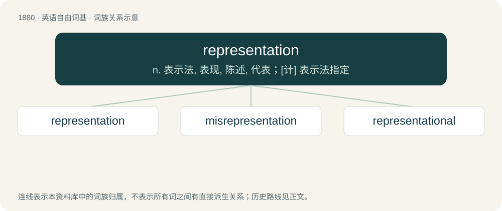

# 1989 · representation — n. 表示法, 表现, 陈述, 代表；\[计\] 表示法指定

[总目录](../00_总目录_按常用程度.md)

**类型**：英语自由词基　｜　**来源语言**：见词源记录

## 核心含义与来源

- 核心含义：n. 表示法, 表现, 陈述, 代表；\[计\] 表示法指定
- 英文含义：That which represents something else.
- 词形：representation

**多个词源／构词路径**：同一拼写可能有不同来源；以下按词性和含义分别列出。

**来源记录 1**（名词；That which represents something else.）

From Late Middle English representacioun, from Old French representacion, from Latin repraesentātiō. By surface analysis, represent + -ation.

**来源记录 2**（名词；An act of representing, i.e. presenting again.）

From re- + presentation.

## 词族图

## 单词速览（常用到不常用）

| 单词 | 音标 | 释义 |
|---|---|---|
| [representation](#w-1) | /ˌɹɛp.ɹə.zɛnˈteɪ.ʃən/ | n. 表示法, 表现, 陈述, 代表；\[计\] 表示法指定 |
| [misrepresentation](#w-2) | /mɪsˌɹɛpɹɪzɛnˈteɪʃən/ | \[计\] 错误表示法；\[经\] 误列, 错误表示, 告知不实 |
| [representational](#w-3) | /.reprizenˈteiʃənl/ | a. 代表的 |

## 逐词详解

### 1. representation

**词性**：名词　｜　**音标**：/ˌɹɛp.ɹə.zɛnˈteɪ.ʃən/

**中文释义**：n. 表示法, 表现, 陈述, 代表；\[计\] 表示法指定

**英文义项**：That which represents something else. / The act of representing.

**词源与演化**：

From Late Middle English representacioun, from Old French representacion, from Latin repraesentātiō. By surface analysis, represent + -ation.

**例句**：

> We are no longer happy with your representation of our company at trade events.

该用例对应义项：The act of representing.

### 2. misrepresentation

**词性**：名词　｜　**音标**：/mɪsˌɹɛpɹɪzɛnˈteɪʃən/

**中文释义**：\[计\] 错误表示法；\[经\] 误列, 错误表示, 告知不实

**英文义项**：Erroneous or false representation; an unfair or dishonest account or exposition; a false statement. / Incorrect or unfaithful representation in the capacity of agent or official representative, such as of a principal in a matter of business, or of constituents in legislation.

**构词拆分**：mis- + representation；misrepresent + -ation

**词源与演化**：

From mis- + representation or misrepresent + -ation.

### 3. representational

**词性**：形容词　｜　**音标**：/.reprizenˈteiʃənl/

**中文释义**：a. 代表的

**英文义项**：Of or pertaining to representation or to representationalism.

**构词拆分**：representation + -al

**词源与演化**：

From representation + -al.

**例句**：

> Until the twentieth century, most paintings were representational. This means that artists “represented” their subjects in a way that was realistic and recognizable.
