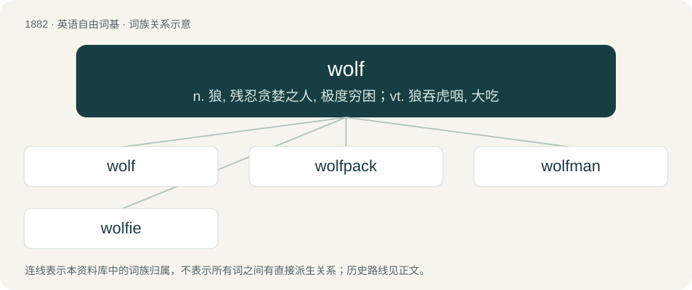

# 1990 · wolf — n. 狼, 残忍贪婪之人, 极度穷困；vt. 狼吞虎咽, 大吃

[总目录](../00_总目录_按常用程度.md)

**类型**：英语自由词基　｜　**来源语言**：见词源记录

## 核心含义与来源

- 核心含义：n. 狼, 残忍贪婪之人, 极度穷困；vt. 狼吞虎咽, 大吃
- 英文含义：Canis lupus; the largest wild member of the canine subfamily.
- 词形：wolf

**来源记录 1**（名词；Canis lupus; the largest wild member of the canine subfamily.）

Inherited from Middle English wolf, from Old English wulf, ƿulf, from Proto-West Germanic \*wulf, from Proto-Germanic \*wulfaz, from Proto-Indo-European \*wĺ̥kʷos. Doublet of lobo and lupus. Cognates Cognate with Scots wouf, North Frisian wulew, Saterland Frisian and German Low German Wulf, West Frisian, Alemannic German, and Dutch wolf, Bavarian bolf, bölf, Woif, Cimbrian and Mòcheno bolf, German Wolf, Luxembourgish Wollef, Vilamovian wuf, Yiddish וואָלף (volf), Danish, Norwegian Bokmål, and Norwegian Nynorsk ulv, Faroese úlvur, Icelandic úlfur, Swedish ulf, ulv, Gothic 𐍅𐌿𐌻𐍆𐍃 (wulfs); also Irish and Scottish Gaelic olc (“bad, evil”), Lepontic 𐌖𐌋𐌊𐌏𐌔 (ulkos), Manx olk (“bad”), Sanskrit वृक (vṛ́ka), Persian گرگ (gorg), Latgalian vylks, Latvian vìlks, Lithuanian vilkas, Belarusian воўк (vowk), Bulgarian вълк (vălk), Czech and Slovak vlk, Macedonian and Russian волк (volk), Polish wilk, Serbo-Croatian вук, vuk, Slovene volk, Ukrainian вовк (vovk), Albanian ujk, ulk, Latin lupus, Greek λύκος (lýkos), Hittite 𒉿𒀠𒆪𒉿𒀸, Lydian 𐤥𐤠𐤩𐤥𐤤 (walwe, “lion”), Tocharian B walkwe.

## 词族图

## 单词速览（常用到不常用）

| 单词 | 音标 | 释义 |
|---|---|---|
| [wolf](#w-1) | 英 /wʊlf/；美 /wʊlf/ | n. 狼, 残忍贪婪之人, 极度穷困；vt. 狼吞虎咽, 大吃 |
| [wolfpack](#w-2) | /ˈwʊlfpæk/ | 【英文】A family or other group of wild wolves. |
| [wolfman](#w-3) | /ˈwʊlfmæn/ | n. 有着狼的意志的人 |
| [wolfie](#w-4) |  | 【英文】A werewolf. |

## 逐词详解

### 1. wolf

**词性**：名词　｜　**音标**：英 /wʊlf/；美 /wʊlf/

**中文释义**：n. 狼, 残忍贪婪之人, 极度穷困；vt. 狼吞虎咽, 大吃

**英文义项**：Canis lupus; the largest wild member of the canine subfamily. / Any of several related canines that resemble Canis lupus in appearance, especially those of the genus Canis.

**词源与演化**：

Inherited from Middle English wolf, from Old English wulf, ƿulf, from Proto-West Germanic \*wulf, from Proto-Germanic \*wulfaz, from Proto-Indo-European \*wĺ̥kʷos. Doublet of lobo and lupus. Cognates Cognate with Scots wouf, North Frisian wulew, Saterland Frisian and German Low German Wulf, West Frisian, Alemannic German, and Dutch wolf, Bavarian bolf, bölf, Woif, Cimbrian and Mòcheno bolf, German Wolf, Luxembourgish Wollef, Vilamovian wuf, Yiddish וואָלף (volf), Danish, Norwegian Bokmål, and Norwegian Nynorsk ulv, Faroese úlvur, Icelandic úlfur, Swedish ulf, ulv, Gothic 𐍅𐌿𐌻𐍆𐍃 (wulfs); also Irish and Scottish Gaelic olc (“bad, evil”), Lepontic 𐌖𐌋𐌊𐌏𐌔 (ulkos), Manx olk (“bad”), Sanskrit वृक (vṛ́ka), Persian گرگ (gorg), Latgalian vylks, Latvian vìlks, Lithuanian vilkas, Belarusian воўк (vowk), Bulgarian вълк (vălk), Czech and Slovak vlk, Macedonian and Russian волк (volk), Polish wilk, Serbo-Croatian вук, vuk, Slovene volk, Ukrainian вовк (vovk), Albanian ujk, ulk, Latin lupus, Greek λύκος (lýkos), Hittite 𒉿𒀠𒆪𒉿𒀸, Lydian 𐤥𐤠𐤩𐤥𐤤 (walwe, “lion”), Tocharian B walkwe.

**例句**：

> They toiled hard to keep the wolf from the door.

该用例对应义项：Any very ravenous, rapacious, or destructive person or thing; especially, want; starvation.

### 2. wolfpack

**词性**：名词　｜　**音标**：/ˈwʊlfpæk/

**英文义项**：A family or other group of wild wolves.

**构词拆分**：wolf + pack

**词源与演化**：

From wolf + pack.

### 3. wolfman

**词性**：名词　｜　**音标**：/ˈwʊlfmæn/

**中文释义**：n. 有着狼的意志的人

**英文义项**：A male werewolf or lycanthrope.

**构词拆分**：wolf + man

**词源与演化**：

From wolf + man.

### 4. wolfie

**词性**：名词

**英文义项**：A werewolf.

**构词拆分**：wolf + -ie

**词源与演化**：

From wolf + -ie.
