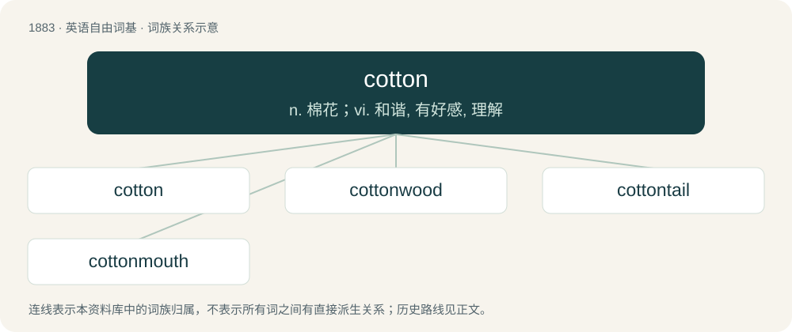

# 1991 · cotton — n. 棉花；vi. 和谐, 有好感, 理解

[总目录](../00_总目录_按常用程度.md)

**类型**：英语自由词基　｜　**来源语言**：见词源记录

## 核心含义与来源

- 核心含义：n. 棉花；vi. 和谐, 有好感, 理解
- 英文含义：A soft, fibrous, usually white substance consisting of fine hairs, especially the substance around the seeds of a plant of genus Gossypium.
- 词形：cotton

**多个词源／构词路径**：同一拼写可能有不同来源；以下按词性和含义分别列出。

**来源记录 1**（名词；A soft, fibrous, usually white substance consisting of fine hairs, especially the substance around the seeds of a plant of genus Gossypium.）

From Middle English cotoun, from Anglo-Norman cotun, Old French coton, from (Genoese) Old Italian cotone, from Arabic قُطُن (quṭun), from Hebrew כֻּתֹּנֶת (kuttṓnĕṯ).

**来源记录 2**（动词；To get on with someone or something; to have a good relationship with someone.）

First use appears c. the 1560s, either from Welsh cydun, cytun (“agree, coincide”) (cyduno, cytuno), from cyd, cyt + un (“one”), literally “to be at one with”, or by metaphor with the textile, as cotton blended well with other textiles, notably wool in hat-making.

## 词族图

## 单词速览（常用到不常用）

| 单词 | 音标 | 释义 |
|---|---|---|
| [cotton](#w-1) | 英 /ˈkɒt.n̩/；美 /ˈkɑt.n̩/ | n. 棉花；vi. 和谐, 有好感, 理解 |
| [cottonwood](#w-2) | /ˈkɔtənwjd/ | n. 三角叶杨 |
| [cottontail](#w-3) | 英 /ˈkɒt.n̩teɪl/；美 /ˈkɑt.n̩teɪl/ | n. 美洲产白尾棕色免 |
| [cottonmouth](#w-4) | /ˈkɔtən.mauθ/ | n. 棉口蛇；水腹蛇；噬鱼蝮蛇（等于water moccasin） |

## 逐词详解

### 1. cotton

**词性**：名词　｜　**音标**：英 /ˈkɒt.n̩/；美 /ˈkɑt.n̩/

**中文释义**：n. 棉花；vi. 和谐, 有好感, 理解

**英文义项**：A soft, fibrous, usually white substance consisting of fine hairs, especially the substance around the seeds of a plant of genus Gossypium. / Any similar soft, fibrous, white substance of fine hairs, of any origin.

**词源与演化**：

From Middle English cotoun, from Anglo-Norman cotun, Old French coton, from (Genoese) Old Italian cotone, from Arabic قُطُن (quṭun), from Hebrew כֻּתֹּנֶת (kuttṓnĕṯ).

**例句**：

> I heard a cotton candy shop has just opened. Let's go, dudes.

### 2. cottonwood

**词性**：名词　｜　**音标**：/ˈkɔtənwjd/

**中文释义**：n. 三角叶杨

**英文义项**：A tree from one of number of species of tree in the genus Populus (poplars), typically growing along watercourses, with fluffy catkins. / Populus sect. Aigeiros, a taxonomic section of the poplar genus

**构词拆分**：cotton + wood

**词源与演化**：

From cotton + wood.

### 3. cottontail

**词性**：名词　｜　**音标**：英 /ˈkɒt.n̩teɪl/；美 /ˈkɑt.n̩teɪl/

**中文释义**：n. 美洲产白尾棕色免

**英文义项**：A rabbit of any of various species in genus Sylvilagus. / A person with a tanned body and untanned buttocks, resembling a cottontail rabbit's dark fur and light tail.

**构词拆分**：cotton + tail

**词源与演化**：

From cotton + tail.

### 4. cottonmouth

**词性**：名词　｜　**音标**：/ˈkɔtən.mauθ/

**中文释义**：n. 棉口蛇；水腹蛇；噬鱼蝮蛇（等于water moccasin）

**英文义项**：An oral dryness often associated with certain medicines and recreational drugs. / A snake, Agkistrodon piscivorus, the water moccasin.

**构词拆分**：cotton + mouth

**词源与演化**：

From cotton + mouth.

**例句**：

> Do you have any gum? I've got really bad cottonmouth.
