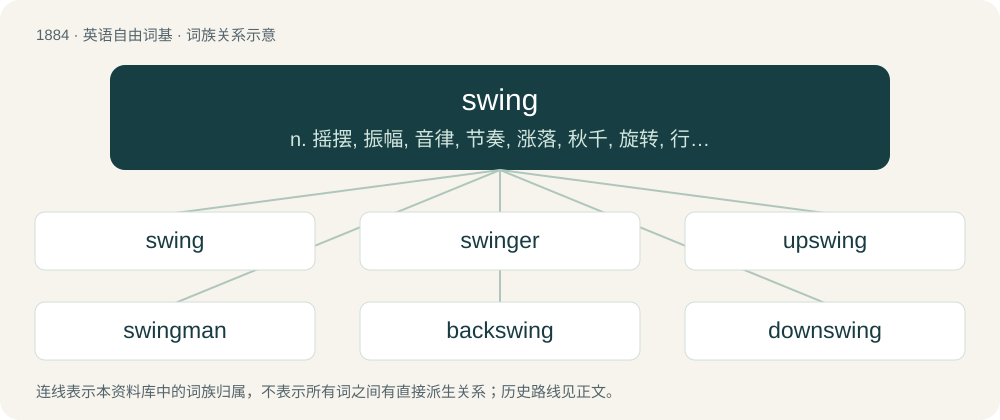

# 1992 · swing — n. 摇摆, 振幅, 音律, 节奏, 涨落, 秋千, 旋转, 行动自由；vi. 摇摆, 悬挂, 旋转, 大摇大摆地走, 转向；vt. 挥舞, 使旋转, 使转向, 悬挂, 吊运

[总目录](../00_总目录_按常用程度.md)

**类型**：英语自由词基　｜　**来源语言**：见词源记录

## 核心含义与来源

- 核心含义：n. 摇摆, 振幅, 音律, 节奏, 涨落, 秋千, 旋转, 行动自由；vi. 摇摆, 悬挂, 旋转, 大摇大摆地走, 转向；vt. 挥舞, 使旋转, 使转向, 悬挂, 吊运
- 英文含义：To rotate about an off-centre fixed point.
- 词形：swing

**来源记录 1**（动词；To rotate about an off-centre fixed point.）

From Middle English swyngen, from Old English swingan, from Proto-West Germanic \*swingan, from Proto-Germanic \*swinganą (compare Low German swingen, German schwingen, Dutch zwingen, Swedish svinga), from Proto-Indo-European \*swenk-, \*sweng- (compare Scottish Gaelic seang (“thin”)). Related to swink.

## 词族图

## 单词速览（常用到不常用）

| 单词 | 音标 | 释义 |
|---|---|---|
| [swing](#w-1) | /ˈswɪŋ/ | n. 摇摆, 振幅, 音律, 节奏, 涨落, 秋千, 旋转, 行动自由；vi. 摇摆, 悬挂, 旋转, 大摇大摆地走, 转向；vt. 挥舞, 使旋转, 使转向, 悬挂, 吊运 |
| [swinger](#w-2) | 英 /ˈswɪŋə/；美 /ˈswɪŋəɹ/ | n. 赶时髦的人, 摆动的人, 摆动的物, 有力的事物, 轰动的事物, 责打者 |
| [upswing](#w-3) | 英 /ˈʌpswɪŋ/ | n. 回升时期, 上升, 向上摆动, 跃进；\[经\] 上升, 向上摆动 |
| [swingman](#w-4) | /sˈwɪŋmæn/ | 代班人 |
| [backswing](#w-5) | /ˈbækswiŋ/ | \[电\] 背向摆动 |
| [downswing](#w-6) | /ˈdajnswiŋ/ | n. 下降趋势；\[经\] 向下摆动 |

## 逐词详解

### 1. swing

**词性**：动词　｜　**音标**：/ˈswɪŋ/

**中文释义**：n. 摇摆, 振幅, 音律, 节奏, 涨落, 秋千, 旋转, 行动自由；vi. 摇摆, 悬挂, 旋转, 大摇大摆地走, 转向；vt. 挥舞, 使旋转, 使转向, 悬挂, 吊运

**英文义项**：To rotate about an off-centre fixed point. / To dance.

**词源与演化**：

From Middle English swyngen, from Old English swingan, from Proto-West Germanic \*swingan, from Proto-Germanic \*swinganą (compare Low German swingen, German schwingen, Dutch zwingen, Swedish svinga), from Proto-Indo-European \*swenk-, \*sweng- (compare Scottish Gaelic seang (“thin”)). Related to swink.

**例句**：

> If it’s not too expensive, I think we can swing it.

该用例对应义项：To make (something) work; especially to afford (something) financially.

### 2. swinger

**词性**：名词　｜　**音标**：英 /ˈswɪŋə/；美 /ˈswɪŋəɹ/

**中文释义**：n. 赶时髦的人, 摆动的人, 摆动的物, 有力的事物, 轰动的事物, 责打者

**英文义项**：One who swings. / A person who practices swinging (sex with different partners).

**构词拆分**：swing + -er

**词源与演化**：

From swing + -er.

### 3. upswing

**词性**：名词　｜　**音标**：英 /ˈʌpswɪŋ/

**中文释义**：n. 回升时期, 上升, 向上摆动, 跃进；\[经\] 上升, 向上摆动

**英文义项**：An upward swing. / An upward trend or an increase in activity.

**构词拆分**：From up- + swing.

**词源与演化**：

From up- + swing.

**例句**：

> Newspapers reported an upswing in the company's sales last month.

该用例对应义项：An upward trend or an increase in activity.

### 4. swingman

**词性**：名词　｜　**音标**：/sˈwɪŋmæn/

**中文释义**：代班人

**英文义项**：A player who can swing between two different positions, often the small forward and shooting guard positions in basketball.

**构词拆分**：swing + man

**词源与演化**：

From swing + man.

### 5. backswing

**词性**：名词　｜　**音标**：/ˈbækswiŋ/

**中文释义**：\[电\] 背向摆动

**英文义项**：The preparatory stroke preceding that which produces contact with the target. Normally associated with sports using an implement such as a bat, club, racket or stick.

**构词拆分**：back + swing

**词源与演化**：

From back + swing.

### 6. downswing

**词性**：名词　｜　**音标**：/ˈdajnswiŋ/

**中文释义**：n. 下降趋势；\[经\] 向下摆动

**英文义项**：The portion of any movement along an arc or curve, heading in a lower direction.

**构词拆分**：From down- + swing.

**词源与演化**：

From down- + swing.

**例句**：

> Hold your head steady and keep your eye on the golf ball during your downswing.

该用例对应义项：The portion of any movement along an arc or curve, heading in a lower direction.
