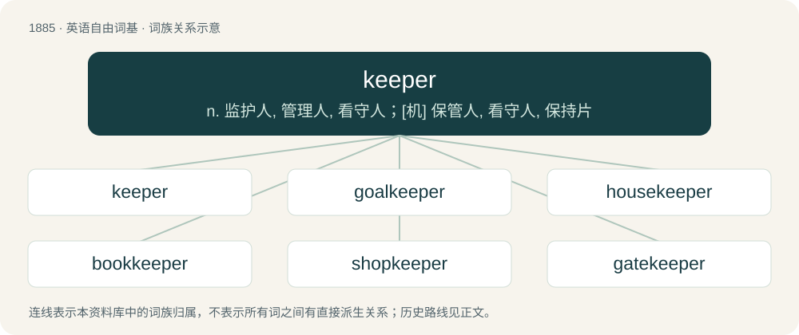

# 1994 · keeper — n. 监护人, 管理人, 看守人；\[机\] 保管人, 看守人, 保持片

[总目录](../00_总目录_按常用程度.md)

**类型**：英语自由词基　｜　**来源语言**：见词源记录

## 核心含义与来源

- 核心含义：n. 监护人, 管理人, 看守人；\[机\] 保管人, 看守人, 保持片
- 英文含义：One who keeps (retains) something.
- 词形：keeper

**来源记录 1**（名词；One who keeps (retains) something.）

From Middle English kepere. By surface analysis, keep + -er.

## 词族图

## 单词速览（常用到不常用）

| 单词 | 音标 | 释义 |
|---|---|---|
| [keeper](#w-1) | 英 /ˈkiː.pə/；美 /ˈkiː.pɚ/ | n. 监护人, 管理人, 看守人；\[机\] 保管人, 看守人, 保持片 |
| [goalkeeper](#w-2) | 英 /ˈɡəʊlˌkiː.pə/；美 /ˈɡoʊl.kiːpɚ/ | n. 守门员 |
| [housekeeper](#w-3) | 英 /ˈhaʊskiːpə/；美 /ˈhaʊskipɚ/ | n. 主妇, 女管家 |
| [bookkeeper](#w-4) | 英 /ˌbʊkˈkiː.pə(ɹ)/ | n. 簿记员；\[经\] 簿记员, 记帐员 |
| [shopkeeper](#w-5) | 英 /ˈʃɒpkiːpə/；美 /ˈʃɑpkiːpɚ/ | n. 零售商, 店主, 老板 |
| [gatekeeper](#w-6) | 英 /ˈɡeɪtˌkiː.pə/；美 /ˈɡeɪtˌki.pəɹ/ | n. 看门人 |
| [innkeeper](#w-7) | 美 /ˈɪnkiːpəɹ/ | n. 小旅馆老板, 客栈老板 |
| [peacekeeper](#w-8) | 英 /ˈpiːsˌkiːpə/；美 /ˈpisˌkipɚ/ | n. (交战国间的)停火执行者(或小组) |
| [beekeeper](#w-9) | 美 /ˈbiˌkipɚ/ | n. 养蜂人 |
| [zookeeper](#w-10) | 美 /ˈzuːkipɚ/ | n. 动物园管理者 |
| [storekeeper](#w-11) | /ˈstɒː.kiːpə/ | n. 店主 |
| [wicketkeeper](#w-12) | /ˈwɪkɪtkiːpə(r)/ | n. （板球）三柱门的防守员, 捕手 |
| [gamekeeper](#w-13) | /ˈgeimkiːpə/ | n. 猎场看守人 |
| [timekeeper](#w-14) | /ˈtaim.kiːpə/ | n. 工作时间记录员, 计时员, 钟表；\[经\] 记时员, 计工员 |
| [groundskeeper](#w-15) | 美 /ˈɡɹaʊndzˌkipɚ/ | n. (运动场、庄园、墓地等的)场地管理员\[亦作 groundkeeper\] |

## 逐词详解

### 1. keeper

**词性**：名词　｜　**音标**：英 /ˈkiː.pə/；美 /ˈkiː.pɚ/

**中文释义**：n. 监护人, 管理人, 看守人；\[机\] 保管人, 看守人, 保持片

**英文义项**：One who keeps (retains) something. / One who remains or keeps in a place or position.

**构词拆分**：By surface analysis, keep + -er

**词源与演化**：

From Middle English kepere. By surface analysis, keep + -er.

**例句**：

> Finders keepers; losers weepers.

该用例对应义项：One who keeps (retains) something.

### 2. goalkeeper

**词性**：名词　｜　**音标**：英 /ˈɡəʊlˌkiː.pə/；美 /ˈɡoʊl.kiːpɚ/

**中文释义**：n. 守门员

**英文义项**：A designated player that attempts to prevent the opposing team from scoring by protecting a goal.

**构词拆分**：From goal + keeper.

**词源与演化**：

From goal + keeper.

**例句**：

> The goalkeeper for France dived to the ground and saved Ronaldo’s shot.

### 3. housekeeper

**词性**：名词　｜　**音标**：英 /ˈhaʊskiːpə/；美 /ˈhaʊskipɚ/

**中文释义**：n. 主妇, 女管家

**英文义项**：Someone (traditionally a woman) employed to look after the home, typically by managing domestic servants or superintending household management; also someone with equivalent duties in a hotel, institution etc. / Someone who manages the running of a home, traditionally the female head of the household.

**构词拆分**：house + keeper

**词源与演化**：

From house + keeper.

**例句**：

> She was their third housekeeper, but after a month or so she also gave up.

该用例对应义项：Someone (traditionally a woman) employed to look after the home, typically by managing domestic servants or superintending household management; also someone with equivalent duties in a hotel, institution etc.

### 4. bookkeeper

**词性**：名词　｜　**音标**：英 /ˌbʊkˈkiː.pə(ɹ)/

**中文释义**：n. 簿记员；\[经\] 簿记员, 记帐员

**英文义项**：A person responsible for keeping records or documents, such as of a business. / A bookseller

**构词拆分**：book + keeper

**词源与演化**：

From book + keeper.

**例句**：

> A bookkeeper computes all the company's income and expenses each week.

### 5. shopkeeper

**词性**：名词　｜　**音标**：英 /ˈʃɒpkiːpə/；美 /ˈʃɑpkiːpɚ/

**中文释义**：n. 零售商, 店主, 老板

**英文义项**：A trader who sells goods in a shop, or by retail, in distinction from one who sells by wholesale, or sells door to door.

**构词拆分**：shop + keeper

**词源与演化**：

From shop + keeper.

**例句**：

> "But don't you think that it's a little big?" asked the shopkeeper.

### 6. gatekeeper

**词性**：名词　｜　**音标**：英 /ˈɡeɪtˌkiː.pə/；美 /ˈɡeɪtˌki.pəɹ/

**中文释义**：n. 看门人

**英文义项**：A person who guards or monitors passage through a gate. / A person or group who controls access to something or somebody.

**构词拆分**：gate + keeper

**词源与演化**：

From gate + keeper.

**例句**：

> Julius goes to the door, which the gatekeeper opens.

### 7. innkeeper

**词性**：名词　｜　**音标**：美 /ˈɪnkiːpəɹ/

**中文释义**：n. 小旅馆老板, 客栈老板

**英文义项**：The person responsible for the running of an inn, usually the proprietor.

**构词拆分**：inn + keeper

**词源与演化**：

From Middle English inkeper; equivalent to inn + keeper. Compare Middle English inholder (“innkeeper”).

**例句**：

> Ten minutes later, the innkeeper slipped into the room, his eyes bright with excitement.

### 8. peacekeeper

**词性**：名词　｜　**音标**：英 /ˈpiːsˌkiːpə/；美 /ˈpisˌkipɚ/

**中文释义**：n. (交战国间的)停火执行者(或小组)

**英文义项**：One that preserves the peace. / A member of a military force charged with peacekeeping duties in a troublespot.

**构词拆分**：peace + keeper

**词源与演化**：

From peace + keeper.

**例句**：

> She's the peacekeeper in that family.

该用例对应义项：someone who keeps peace

### 9. beekeeper

**词性**：名词　｜　**音标**：美 /ˈbiˌkipɚ/

**中文释义**：n. 养蜂人

**英文义项**：A person who maintains hives and keeps bees, especially for the production of honey.

**构词拆分**：bee + keeper

**词源与演化**：

From bee + keeper.

**例句**：

> The beekeeper was so confident that she didn't bother to wear protective gear.

### 10. zookeeper

**词性**：名词　｜　**音标**：美 /ˈzuːkipɚ/

**中文释义**：n. 动物园管理者

**英文义项**：A person employed at a zoo to attend to the animals.

**构词拆分**：zoo + keeper

**词源与演化**：

From zoo + keeper.

**例句**：

> My name is Mary, I'm 40 years old and I'm a zookeeper.

### 11. storekeeper

**词性**：名词　｜　**音标**：/ˈstɒː.kiːpə/

**中文释义**：n. 店主

**英文义项**：One who runs a shop, either the owner or manager. / One who is in charge of stores or goods of any kind.

**构词拆分**：store + keeper

**词源与演化**：

From store + keeper.

**用法示例／搭配（非完整句）**：

> a naval storekeeper

该用例对应义项：One who is in charge of stores or goods of any kind.

### 12. wicketkeeper

**词性**：名词　｜　**音标**：/ˈwɪkɪtkiːpə(r)/

**中文释义**：n. （板球）三柱门的防守员, 捕手

**英文义项**：A player who stands behind the batsman’s wicket ready to catch the ball, or to stump the batsman.

**构词拆分**：From wicket + keeper.

**词源与演化**：

From wicket + keeper.

### 13. gamekeeper

**词性**：名词　｜　**音标**：/ˈgeimkiːpə/

**中文释义**：n. 猎场看守人

**英文义项**：A person employed to maintain the game for hunting and all associated materials and effects.

**构词拆分**：game + keeper

**词源与演化**：

From game + keeper.

**例句**：

> It was the gamekeeper who found the body.

### 14. timekeeper

**词性**：名词　｜　**音标**：/ˈtaim.kiːpə/

**中文释义**：n. 工作时间记录员, 计时员, 钟表；\[经\] 记时员, 计工员

**英文义项**：A device that shows the time; a timepiece. / A person who keeps records of the hours of attendance of employees.

**构词拆分**：time + keeper

**词源与演化**：

From time + keeper.

### 15. groundskeeper

**词性**：名词　｜　**音标**：美 /ˈɡɹaʊndzˌkipɚ/

**中文释义**：n. (运动场、庄园、墓地等的)场地管理员\[亦作 groundkeeper\]

**英文义项**：Someone who takes care of the upkeep of grounds (gardens, a playing field, woodlands, etc.)

**构词拆分**：grounds + keeper

**词源与演化**：

From grounds + keeper.
