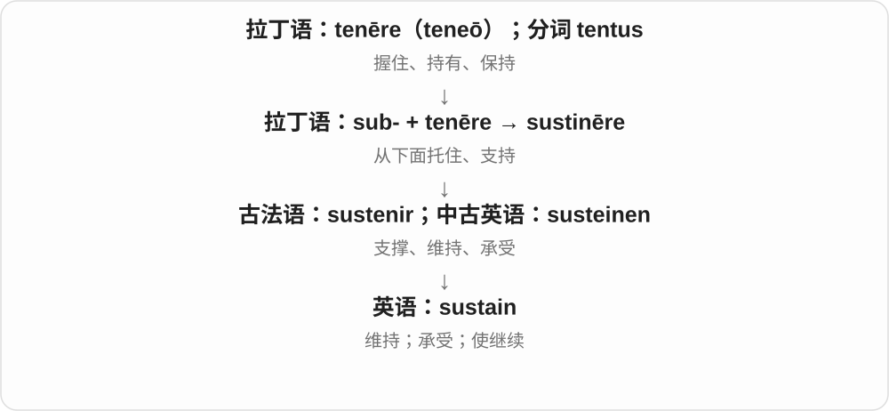
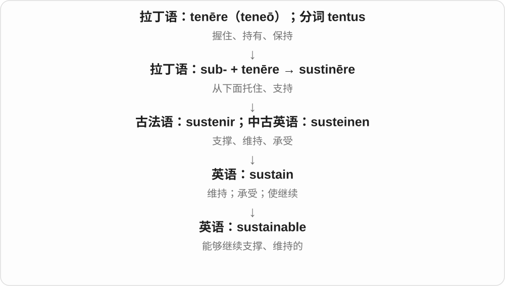
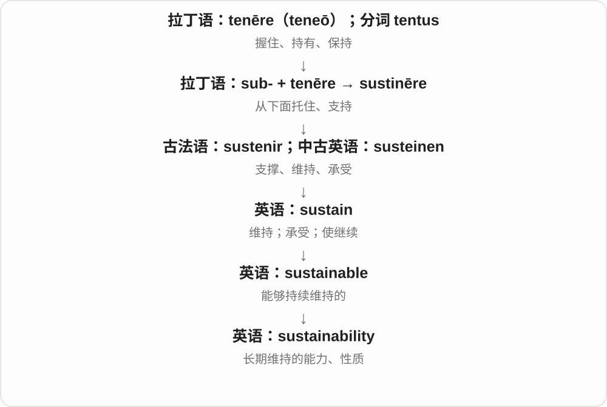
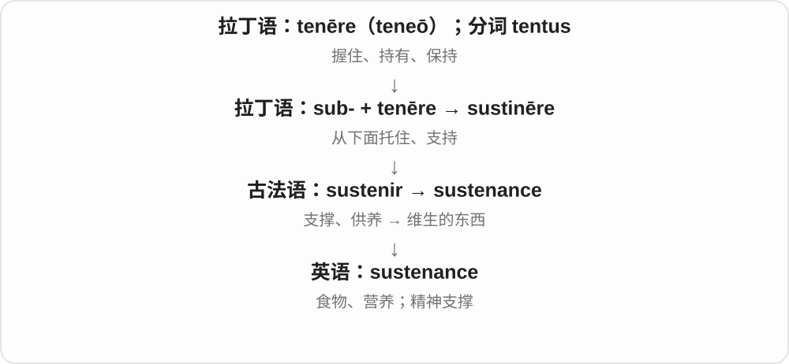

# 1994 · sustain — 从下面托住，让活动和生命持续

[逐词精讲目录](../00_逐词精讲目录.md) · [总目录](../00_总目录_按常用程度.md)

## 核心词根与来源

动词、过程、执行者、性质分开排。后勤保障、环境可持续和维生食物都能抓支撑，但不能把名词随便互换。

**SUSTAIN：不是一下顶住，而是不断支撑下去**

sustain → sustainment 保障过程、sustainer 支撑者；sustainable → sustainability 能否长期持续；sustenance 维生支持。

- **支撑动作、过程与执行者**：sustain · sustainment · sustainer
- **长期持续的性质**：sustainable · sustainability
- **维生食物、支持**：sustenance

## 词形与演化规律

sub- + tenēre → sustinēre → sustain；sustain + -ment/-er/-able；sustainable → sustainability；sustenance 为同族名词。

## 单词速览（按词族由简到繁）

同一基础词的相关扩展放在一起，先读基础形式，再读扩展；各组之间优先读常用的。具体词源关系见各词讲解。

| 单词 | 音标 | 核心意思 |
|---|---|---|
| [sustain](#w-2) | /səˈsteɪn/ | 维持；支撑；承受；遭受 |
| [sustainable](#w-1) | /səˈsteɪnəbəl/ | 可持续的；能够长期维持的 |
| [sustainability](#w-3) | /səˌsteɪnəˈbɪləti/ | 可持续性；长期维持能力 |
| [sustenance](#w-4) | /ˈsʌstənəns/ | 食物；营养；维生、精神支撑 |
| [sustainment](#w-5) | /səˈsteɪnmənt/ | 持续保障、维持、供给支持 |
| [sustainer](#w-6) | 英 /səˈsteɪnə/；美 /səˈsteɪnər/ | 维持、支撑的人或物；持续推力发动机〔技术〕 |

## 逐词讲解

### 1. sustain — 维持；支撑；承受；遭受

**音标**：/səˈsteɪn/

**先抓住这个画面**

sustain 像从下面一直托着，让某种状态继续：维持生活、保持努力、把一个音拉住；承受伤害则是身体接住了不好的影响。

**怎么拆**

经古法语 sustenir 来自拉丁语 sustinēre，sub-（从下面）+ tenēre（保持）发生词形变化。

**怎么变成今天的意思**

sustain an effort 是让努力持续；sustain injuries 是遭受伤害。不是所有搭配都能译为支持某个观点。

**常见搭配与例句**

sustain growth；sustain an effort；sustain an injury；sustain a note。

> The small business could not sustain such high costs.

这家小企业无法持续承担这么高的成本。

> Several passengers sustained minor injuries.

几名乘客受了轻伤。

> The singer sustained the final note.

歌手延长保持了最后一个音。

**别混淆**

support 可以在某一刻提供帮助；sustain 往往强调把它托住并维持一段时间。

### 2. sustainable — 可持续的；能够长期维持的

**音标**：/səˈsteɪnəbəl/

**先抓住这个画面**

sustainable 像一种生活或生产方式，今天能运转，明天也不至于把维持它的资源和条件耗光。

**怎么拆**

sustain + -able。

**怎么变成今天的意思**

环境话题最常见，但也能说工作强度、财务模式、增长速度。不能只翻成绿色或环保而丢掉持续的含义。

**常见搭配与例句**

sustainable development；a sustainable pace；a sustainable business model。

> We need a sustainable pace of work, not constant overtime.

我们需要能长期维持的工作节奏，而不是持续加班。

> The project explores more sustainable ways to use local resources.

项目探索更可持续地使用本地资源的方法。

**别混淆**

renewable 是资源可再生；sustainable 是整体做法能否长期维持，两者相关但不完全相同。

### 3. sustainability — 可持续性；长期维持能力

**音标**：/səˌsteɪnəˈbɪləti/

**先抓住这个画面**

sustainability 是追问“这样一直做下去，还撑不撑得住”，要把资源、成本和长期影响一起考虑。

**怎么拆**

sustain + -ability，或从 sustainable 的名词形式理解。

**怎么变成今天的意思**

可以讨论生态，也可以讨论项目经费、工作安排。单词不是给任何新产品自动盖环保认证章。

**常见搭配与例句**

environmental sustainability；financial sustainability；long-term sustainability。

> The review questioned the financial sustainability of the programme.

评审对项目的财务可持续性提出了疑问。

> Sustainability was considered from the beginning of the design process.

设计过程从一开始就考虑了可持续性。

**别混淆**

efficiency 看投入与产出如何；sustainability 看这种做法能否持续。短期高效的做法未必长期撑得住。

### 4. sustenance — 食物；营养；维生、精神支撑

**音标**：/ˈsʌstənəns/

**先抓住这个画面**

sustenance 像让人继续活下去的那一份支撑，具体是食物，也可以是情感或精神上的滋养。

**怎么拆**

经古法语 sustenance 来自 sustenir“支撑、供养”，远源为拉丁语 sustinēre。

**怎么变成今天的意思**

语气比 food 更书面，着重食物维持生命的作用。spiritual sustenance 不是给思想真的喂饭，而是能让人撑下去。

**常见搭配与例句**

provide sustenance；basic sustenance；emotional sustenance。

> The small farm provided sustenance for the family.

这个小农场为一家人提供维生食物。

> She drew emotional sustenance from her friends.

她从朋友那里获得了情感上的支撑。

**别混淆**

nutrition 侧重营养摄入或营养学；sustenance 侧重维生、支撑所需的东西，也可比喻使用。

### 5. sustainment — 持续保障、维持、供给支持

**音标**：/səˈsteɪnmənt/

**先抓住这个画面**

让一套系统、行动一直转下去，要不断补给、维修、组织支持；尤其后勤语境里不是只顶住一秒。

**怎么拆**

sustain + -ment，动作、过程名词。普通写作有时用 support、maintenance 更自然，sustainment 常见于持续保障等专门语境。

**怎么变成今天的意思**

**拉丁 sub- + tenēre → sustinēre**  
从下面托住、支撑、维持

↓

**法语相关形式 → sustain**  
使持续、支撑；承受等分支

↓

**sustain + -ment → sustainment**  
使活动、系统长期继续的支持与维持

logistical sustainment 后勤持续保障，long-term sustainment 长期维持，sustainment costs 持续保障费用。

**常见搭配与例句**

logistical sustainment；long-term sustainment；sustainment costs。

> The plan includes long-term sustainment costs.

计划包含长期保障费用。

> The report focuses on the sustainment of field operations.

报告重点讨论外勤行动的持续保障。

**别混淆**

sustainment 是支撑、维持过程，sustainability 是能否长期持续的性质；sustenance 又常是维生食物、养料。

### 6. sustainer — 维持、支撑的人或物；持续推力发动机〔技术〕

**音标**：英 /səˈsteɪnə/；美 /səˈsteɪnər/

**先抓住这个画面**

主力活动持续下去，背后那个一直托着、供着的角色；可以是人，也可以是某个系统部件。

**怎么拆**

sustain + -er，施事或器物名词。火箭等语境借它叫持续提供推力的发动机，但不只限航天。

**怎么变成今天的意思**

**拉丁 sub- + tenēre → sustinēre**  
从下面托住、支撑、维持

↓

**法语相关形式 → sustain**  
使持续、支撑；承受等分支

↓

**sustain + -er → sustainer**  
持续支撑者、维持装置；技术中持续推力部件

a sustainer of life 维持生命的事物，a sustainer engine 持续推力发动机，a long-term sustainer 长期支持者。

**常见搭配与例句**

a sustainer of life；a sustainer engine。

> The essay describes food as a sustainer of life.

文章把食物称为维持生命的事物。

> The diagram labels the booster and the sustainer engine.

图示标出了助推器和持续推力发动机。

**别混淆**

sustainer 是支撑者或装置，sustenance 是维生食物、支持；两者都同族，但句中角色不同。

## 这一组要分清什么

sustainment/sustainability 维持过程与可持续性质；sustainer/sustenance 支撑者与维生支持。

## 串起来练习

Long-term sustainment helps sustain the system, but its sustainability still needs assessment.

长期保障帮助维持系统，但它能否长期持续仍需评估。
