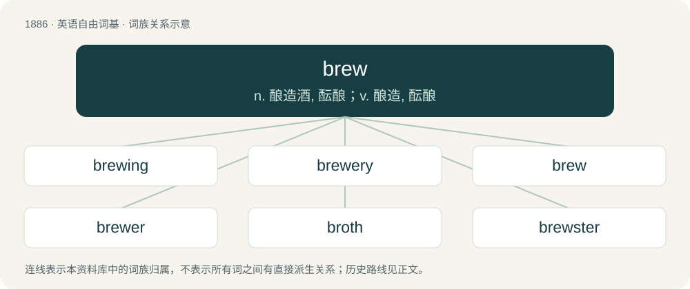

# 1995 · brew — n. 酿造酒, 酝酿；v. 酿造, 酝酿

[总目录](../00_总目录_按常用程度.md)

**类型**：英语自由词基　｜　**来源语言**：见词源记录

## 核心含义与来源

- 核心含义：n. 酿造酒, 酝酿；v. 酿造, 酝酿
- 英文含义：To make tea or coffee by mixing tea leaves or coffee beans with hot water.
- 词形：brew

**多个词源／构词路径**：同一拼写可能有不同来源；以下按词性和含义分别列出。

**来源记录 1**（动词；To make tea or coffee by mixing tea leaves or coffee beans with hot water.）

From Middle English brewen, from Old English brēowan, from Proto-West Germanic \*breuwan, from Proto-Germanic \*brewwaną, from Proto-Indo-European \*bʰrewh₁-. Doublet of burn. Cognate with Dutch brouwen, German brauen, Swedish brygga, Norwegian Bokmål brygge; also Ancient Greek φρέαρ (phréar, “well”), Latin fervēre (“to be hot; to burn; to boil”), Old Irish bruth (“violent, boiling heat”), Sanskrit भुर्वन् (bhurván, “motion of water”). It may be related to English barley.

**来源记录 2**（名词；An overhanging hill or cliff.）

From Middle English brewe (“eyebrow”), from Old English bru (“eyebrow”). Doublet of brow.

## 词族图

## 单词速览（常用到不常用）

| 单词 | 音标 | 释义 |
|---|---|---|
| [brewing](#w-1) | /ˈbɹuːɪŋ/ | n. 酿造, 一次酿造的量；\[机\] 酿造, 酿酒 |
| [brewery](#w-2) | /ˈbɹuːəɹi/ | n. 啤酒厂, 酿酒厂；\[经\] 酿造所 |
| [brew](#w-3) | /bɹuː/ | n. 酿造酒, 酝酿；v. 酿造, 酝酿 |
| [brewer](#w-4) | 英 /ˈbɹuː.ə(ɹ)/ | n. (啤酒)制造者, 泡制饮料的器皿；\[机\] 啤酒工人 |
| [broth](#w-5) | 英 /bɹɒθ/；美 /bɹɔθ/ | n. 原汁清汤, 肉汤；\[医\] 肉汤(培养基) |
| [brewster](#w-6) | /ˈbruːstə/ | 【英文】A brewer (of either sex). |
| [homebrew](#w-7) | 美 /ˈhoʊmˌbɹu/ | n. 自酿（啤）酒; 公司自产自用 |
| [brewhouse](#w-8) | /ˈbruːhajs/ | n. 酿酒厂,啤酒厂 |
| [brewpub](#w-9) | /ˈbruːˌpʌb/ | n. 出售自制啤酒的酒馆 |

## 逐词详解

### 1. brewing

**词性**：名词　｜　**音标**：/ˈbɹuːɪŋ/

**中文释义**：n. 酿造, 一次酿造的量；\[机\] 酿造, 酿酒

**英文义项**：The production of alcoholic beverages, such as beer, by fermentation; the process of being brewed. / The business or occupation of a brewer.

**构词拆分**：brew + -ing

**词源与演化**：

From Middle English brewynge; equivalent to brew + -ing.

**例句**：

> I was happy to wake up to the aroma of coffee brewing.

### 2. brewery

**词性**：名词　｜　**音标**：/ˈbɹuːəɹi/

**中文释义**：n. 啤酒厂, 酿酒厂；\[经\] 酿造所

**英文义项**：A building where beer is produced. / A company that brews beer.

**构词拆分**：brew + -ery

**词源与演化**：

From Dutch brouwerij (“brewery”), equivalent to brew + -ery. See also brewhouse.

**例句**：

> We took a day trip to the Guiness Brewery.

该用例对应义项：A building where beer is produced.

### 3. brew

**词性**：动词　｜　**音标**：/bɹuː/

**中文释义**：n. 酿造酒, 酝酿；v. 酿造, 酝酿

**英文义项**：To make tea or coffee by mixing tea leaves or coffee beans with hot water. / To heat wine, infusing it with spices; to mull.

**词源与演化**：

From Middle English brewen, from Old English brēowan, from Proto-West Germanic \*breuwan, from Proto-Germanic \*brewwaną, from Proto-Indo-European \*bʰrewh₁-. Doublet of burn. Cognate with Dutch brouwen, German brauen, Swedish brygga, Norwegian Bokmål brygge; also Ancient Greek φρέαρ (phréar, “well”), Latin fervēre (“to be hot; to burn; to boil”), Old Irish bruth (“violent, boiling heat”), Sanskrit भुर्वन् (bhurván, “motion of water”). It may be related to English barley.

**例句**：

> Tom has been trying to learn how to brew the perfect cup of coffee.

### 4. brewer

**词性**：名词　｜　**音标**：英 /ˈbɹuː.ə(ɹ)/

**中文释义**：n. (啤酒)制造者, 泡制饮料的器皿；\[机\] 啤酒工人

**英文义项**：A person who brews (vocationally or avocationally); especially, one whose occupation is to prepare malt liquors, usually as part of an alemaking or beermaking process. / A company that brews beer or ale.

**构词拆分**：brew + -er

**词源与演化**：

From Middle English brewere, equivalent to brew + -er; cognate with Dutch brouwer, Swedish bryggare.

**例句**：

> By that time, Anheuser-Busch was the largest brewer in the region.

该用例对应义项：A company that brews beer or ale.

### 5. broth

**词性**：名词　｜　**音标**：英 /bɹɒθ/；美 /bɹɔθ/

**中文释义**：n. 原汁清汤, 肉汤；\[医\] 肉汤(培养基)

**英文义项**：Water in which food (meat, vegetable, etc.) has been boiled. / A soup made from broth and other ingredients such as vegetables, herbs or diced meat.

**构词拆分**：By surface analysis, brew + -th (abstract nominal suffix)

**词源与演化**：

From Middle English broth, from Old English broþ (“broth”), from Proto-West Germanic \*broþ (“broth”), from Proto-Germanic \*bruþą (“broth”), from Proto-Indo-European \*bʰrewh₁- (“to seethe, roil, brew”). By surface analysis, brew + -th (abstract nominal suffix).

**例句**：

> Add the Diced Tomatoes to the beef broth, and let it simmer.

### 6. brewster

**词性**：名词　｜　**音标**：/ˈbruːstə/

**英文义项**：A brewer (of either sex).

**构词拆分**：brew + -ster

**词源与演化**：

Circa 1300, from Middle English brewestere; equivalent to brew + -ster.

### 7. homebrew

**词性**：名词　｜　**音标**：美 /ˈhoʊmˌbɹu/

**中文释义**：n. 自酿（啤）酒; 公司自产自用

**英文义项**：A beer brewed by enthusiasts rather than commercially. / A game or amateur radio equipment made or modified by an amateur.

**构词拆分**：home + brew

**词源与演化**：

From home + brew.

**例句**：

> I'm too cheap to play anything but homebrew PC games.

### 8. brewhouse

**词性**：名词　｜　**音标**：/ˈbruːhajs/

**中文释义**：n. 酿酒厂,啤酒厂

**英文义项**：The part of a brewery where the wort is made, as contrasted with the cellars and warehouses; a brewery (sometimes synonymous in cases involving a single building).

**构词拆分**：brew + house

**词源与演化**：

From Middle English brewhous, brouhous, brewehous, equivalent to brew + house. Compare Dutch brouwhuis (“brewhouse”).

### 9. brewpub

**词性**：名词　｜　**音标**：/ˈbruːˌpʌb/

**中文释义**：n. 出售自制啤酒的酒馆

**英文义项**：A public house with a brewery (usually a microbrewery) attached.

**构词拆分**：brew + pub

**词源与演化**：

From brew + pub.
