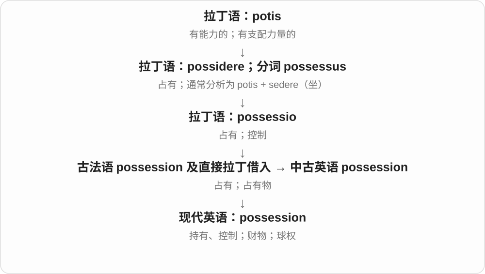
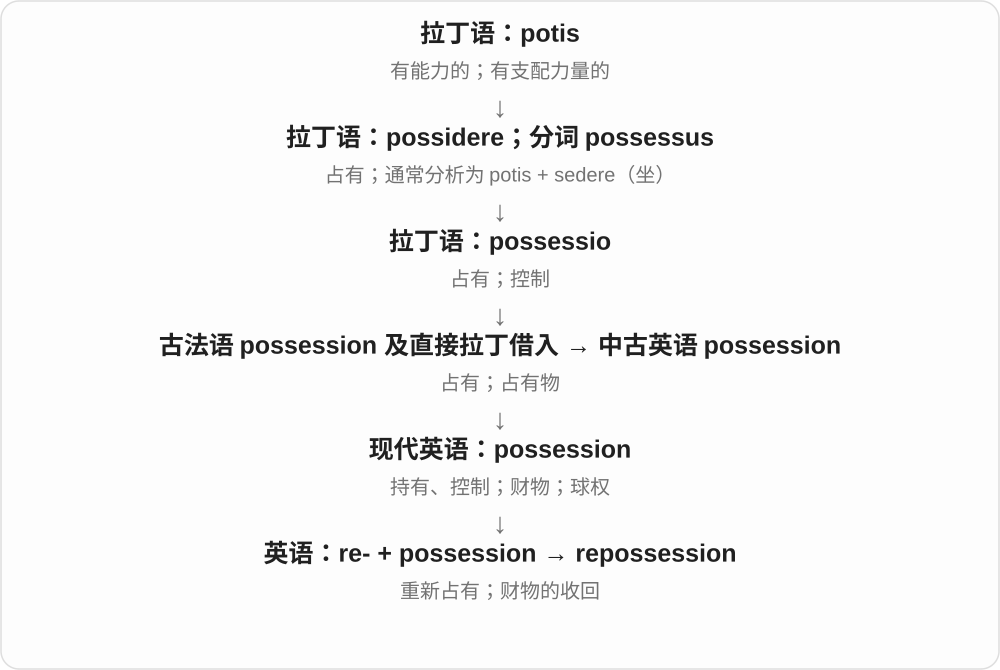
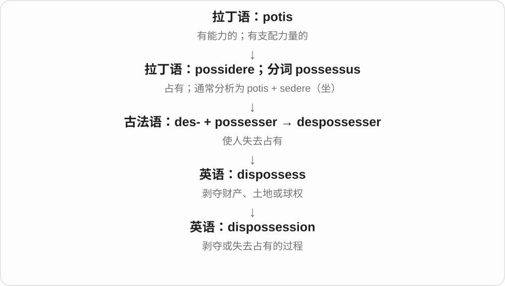

# 1995 · possession — 拥有；持有；占有

[逐词精讲目录](../00_逐词精讲目录.md) · [总目录](../00_总目录_按常用程度.md)

## 核心词根与来源

possession 经法语接拉丁占有一支；repossession 是重新取回占有，dispossession 是剥夺、失去占有。具体法律与一般用法需要区别。

**POSSESSION：实际持着或控制着某物**

先有控制权，再看它是被取回还是被夺走。

- **拥有和财物**：possession
- **取回与剥夺**：repossession · dispossession
- **possession → possessions：拥有的东西**：possessions

## 词形与演化规律

possession of；possessions 复数可指财物。re- 表重新，dis- 在此涉及夺去，不能把两种变化方向混同。

possession 经法语、拉丁 possessio 进入英语，远接 possidere 持有。现代复数常说随身物、财物；英语 possess 有由该名词逆构等历史影响。

## 单词速览（按词族由简到繁）

同一基础词的相关扩展放在一起，先读基础形式，再读扩展；各组之间优先读常用的。具体词源关系见各词讲解。

| 单词 | 音标 | 核心意思 |
|---|---|---|
| [possession](#w-1) | /pəˈzeʃən/ | 占有、持有；财物；球权；被附身的状态 |
| [possessions](#w-4) | 英 /pəˈzeʃənz/；美 /pəˈzeʃənz/ | 财物；个人物品；拥有之物〔复数〕 |
| [repossession](#w-2) | /ˌriːpəˈzeʃən/ | 收回占有；因欠款等被收回财物 |
| [dispossession](#w-3) | /ˌdɪspəˈzeʃən/ | 剥夺占有；土地或财产被夺走 |

## 逐词讲解

### 1. possession — 占有、持有；财物；球权；被附身的状态

**音标**：/pəˈzeʃən/

**先抓住这个画面**

possession 先问“东西现在在谁手里、受谁控制”，也能直接指手里的那件东西。

**怎么拆**

源自拉丁 possessio，经古法语及直接拉丁借入；英语名词并非统一由更晚的 possess 加 -ion 形成。现代构词仍可把两者联系起来。

**怎么变成今天的意思**

in possession of the keys 是持有钥匙；a prized possession 是珍爱的物品；复数 possessions 常指个人财物。足球里的 keep possession 是控住球，恐怖故事里的 demonic possession 则是被恶魔控制。

**常见搭配与例句**

in possession of；take possession of；personal possessions；retain possession。

> The original letter is still in her possession.

原信仍由她保存着。

> He packed his few possessions into one suitcase.

他把不多的个人物品装进了一个行李箱。

> Our team kept possession for most of the second half.

下半场大部分时间是我们队在控球。

**别混淆**

possession 可强调实际持有或控制；ownership 强调所有权。借来的书在你手里，也可能是 in your possession。

### 2. possessions — 财物；个人物品；拥有之物〔复数〕

**音标**：英 /pəˈzeʃənz/；美 /pəˈzeʃənz/

**先抓住这个画面**

不是拥有这个抽象状态，而是你拥有的那一件件东西：书、衣服、随身物品，都可以是 possessions。

**怎么拆**

possession + -s → possessions，/n/ 后读 /z/。possession 接法语、拉丁 possessio，远连 possidere 持有，通常分析为有支配力与坐、占据的材料。

**怎么变成今天的意思**

**拉丁 possidere 持有、占据 → possessio → possession**  
拥有状态与所拥有之物的名词词义

↓

**possession + -s → possessions**  
现代常指一件件私人物品、财物

personal possessions 是个人财物；prized possessions 是珍爱的物品；all her possessions 是她全部家当。

**常见搭配与例句**

personal possessions；prized possessions；all his possessions。

> She packed her few possessions into one bag.

她把不多的随身物品装进一个包。

> The old notebook was one of his most prized possessions.

那本旧笔记本是他最珍爱的物品之一。

**别混淆**

possession 单数可说拥有、占有状态，possessions 常说东西本身；英语 possess 又有从 possession 逆构等历史影响，不按短词必先造长词推史。

### 3. repossession — 收回占有；因欠款等被收回财物

**音标**：/ˌriːpəˈzeʃən/

**先抓住这个画面**

repossession 把收回房屋、车辆的整个过程当作一个事件来讲。

**怎么拆**

re- + possession，也与动词 repossess 对应；现代可看作重新取得占有的名词。

**怎么变成今天的意思**

the repossession of a car 是车被收回这件事；face repossession 说面临这种局面。并不是每种“把东西还回来”都用这个正式词。

**常见搭配与例句**

face repossession；avoid repossession；the repossession of property。

> The letter warned the tenant about repossession of the equipment.

信中警告租用人，设备可能被收回。

> The documentary follows families facing repossession.

纪录片跟拍了面临房产被收回的家庭。

**别混淆**

repayment 是还款；repossession 是收回财物，两者可能有关联，但不是同一个动作。

### 4. dispossession — 剥夺占有；土地或财产被夺走

**音标**：/ˌdɪspəˈzeʃən/

**先抓住这个画面**

dispossession 说的是“原本属于自己生活的一块地方或财物，被别人拿走了”的过程和结果。

**怎么拆**

与 dispossess 相应的英语名词；也可从现代形式看作 dis- + possession。

**怎么变成今天的意思**

历史、社会研究里常谈土地被剥夺及其长期影响。这个词强调失去控制的社会过程，不只是一件物品暂时不见了。

**常见搭配与例句**

land dispossession；forced dispossession；a history of dispossession。

> The exhibition documents the community’s dispossession of its land.

展览记录了这个社区的土地被剥夺的历史。

> Dispossession disrupted both farming and family life.

失去土地既打乱了耕作，也破坏了家庭生活。

**别混淆**

loss 可以是各种原因的失去；dispossession 通常涉及别人使原占有者失去财物或土地。

## 这一组要分清什么

possession 与 ownership 不总相同：持有、实际控制与所有权是不同概念。

## 串起来练习

The history describes both possession of the land and later dispossession.

历史叙述了对土地的占有以及后来的失地。
