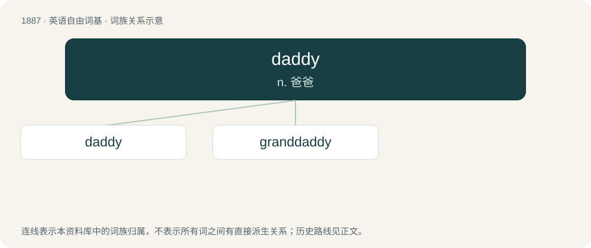

# 1996 · daddy — n. 爸爸

[总目录](../00_总目录_按常用程度.md)

**类型**：英语自由词基　｜　**来源语言**：见词源记录

## 核心含义与来源

- 核心含义：n. 爸爸
- 英文含义：Characteristic of or resembling a dad or father.
- 词形：daddy

**来源记录 1**（形容词；Characteristic of or resembling a dad or father.）

From dad + -y (suffix forming adjectives with the sense ‘having the quality of’).

## 词族图

## 单词速览（常用到不常用）

| 单词 | 音标 | 释义 |
|---|---|---|
| [daddy](#w-1) | 英 /ˈdædi/ | n. 爸爸 |
| [granddaddy](#w-2) | /ˈgrændædi/ | n. &lt;非正&gt;祖师爷, 老祖宗； 爷爷, 祖父 |

## 逐词详解

### 1. daddy

**词性**：形容词　｜　**音标**：英 /ˈdædi/

**中文释义**：n. 爸爸

**英文义项**：Characteristic of or resembling a dad or father.

**构词拆分**：dad + -y

**词源与演化**：

From dad + -y (suffix forming adjectives with the sense ‘having the quality of’).

**例句**：

> Daddy, can you read me a story before I go to sleep?

### 2. granddaddy

**词性**：名词　｜　**音标**：/ˈgrændædi/

**中文释义**：n. &lt;非正&gt;祖师爷, 老祖宗； 爷爷, 祖父

**英文义项**：A grandfather. / Something that is the greatest or most significant of its kind.

**构词拆分**：grand- + daddy

**词源与演化**：

From grand- + daddy.
