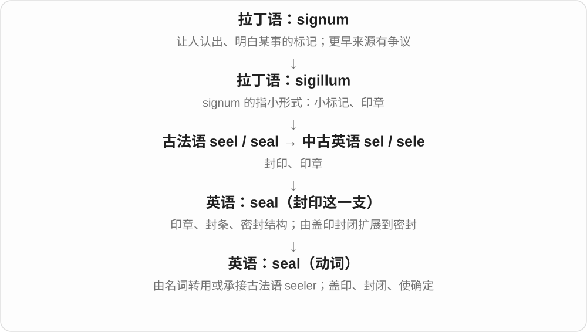
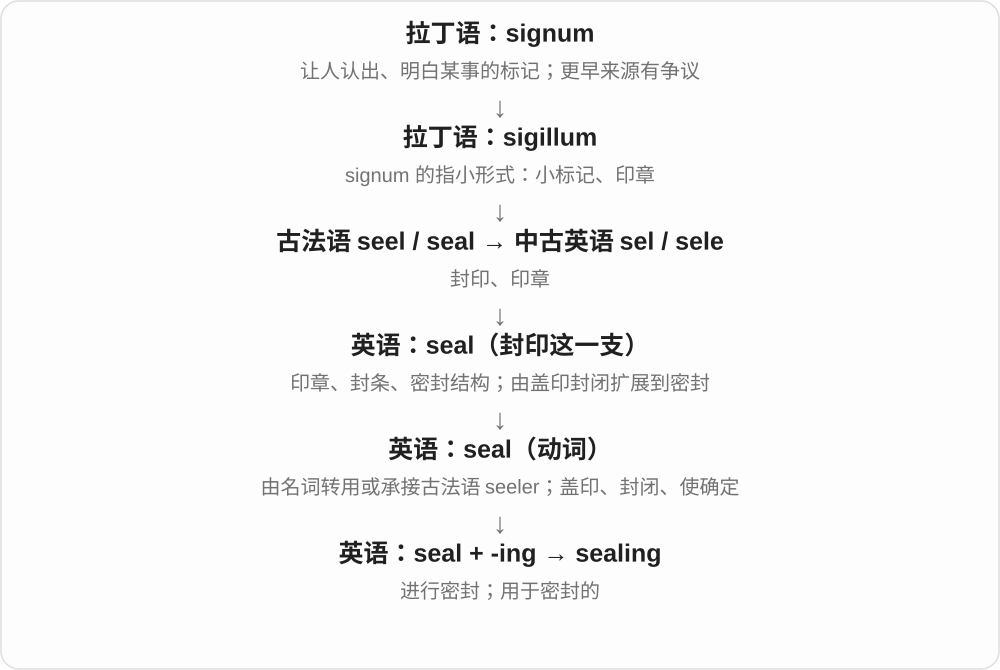
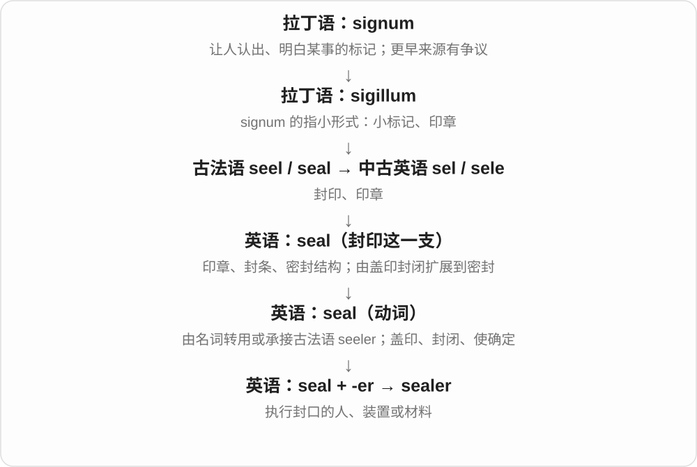
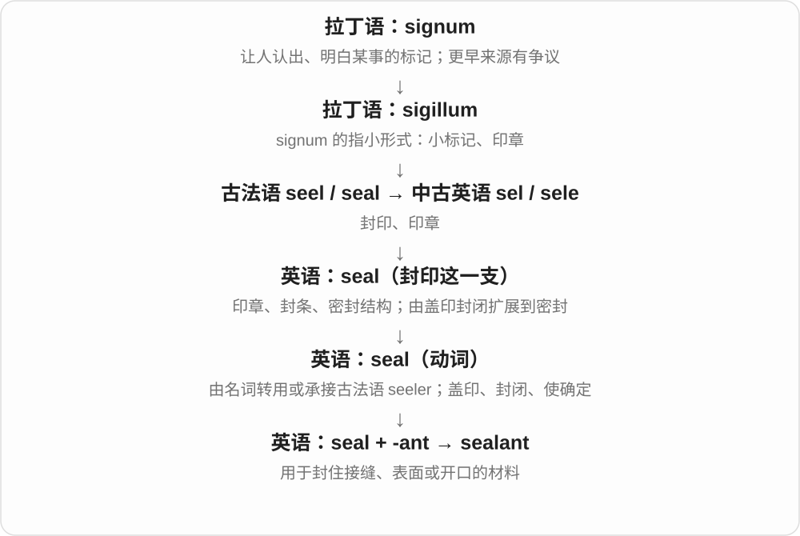

# 1996 · seal — 印章、密封与海豹的不同来源

[逐词精讲目录](../00_逐词精讲目录.md) · [总目录](../00_总目录_按常用程度.md)

## 核心词根与来源

常见派生主要接封闭、密封动作；sealing、sealer 在海豹捕猎语境也可另走动物名路线。不能把海豹讲成印章形的小动物。

**SEAL：封印一线，海豹另线**

sigillum → seel → seal 印章、密封；古英语 seolh → seal 海豹。

- **封印、过程、材料与解除**：seal · sealing · sealer · sealant · unseal
- **seals：封印、密封与海豹分源**：seals

## 词形与演化规律

seal + -ing/-er/-ant；un- 逆转 + seal。各词有同形分支时再看对象。

封印义接拉丁小标记材料，动物名 seal 承古英语 seolh，远源未定；两路不能从海豹故事互推。现代 -s 均读 /z/。

## 单词速览（按词族由简到繁）

同一基础词的相关扩展放在一起，先读基础形式，再读扩展；各组之间优先读常用的。具体词源关系见各词讲解。

| 单词 | 音标 | 核心意思 |
|---|---|---|
| [seal](#w-1) | /siːl/ | 印章；封印；密封条；封闭、密封；海豹〔另源〕 |
| [seals](#w-7) | 英、美 /siːlz/ | 海豹〔复数〕；印章、封印、密封件〔复数〕；封闭，密封〔第三人称〕 |
| [sealing](#w-2) | /ˈsiːlɪŋ/ | 封口；密封；密封用的；猎捕海豹〔另源〕 |
| [sealer](#w-3) | 英 /ˈsiːlə/；美 /ˈsiːlər/ | 封口机；密封材料；封口者；猎海豹者〔另源〕 |
| [sealant](#w-4) | /ˈsiːlənt/ | 密封胶；密封材料 |
| [unseal](#w-6) | /ʌnˈsiːl/ | 拆封；启封；解除封闭 |

## 逐词讲解

### 1. seal — 印章；封印；密封条；封闭、密封；海豹〔另源〕

**音标**：/siːl/

**先抓住这个画面**

本族的 seal 从印在蜡上的身份标记出发：蜡既留下印，也封住信，于是意思走到密封。海豹只是碰巧同拼写。

**怎么拆**

印章义经古法语 seel 来自拉丁 sigillum，是 signum 的指小形式；动词可由名词转用或承接法语 seeler。海豹义来自古英语 seolh，另属日耳曼语来源。

**怎么变成今天的意思**

a wax seal 是蜡封；a rubber seal 是密封圈或密封条；seal an envelope 是封信；seal a deal 是把约定敲定。

**常见搭配与例句**

a broken seal；seal a container；seal the deal；my lips are sealed。

> The letter bore a red wax seal.

信上带着一枚红色蜡封。

> Please seal the container tightly after use.

使用后请把容器密封好。

> A seal rested on the rock beside the water.

一只海豹趴在水边的岩石上休息。

**别混淆**

stamp 强调盖印工具或动作；seal 常把身份确认与封闭联系起来。动物 seal 不参与本页的历史图。

### 2. seals — 海豹〔复数〕；印章、封印、密封件〔复数〕；封闭，密封〔第三人称〕

**音标**：英、美 /siːlz/

**先抓住这个画面**

海边游的 seals 是海豹；信件上的 seals 是封印；胶条 seals a gap，是把缝隙封住。三种场景，背后却不是同一条词源。

**怎么拆**

seal + -s → seals，/l/ 后读 /z/。封印义经法语接拉丁 sigillum 小印记、signum 标记的小称材料；海豹义承古英语 seolh，远源不明。

**怎么变成今天的意思**

**拉丁 signum → 小称 sigillum → 法语、英语 seal 封印**  
再有封闭、密封件与密封动词用法

↓

**古英语 seolh → seal 海豹**  
独立动物名，不能从封口故事推出

↓

**seal + -s → seals**  
两路名词复数及密封动词第三人称

seals on the rocks 是礁石上的海豹；wax seals 是蜡封；seals the envelope 是封信封；rubber seals 是橡胶密封件。

**常见搭配与例句**

seals on the rocks；wax seals；seals the envelope。

> Several seals were resting on the rocks.

几只海豹在礁石上休息。

> The old letters still had their wax seals.

那些旧信仍保留着蜡封。

> The rubber strip seals the gap.

橡胶条把缝隙密封住。

**别混淆**

印章和密封之间有真实的封缄历史联系；动物名只是同形，不能为方便记忆把海豹硬拉进同一个词根。

### 3. sealing — 封口；密封；密封用的；猎捕海豹〔另源〕

**音标**：/ˈsiːlɪŋ/

**先抓住这个画面**

本族的 sealing 是把开口或缝隙封住这件事，让水、空气或内容物不随意进出。

**怎么拆**

seal“封印、密封”+ -ing；同形的海豹捕猎义来自另一个动物名 seal，不能把那条历史混进来。

**怎么变成今天的意思**

sealing wax 是封蜡；sealing tape 是封口胶带；检查语境才能辨别是否在讨论 seal“海豹”的行业史。

**常见搭配与例句**

sealing wax；sealing tape；the sealing of a joint。

> The worker applied sealing tape around the joint.

工人在接缝周围贴上了密封胶带。

> The display includes a stick of traditional sealing wax.

展品中有一根传统封蜡。

**别混淆**

sealing /ˈsiːlɪŋ/ 与 ceiling“天花板”同音；拼写与来源不同。

### 4. sealer — 封口机；密封材料；封口者；猎海豹者〔另源〕

**音标**：英 /ˈsiːlə/；美 /ˈsiːlər/

**先抓住这个画面**

sealer 是帮你把口封上的人、工具或材料：比如把袋口封紧的机器，或封住木材表面的涂层。

**怎么拆**

seal“封闭”+ -er；另有从动物 seal 形成的猎海豹者、猎海豹船等义，不属于标记这一支。

**怎么变成今天的意思**

a vacuum sealer 是真空封口机；wood sealer 是木材封闭保护材料。这个词不只指一个人。

**常见搭配与例句**

a vacuum sealer；wood sealer；a bag sealer。

> The café uses a bag sealer for its coffee beans.

咖啡馆用封口机封装咖啡豆袋。

> She applied a clear sealer to the wooden surface.

她在木面上涂了一层透明封闭涂层。

**别混淆**

sealant 特别常指填缝密封材料；sealer 还可以指机器，二者不能在所有场景互换。

### 5. sealant — 密封胶；密封材料

**音标**：/ˈsiːlənt/

**先抓住这个画面**

sealant 像填进缝里的一层屏障，把水和空气原本能钻过的空隙堵住。

**怎么拆**

seal + -ant，英语构词，用来命名发挥密封作用的材料。

**怎么变成今天的意思**

常见于窗框、浴室接缝等；具体材料和使用方式因用途不同，不是所有 sealant 都是同一种胶。

**常见搭配与例句**

apply sealant；silicone sealant；a waterproof sealant。

> The old sealant around the window had cracked.

窗户周围的旧密封胶开裂了。

> They used a flexible sealant along the joint.

他们沿接缝使用了一种柔性密封材料。

**别混淆**

adhesive 重点是把东西粘在一起；sealant 重点是封住空隙，有些产品会兼具两种功能。

### 6. unseal — 拆封；启封；解除封闭

**音标**：/ʌnˈsiːl/

**先抓住这个画面**

unseal 像揭开封条、破开蜡封，让原来封着的东西重新能够打开或查看。

**怎么拆**

un-（解除、逆转动作）+ seal，英语构词；这里的 un- 表示把密封状态撤去。

**怎么变成今天的意思**

unseal an envelope 是拆封；unseal records 可指正式解除文件的封存状态，使其可查阅。

**常见搭配与例句**

unseal a container；unseal an envelope；unseal records。

> She carefully unsealed the envelope.

她小心地拆开了信封。

> The archive unsealed the collection after the restriction expired.

限制期满后，档案馆解除了这批资料的封存。

**别混淆**

open 是一般打开；unseal 特别说明此前有封口、封条或封存状态。

## 这一组要分清什么

seal 的海豹义另源；sealer 可是密封剂、设备，也可能是猎海豹者，必须看上下文。

## 串起来练习

The restorer removed the old sealant before sealing the frame again.

修复人员先去掉旧密封剂，再重新密封框架。
