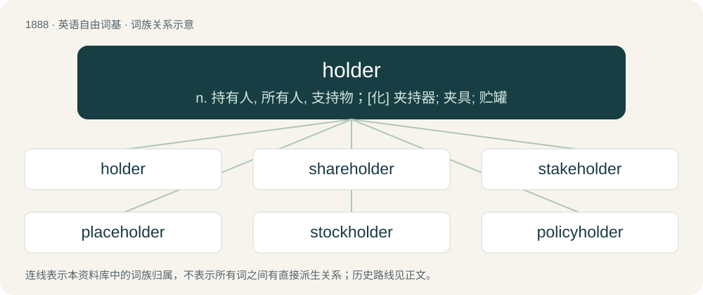

# 1997 · holder — n. 持有人, 所有人, 支持物；\[化\] 夹持器; 夹具; 贮罐

[总目录](../00_总目录_按常用程度.md)

**类型**：英语自由词基　｜　**来源语言**：见词源记录

## 核心含义与来源

- 核心含义：n. 持有人, 所有人, 支持物；\[化\] 夹持器; 夹具; 贮罐
- 英文含义：A thing that holds.
- 词形：holder

**来源记录 1**（名词；A thing that holds.）

From hold + -er.

## 词族图

## 单词速览（常用到不常用）

| 单词 | 音标 | 释义 |
|---|---|---|
| [holder](#w-1) | 英 /ˈhəʊldə/；美 /ˈhoʊɫdɚ/ | n. 持有人, 所有人, 支持物；\[化\] 夹持器; 夹具; 贮罐 |
| [shareholder](#w-2) | 英 /ˈʃɛəˌhəʊl.də(ɹ)/；美 /ˈʃɛɹˌhoʊl.dɚ/ | n. 股东；\[法\] 股东, 股票持有人 |
| [stakeholder](#w-3) | 英 /ˈsteɪkˌhəʊl.də/；美 /ˈsteɪkˌhoʊl.dɚ/ | n. 赌金保管者；\[法\] 赌款保存人, 保存保证金的人 |
| [placeholder](#w-4) | 美 /ˈpleɪsˌhoʊldɚ/ | n. 占位符；\[计\] 占位符 |
| [stockholder](#w-5) | 英 /ˈstɒk.həʊl.də/；美 /ˈstɑk.hoʊl.dɚ/ | n. 股东；\[法\] 股东, 股票持有者, 股票所有人 |
| [policyholder](#w-6) | /ˈpɒləsi.həuldə/ | n. 投保者, 保险客户 |
| [cardholder](#w-7) | /ˈkɑːd,həjldə(r)/ | n. 持有信用卡的人,持有正式成员证的人,(持卡可获得某种权利的)持卡人 |

## 逐词详解

### 1. holder

**词性**：名词　｜　**音标**：英 /ˈhəʊldə/；美 /ˈhoʊɫdɚ/

**中文释义**：n. 持有人, 所有人, 支持物；\[化\] 夹持器; 夹具; 贮罐

**英文义项**：A thing that holds. / A person who temporarily or permanently possesses something.

**构词拆分**：hold + -er

**词源与演化**：

From hold + -er.

**例句**：

> In 2012, there were 28 living holders of the Victoria Cross or the George Cross.

该用例对应义项：A person who temporarily or permanently possesses something.

### 2. shareholder

**词性**：名词　｜　**音标**：英 /ˈʃɛəˌhəʊl.də(ɹ)/；美 /ˈʃɛɹˌhoʊl.dɚ/

**中文释义**：n. 股东；\[法\] 股东, 股票持有人

**英文义项**：One who owns shares of stock in a corporation.

**构词拆分**：share + holder

**词源与演化**：

From share + holder.

**例句**：

> Shareholders are the real owners of a publicly traded business, but management runs it.

该用例对应义项：One who owns shares of stock in a corporation.

### 3. stakeholder

**词性**：名词　｜　**音标**：英 /ˈsteɪkˌhəʊl.də/；美 /ˈsteɪkˌhoʊl.dɚ/

**中文释义**：n. 赌金保管者；\[法\] 赌款保存人, 保存保证金的人

**英文义项**：A person holding the stakes of bettors, with the responsibility of delivering the pot to the winner of the bet. / A person such as a trustee, escrow agent or garnishee, who holds money or assets under trust for another party in a contractual agreement or as part of a claim.

**构词拆分**：stake + holder

**词源与演化**：

From stake + holder.

**例句**：

> The stakeholder most deeply affected by this decision is the chief executive officer.

### 4. placeholder

**词性**：名词　｜　**音标**：美 /ˈpleɪsˌhoʊldɚ/

**中文释义**：n. 占位符；\[计\] 占位符

**英文义项**：Something used or included temporarily or as a substitute for something that is not known or must remain generic; that which holds, denotes or reserves a place for something to come later. / A non-editable caption initially displayed in a blank text box to indicate its function.

**构词拆分**：place + holder

**词源与演化**：

From place + holder.

**例句**：

> This data is a placeholder, so you'll want to include the real numbers as soon as you have them.

该用例对应义项：Something used or included temporarily or as a substitute for something that is not known or must remain generic; that which holds, denotes or reserves a place for something to come later.

### 5. stockholder

**词性**：名词　｜　**音标**：英 /ˈstɒk.həʊl.də/；美 /ˈstɑk.hoʊl.dɚ/

**中文释义**：n. 股东；\[法\] 股东, 股票持有者, 股票所有人

**英文义项**：One who owns stock. / A company that maintains a stock of certain products.

**构词拆分**：stock + holder

**词源与演化**：

From stock + holder.

**例句**：

> Zumbeco are stockholders of round bar, flat bar and plate.

该用例对应义项：A company that maintains a stock of certain products.

### 6. policyholder

**词性**：名词　｜　**音标**：/ˈpɒləsi.həuldə/

**中文释义**：n. 投保者, 保险客户

**英文义项**：The party to an insurance contract who owns the policy and thus transfers a risk to an insurer (i.e., pays the insurer to take the risk).

**构词拆分**：policy + holder

**词源与演化**：

From policy + holder.

**例句**：

> The insurer will indemnify the policyholder against loss of or damage to the motor car.

### 7. cardholder

**词性**：名词　｜　**音标**：/ˈkɑːd,həjldə(r)/

**中文释义**：n. 持有信用卡的人,持有正式成员证的人,(持卡可获得某种权利的)持卡人

**英文义项**：A case for holding cards, as credit cards, bankcards, or business cards. / An authorized user of a card that is used for financial transactions, etc.

**构词拆分**：card + holder

**词源与演化**：

From card + holder.
