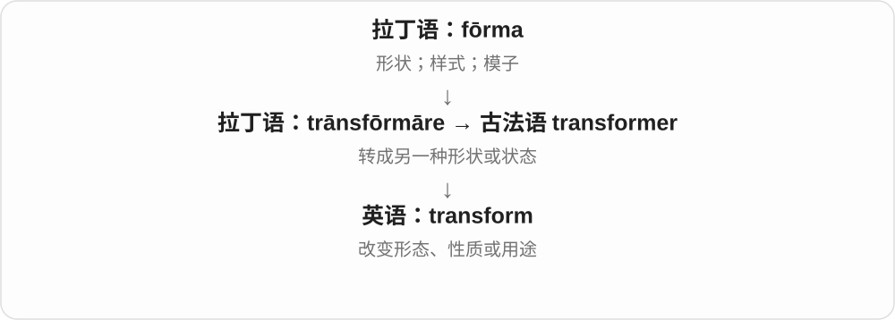
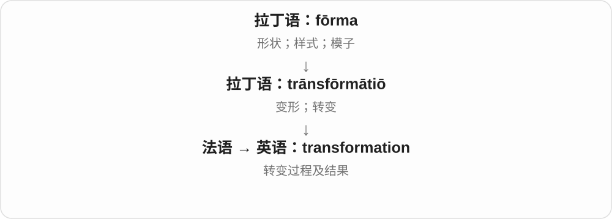

# 1997 · transform — 改变形态、面貌、性质和运作方式

[逐词精讲目录](../00_逐词精讲目录.md) · [总目录](../00_总目录_按常用程度.md)

## 核心词根与来源

先看动作与结果，再看执行转换的装置和具有变革作用的性质。变压器只是这份广义转换中的一个特定器物名称。

**TRANSFORM：从一种样子，变成另一种样子**

transform → transformation 转变过程、结果；transformer 转换装置；transformative 造成深刻改变的。

- **改变、改变的过程**：transform · transformation
- **执行者和变革性质**：transformer · transformative

## 词形与演化规律

trāns- + fōrmāre → trānsfōrmāre → transform；transform + -ation/-er；transformātīvus → transformative。

## 单词速览（按词族由简到繁）

同一基础词的相关扩展放在一起，先读基础形式，再读扩展；各组之间优先读常用的。具体词源关系见各词讲解。

| 单词 | 音标 | 核心意思 |
|---|---|---|
| [transform](#w-2) | 英 /trænsˈfɔːm/；美 /trænsˈfɔːrm/ | 彻底改变；变换 |
| [transformation](#w-1) | 英 /ˌtrænsfəˈmeɪʃən/；美 /ˌtrænsfərˈmeɪʃən/ | 转变；改造；变换 |
| [transformer](#w-3) | 英 /trænsˈfɔːmə/；美 /trænsˈfɔːrmər/ | 变压器；改变形态、状态的人或装置 |
| [transformative](#w-4) | 英 /trænsˈfɔːmətɪv/；美 /trænsˈfɔːrmətɪv/ | 带来深刻改变的、具有变革作用的 |

## 逐词讲解

### 1. transform — 彻底改变；变换

**音标**：英 /trænsˈfɔːm/；美 /trænsˈfɔːrm/

**先抓住这个画面**

旧仓库变成明亮的图书馆，还是那个地方，但用途和感觉都换了一个样。

**怎么拆**

来自拉丁语 trānsfōrmāre，经法语 transformer；trans- 表跨越、转变，接 fōrmāre“塑形”。

**怎么变成今天的意思**

不只外观改变，也能说经历改变了一个人的生活。技术用法可以是按规则把一种表示变为另一种表示。

**常见搭配与例句**

transform A into B；transform a space；transform someone’s life。

> They transformed the warehouse into a library.

他们把仓库改成了图书馆。

> The scholarship transformed her life.

那份奖学金改变了她的人生。

**别混淆**

change 范围很宽；transform 往往让人感觉改变明显，带来新的状态。

### 2. transformation — 转变；改造；变换

**音标**：英 /ˌtrænsfəˈmeɪʃən/；美 /ˌtrænsfərˈmeɪʃən/

**先抓住这个画面**

把从原先的样子走到新样子的整段变化，打包成一个名词。

**怎么拆**

经法语来自拉丁语 trānsfōrmātiō；与 transform 同族，现代可对应 transform + -ation。

**怎么变成今天的意思**

可以是城市改造、人的变化，也可以是数学变换。日常语境通常比一个小调整更明显。

**常见搭配与例句**

undergo a transformation；a remarkable transformation；digital transformation。

> The old station has undergone a remarkable transformation.

老车站经历了显著改造。

> The photos document her garden’s transformation over five years.

这些照片记录了她的花园五年间的变化。

**别混淆**

formation 是形成；transformation 是已经存在的东西变成另一个状态。

### 3. transformer — 变压器；改变形态、状态的人或装置

**音标**：英 /trænsˈfɔːmə/；美 /trænsˈfɔːrmər/

**先抓住这个画面**

工程里最常见的是让交流电的电压等按设计转换的装置；词形上先抓执行 transform 的东西，-er 不只限人。

**怎么拆**

transform + -er，器物、施事名。电学义是特定装置的名称，现代大写 Transformer 还可作作品、角色或技术专名，需按上下文分。

**怎么变成今天的意思**

**拉丁 trāns- + fōrmāre → trānsfōrmāre**  
跨到另一种形态，改变形状、面貌

↓

**英语 transform**  
改造、变形；改变性质、运作方式

↓

**transform + -er → transformer**  
实现转换的人、装置；电学变压器专门义

a power transformer 电力变压器，a step-down transformer 降压变压器，an electrical transformer 电学变压器。

**常见搭配与例句**

a power transformer；a step-down transformer；an electrical transformer。

> The diagram shows a transformer between the two circuits.

图示在两个电路之间画出了一台变压器。

> The equipment includes a small power transformer.

设备包含一台小型电力变压器。

**别混淆**

transformer 变压器和 adapter 适配器不完全等同；一个适配装置可能包含多种部件，不能只按中文转换就认为内部结构相同。

### 4. transformative — 带来深刻改变的、具有变革作用的

**音标**：英 /trænsˈfɔːmətɪv/；美 /trænsˈfɔːrmətɪv/

**先抓住这个画面**

变化不只换一层颜色，而是让生活、理解、做事方式发生大转变；a transformative experience 是经历之后人不太一样了。

**怎么拆**

历史接中世纪拉丁 transformātīvus 等，使用 trānsfōrmāt- 分词词干；现代可对应 transform + -ative 的形容词材料，不必断言现代英语先造长词才有拉丁形式。

**怎么变成今天的意思**

**拉丁 trāns- + fōrmāre → trānsfōrmāre**  
跨到另一种形态，改变形状、面貌

↓

**英语 transform**  
改造、变形；改变性质、运作方式

↓

**拉丁 transformāt- + -īvus → transformative**  
具有使之转变作用的形容词

a transformative experience 改变人生、认知的经历，transformative change 深刻变革，a transformative effect 深远改变作用。

**常见搭配与例句**

a transformative experience；transformative change；a transformative effect。

> Living abroad was a transformative experience for her.

在国外生活对她是一次改变人生的经历。

> The discovery had a transformative effect on the field.

这个发现给该领域带来了深刻改变。

**别混淆**

transformative 强调造成明显、深刻改变，不只说明东西有不同；transformational 在许多变革语境重叠，也有专门术语用法。

## 这一组要分清什么

transformer/adapter 具体装置类型不能全等；transformative 突出深刻改变；专名 Transformer 需看领域。

## 串起来练习

The new approach transformed the project and had a transformative effect on the team.

新方法改造了项目，也给团队带来了深刻改变。
