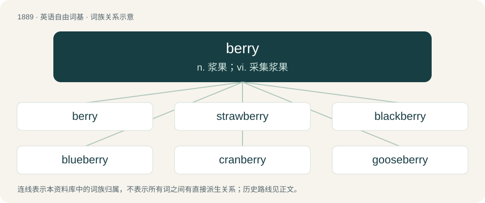

# 1998 · berry — n. 浆果；vi. 采集浆果

[总目录](../00_总目录_按常用程度.md)

**类型**：英语自由词基　｜　**来源语言**：见词源记录

## 核心含义与来源

- 核心含义：n. 浆果；vi. 采集浆果
- 英文含义：A small succulent fruit, of any one of many varieties.
- 词形：berry

**多个词源／构词路径**：同一拼写可能有不同来源；以下按词性和含义分别列出。

**来源记录 1**（名词；A small succulent fruit, of any one of many varieties.）

From Middle English berie, from Old English berġe, from Proto-West Germanic \*baʀi, from Proto-Germanic \*bazją. Cognate with Saterland Frisian Bäie, West Flemish beier, German Beere, Icelandic ber, Danish bær. The slang sense "police car" may come from the lights on the vehicles' roofs.

**来源记录 2**（名词；A mound; a barrow.）

From Middle English berȝe, berghe, from Old English beorġe, dative form of beorg (“mountain, hill, mound, barrow”), from Proto-West Germanic \*berg, from Proto-Germanic \*bergaz (“mountain, hill”). More at barrow. Cognates Cognate with Scots burrow (“mound, tumulus, barrow”), North Frisian Bārig, beerch, beeri, beerj, berag, berig, berri, bärj (“mountain”), Saterland Frisian Bierich, Bíerig, Bäirch (“mountain”), West Frisian berch (“mountain”), Cimbrian pèrge (“mountain”), Dutch berg (“mountain”), German Berg (“mountain”), German Low German Barg (“mountain”), Limburgish berg, Bärrech (“hill, mountain”), Luxembourgish Bierg (“mountain”), Mòcheno pèrg (“mountain”), Yiddish באַרג (barg, “mountain”), Danish bjerg (“mountain”), Faroese berg, bjarg (“cliff”), bjørg (“cliffs”), Icelandic, Norwegian Bokmål, Norwegian Nynorsk, and Swedish berg (“mountain”); also Northern Luri برگ (berg, “mountain”), Polish brzeg (“bank, shore”), Russian бе́рег (béreg, “bank, shore”).

**来源记录 3**（名词；A burrow, especially a rabbit's burrow.）

From Middle English bery (“a burrow”). More at burrow.

**来源记录 4**（动词；To beat; give a beating to; thrash.）

From Middle English beryen, berien, from Old English \*berian (found only in past participle ġebered (“crushed, kneaded, harassed, oppressed, vexed”)), from Proto-West Germanic \*barjan, from Proto-Germanic \*barjaną (“to beat, hit”), from Proto-Indo-European \*bʰerH- (“to rip, cut, split, grate”). Cognate with Scots berry, barry (“to thresh, thrash”), German beren (“to beat, knead”), Icelandic berja (“to beat”), Latin feriō (“strike, hit”, verb).

## 词族图

## 单词速览（常用到不常用）

| 单词 | 音标 | 释义 |
|---|---|---|
| [berry](#w-1) | 英 /ˈbɛɹi/ | n. 浆果；vi. 采集浆果 |
| [strawberry](#w-2) | 英 /ˈstɹɔːb(ə)ɹi/；美 /ˈstɹɔˌbɛɹi/ | n. 草莓 |
| [blackberry](#w-3) | 英 /ˈblækbəɹi/；美 /ˈblækbɛɹi/ | n. 刺, 黑莓；\[医\] 黑果莓 |
| [blueberry](#w-4) | 英 /ˈbluːb(ə)ɹi/；美 /ˈbluˌbɛ.ɹi/ | n. 乌饭树 |
| [cranberry](#w-5) | 英 /ˈkræn.b(ə).ri/；美 /ˈkɹæn.bɛr.i/ | n. 越橘 |
| [gooseberry](#w-6) | 英 /ˈɡʊzb(ə)ɹi/；美 /ˈɡusˌbɛɹi/ | n. 醋栗, 醋栗酒 |
| [elderberry](#w-7) | /ˈɛldə(ɹ)ˌbɛɹi/ | n. 接骨木属植物 |

## 逐词详解

### 1. berry

**词性**：动词　｜　**音标**：英 /ˈbɛɹi/

**中文释义**：n. 浆果；vi. 采集浆果

**英文义项**：To pick berries. / To bear or produce berries.

**词源与演化**：

From Middle English berie, from Old English berġe, from Proto-West Germanic \*baʀi, from Proto-Germanic \*bazją. Cognate with Saterland Frisian Bäie, West Flemish beier, German Beere, Icelandic ber, Danish bær. The slang sense "police car" may come from the lights on the vehicles' roofs.

**例句**：

> On summer days Grandma used to take us berrying, whether we wanted to go or not.

该用例对应义项：To pick berries.

### 2. strawberry

**词性**：名词　｜　**音标**：英 /ˈstɹɔːb(ə)ɹi/；美 /ˈstɹɔˌbɛɹi/

**中文释义**：n. 草莓

**英文义项**：The sweet, usually red, edible accessory fruit of certain plants of the genus Fragaria. / Any plant of the genus Fragaria (that bears such fruit).

**构词拆分**：straw + berry

**词源与演化**：

From Middle English strawberie, strawbery, from Old English strēawberġe, corresponding to straw + berry. Of various theories advanced to explain the name, the two most plausible are: # from the fact that wild strawberries grow on straw-like runners (compare Norwegian stråbær, denoting cranberries, which grow in a similar way); # from the practice, still common in parts of Europe, of gathering strawberries by stringing them on a straw or stalk.

**例句**：

> She has the best strawberry patch I've ever seen.

该用例对应义项：Any plant of the genus Fragaria (that bears such fruit).

### 3. blackberry

**词性**：名词　｜　**音标**：英 /ˈblækbəɹi/；美 /ˈblækbɛɹi/

**中文释义**：n. 刺, 黑莓；\[医\] 黑果莓

**英文义项**：A fruit-bearing shrub of the aggregate species Rubus fruticosus and some hybrids. / The soft fruit borne by this shrub, formed of a black (when ripe) cluster of drupelets.

**构词拆分**：black + berry

**词源与演化**：

From Middle English blakberie, blakeberie (“brambleberry”), from Old English blacu berġe, blæcberġe (attested in plural blaca berġan), equivalent to black + berry.

**例句**：

> The tayberry is a cultivated cross between a blackberry and a raspberry.

### 4. blueberry

**词性**：名词　｜　**音标**：英 /ˈbluːb(ə)ɹi/；美 /ˈbluˌbɛ.ɹi/

**中文释义**：n. 乌饭树

**英文义项**：An edible round berry, belonging to the cowberry group (Vaccinium sect. Cyanococcus), with flared crowns at the end, that turns blue on ripening. / The shrub of the above-mentioned berry.

**构词拆分**：blue + berry

**词源与演化**：

From blue + berry.

**例句**：

> He prepared the blueberry sauce with which to flavor the duck.

### 5. cranberry

**词性**：名词　｜　**音标**：英 /ˈkræn.b(ə).ri/；美 /ˈkɹæn.bɛr.i/

**中文释义**：n. 越橘

**英文义项**：A shrub belonging to the section Vaccinium sect. Oxycoccus of the genus Vaccinium. / The edible red berry of that shrub.

**构词拆分**：cran- + berry

**词源与演化**：

Adapted in the 1640s from Dutch Low Saxon or German Low German Kraanbeere, from Kraan m (which means and is cognate with crane) + Beere f (which means and is cognate with berry). Equivalent to cran- + berry. Via PIE cognate with Polish żurawina, Ukrainian журавли́на (žuravlýna) (akin to жураве́ль (žuravélʹ, “crane”)); Latvian dzērvene &lt; dzērve (“crane”).

**例句**：

> Many will serve traditional foods like turkey, stuffing, sweet potatoes and cranberry sauce.

### 6. gooseberry

**词性**：名词　｜　**音标**：英 /ˈɡʊzb(ə)ɹi/；美 /ˈɡusˌbɛɹi/

**中文释义**：n. 醋栗, 醋栗酒

**英文义项**：A fruit of species Ribes uva-crispa, related to the currant. / Any other plant or fruit in the subgenus Grossularia, distinguished from currants by bearing spines, including Ribes hirtellum (American gooseberry).

**构词拆分**：goose + berry

**词源与演化**：

From goose + berry. It is possible that the first element was originally something related to the gros- of French groseille and/or the kruis- of Dutch kruisbes but has been altered by folk etymology.

**例句**：

> Robert and Susan were so in love with each other that nobody could go near them without feeling like a gooseberry.

该用例对应义项：An additional person who is neither necessary nor wanted in a given situation.

### 7. elderberry

**词性**：名词　｜　**音标**：/ˈɛldə(ɹ)ˌbɛɹi/

**中文释义**：n. 接骨木属植物

**英文义项**：Any shrub or tree of the genus Sambucus; / The small, edible, purplish-black fruit of this plant, used in cooking and to flavour drinks etc.

**构词拆分**：elder + berry

**词源与演化**：

Compound of elder + berry.
