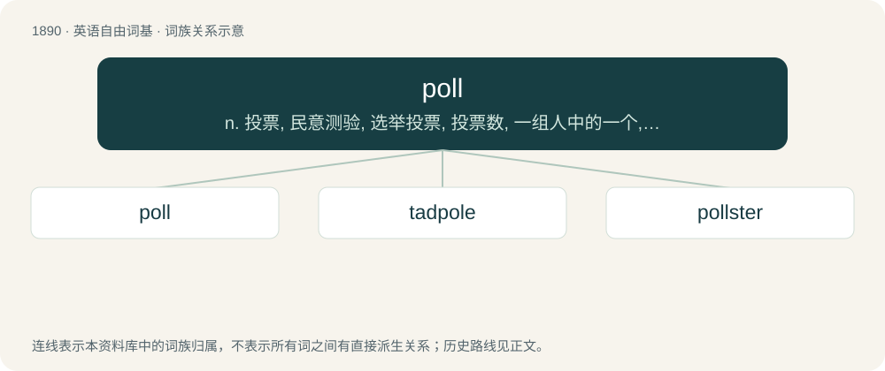

# 1999 · poll — n. 投票, 民意测验, 选举投票, 投票数, 一组人中的一个, 头颈和后脑部, 鹦鹉；vt. 对...进行民意测验, 获得...票, 剪树枝, 轮询；vi. 投票

[总目录](../00_总目录_按常用程度.md)

**类型**：英语自由词基　｜　**来源语言**：见词源记录

## 核心含义与来源

- 核心含义：n. 投票, 民意测验, 选举投票, 投票数, 一组人中的一个, 头颈和后脑部, 鹦鹉；vt. 对...进行民意测验, 获得...票, 剪树枝, 轮询；vi. 投票
- 英文含义：A survey of people, usually statistically analyzed to gauge wider public opinion.
- 词形：poll

**多个词源／构词路径**：同一拼写可能有不同来源；以下按词性和含义分别列出。

**来源记录 1**（名词；A survey of people, usually statistically analyzed to gauge wider public opinion.）

From Middle English pol, polle ("scalp, pate"), from or cognate with Middle Dutch pol, pōle, polle (“top, summit; head”), from Proto-West Germanic \*poll, from Proto-Germanic \*pullaz (“round object, head, top”), from Proto-Indo-European \*bolno-, \*bōwl- (“orb, round object, bubble”), from Proto-Indo-European \*bew- (“to blow, swell”). Akin to Scots pow (“head, crown, scalp, skull”), Saterland Frisian pol (“round, full, brimming”, adjective), German Low German Polle, Poll (“round object, ball”), German Low German Poller (“head, tree-top, bulb”), Danish puld (“crown of a hat”), Swedish dialectal pull (“head”). Meaning "collection of votes" is first recorded 1625, from the notion of "counting heads".

**来源记录 2**（名词；A pet parrot.）

Perhaps a shortening of Polly, a common name for pet parrots.

**来源记录 3**（名词；One who does not try for honors at university, but is content to take a degree merely; a passman.）

From Ancient Greek πολλοί (polloí, “the many, the masses”), as in hoi polloi.

## 词族图

## 单词速览（常用到不常用）

| 单词 | 音标 | 释义 |
|---|---|---|
| [poll](#w-1) | 英 /pəʊl/；美 /poʊl/ | n. 投票, 民意测验, 选举投票, 投票数, 一组人中的一个, 头颈和后脑部, 鹦鹉；vt. 对...进行民意测验, 获得...票, 剪树枝, 轮询；vi. 投票 |
| [tadpole](#w-2) | /ˈtædpoʊl/ | n. 蝌蚪 |
| [pollster](#w-3) | 美 /ˈpoʊlstɚ/ | n. 民意调查人, 民意测验经办人 |

## 逐词详解

### 1. poll

**词性**：名词　｜　**音标**：英 /pəʊl/；美 /poʊl/

**中文释义**：n. 投票, 民意测验, 选举投票, 投票数, 一组人中的一个, 头颈和后脑部, 鹦鹉；vt. 对...进行民意测验, 获得...票, 剪树枝, 轮询；vi. 投票

**英文义项**：A survey of people, usually statistically analyzed to gauge wider public opinion. / A formal vote held in order to ascertain the most popular choice.

**词源与演化**：

From Middle English pol, polle ("scalp, pate"), from or cognate with Middle Dutch pol, pōle, polle (“top, summit; head”), from Proto-West Germanic \*poll, from Proto-Germanic \*pullaz (“round object, head, top”), from Proto-Indo-European \*bolno-, \*bōwl- (“orb, round object, bubble”), from Proto-Indo-European \*bew- (“to blow, swell”). Akin to Scots pow (“head, crown, scalp, skull”), Saterland Frisian pol (“round, full, brimming”, adjective), German Low German Polle, Poll (“round object, ball”), German Low German Poller (“head, tree-top, bulb”), Danish puld (“crown of a hat”), Swedish dialectal pull (“head”). Meaning "collection of votes" is first recorded 1625, from the notion of "counting heads".

**例句**：

> The student council had a poll to see what people want served in the cafeteria.

该用例对应义项：A formal vote held in order to ascertain the most popular choice.

### 2. tadpole

**词性**：名词　｜　**音标**：/ˈtædpoʊl/

**中文释义**：n. 蝌蚪

**英文义项**：A young toad or frog in its larval stage of development that lives in water, has a tail and no legs, and, like a fish, breathes through gills. / The aquatic larva of any amphibian.

**构词拆分**：toad + poll (“head”)

**词源与演化**：

From Middle English tadpolle, taddepol, equivalent to toad + poll (“head”).

**用法示例／搭配（非完整句）**：

> salamander tadpole

该用例对应义项：The aquatic larva of any amphibian.

### 3. pollster

**词性**：名词　｜　**音标**：美 /ˈpoʊlstɚ/

**中文释义**：n. 民意调查人, 民意测验经办人

**英文义项**：A professional who conducts or analyzes opinion polls.

**构词拆分**：poll + -ster

**词源与演化**：

From poll + -ster.

**例句**：

> Trump didn't like the results of the polls, so he fired the pollsters.

该用例对应义项：A professional who conducts or analyzes opinion polls.
