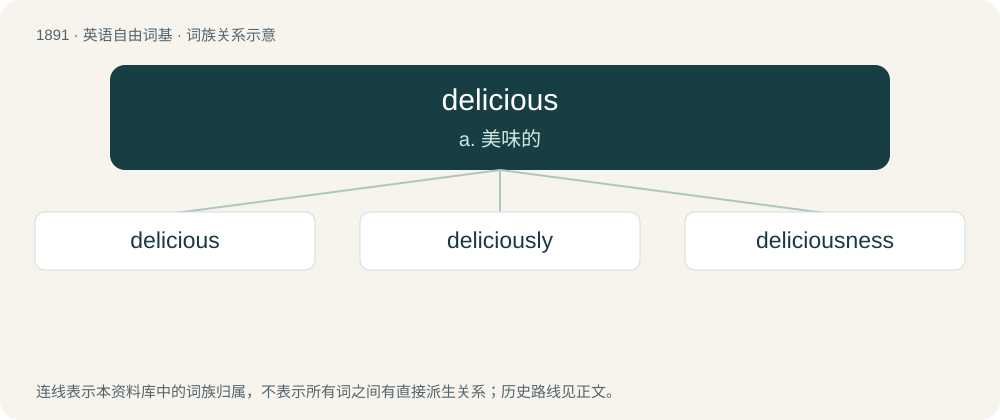

# 2001 · delicious — a. 美味的

[总目录](../00_总目录_按常用程度.md)

**类型**：英语自由词基　｜　**来源语言**：见词源记录

## 核心含义与来源

- 核心含义：a. 美味的
- 英文含义：Pleasing to the sense of taste; tasty.
- 词形：delicious

**来源记录 1**（形容词；Pleasing to the sense of taste; tasty.）

From Middle English delicious, from Anglo-Norman delicious, from Old French delicious, delicieux, from Late Latin dēliciōsus (“delicate, delicious”), from dēliciae (“delights”), plural of dēlicia (“pleasure”), from delicere (“to allure, to entice”), from de- (“away”) + laciō (“to lure, deceive”), from Proto-Italic \*lakjō (“to draw, pull”), of unknown ultimate origin. Displaced native Old English ārlīċ (“delicious”).

## 词族图

## 单词速览（常用到不常用）

| 单词 | 音标 | 释义 |
|---|---|---|
| [delicious](#w-1) | 英 /dɪˈlɪ.ʃəs/；美 /dɪˈlɪ.ʃəs/ | a. 美味的 |
| [deliciously](#w-2) | 美 /dəˈlɪ.ʃəs.li/ | adv. 美味地, 芬香地 |
| [deliciousness](#w-3) | /diˈliʃəsnis/ | n. 美味；怡人；芬芳 |

## 逐词详解

### 1. delicious

**词性**：形容词　｜　**音标**：英 /dɪˈlɪ.ʃəs/；美 /dɪˈlɪ.ʃəs/

**中文释义**：a. 美味的

**英文义项**：Pleasing to the sense of taste; tasty. / Pleasing to a person's taste; pleasing to the eyes or mind.

**词源与演化**：

From Middle English delicious, from Anglo-Norman delicious, from Old French delicious, delicieux, from Late Latin dēliciōsus (“delicate, delicious”), from dēliciae (“delights”), plural of dēlicia (“pleasure”), from delicere (“to allure, to entice”), from de- (“away”) + laciō (“to lure, deceive”), from Proto-Italic \*lakjō (“to draw, pull”), of unknown ultimate origin. Displaced native Old English ārlīċ (“delicious”).

**例句**：

> The irony is delicious!

该用例对应义项：Pleasing to a person's taste; pleasing to the eyes or mind.

### 2. deliciously

**词性**：副词　｜　**音标**：美 /dəˈlɪ.ʃəs.li/

**中文释义**：adv. 美味地, 芬香地

**英文义项**：In a delicious manner.

**构词拆分**：delicious + -ly

**词源与演化**：

From delicious + -ly.

**例句**：

> They were walking along the beach slowly and deliciously.

该用例对应义项：in a very pleasurable manner

### 3. deliciousness

**词性**：名词　｜　**音标**：/diˈliʃəsnis/

**中文释义**：n. 美味；怡人；芬芳

**英文义项**：The state or quality of being delicious.

**构词拆分**：delicious + -ness

**词源与演化**：

From delicious + -ness.

**例句**：

> Today's stew has been carefully and slowly boiled to perfect deliciousness.
