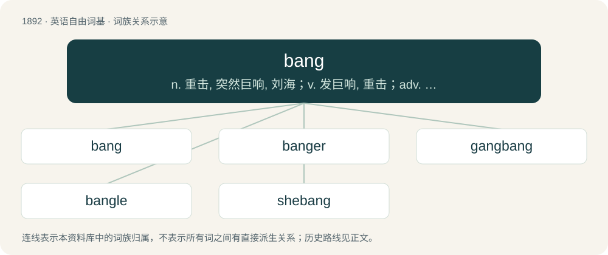

# 2002 · bang — n. 重击, 突然巨响, 刘海；v. 发巨响, 重击；adv. 砰然地, 突然巨响地, 直接地

[总目录](../00_总目录_按常用程度.md)

**类型**：英语自由词基　｜　**来源语言**：见词源记录

## 核心含义与来源

- 核心含义：n. 重击, 突然巨响, 刘海；v. 发巨响, 重击；adv. 砰然地, 突然巨响地, 直接地
- 英文含义：A sudden percussive noise.
- 词形：bang

**来源记录 1**（名词；A sudden percussive noise.）

From Middle English \*bangen, from Old English \*bangian or borrowed from Old Norse banga (“to pound, hammer”); both from Proto-Germanic \*bangōną (“to beat, pound”), from Proto-Indo-European \*bʰen- (“to beat, hit, injure”). Cognate with Scots bang, bung (“to strike, bang, hurl, thrash, offend”), Icelandic banga (“to pound, hammer”), Old Swedish bånga ("to hammer"; whence modern Swedish banka (“to knock, pound, bang”)), Danish banke (“to beat”), bengel (“club”), Low German bangen, bangeln (“to strike, beat”), West Frisian bingel, bongel, Dutch bengel (“bell; rascal”), German Bengel (“club”), bungen (“to throb, pulsate”). In the sense of a fringe of hair, from bang off. In the sense of abrupt left turn, from Boston left and associated risk of a crash.

## 词族图

## 单词速览（常用到不常用）

| 单词 | 音标 | 释义 |
|---|---|---|
| [bang](#w-1) | 英 /ˈbæŋ/；/ˈbeɪ̯ŋ/ | n. 重击, 突然巨响, 刘海；v. 发巨响, 重击；adv. 砰然地, 突然巨响地, 直接地 |
| [banger](#w-2) | 英 /ˈbæŋ.ə/；/ˈbæŋ.ɚ/ | n. 敲打的人, 砰然作响的东西, 香肠, 鞭炮, 旧汽车 |
| [gangbang](#w-3) | 美 /ˈɡeɪ̯ŋˌbeɪ̯ŋ/；/ˈɡæŋˌbæŋ/ | n. \[美俚\]一群男子（流氓团伙）与一女子的淫乱活动；轮奸 |
| [bangle](#w-4) | /ˈbæŋ.ɡəl/ | 【英文】(falconry) to beat about in the air; flutter: said of a hawk which does not rise steadily and then swoop down upon its prey. |
| [shebang](#w-5) | /ʃɪˈbæŋ(ɡ)/ | 【英文】The character string "#!" used at the beginning of a computer file to indicate which interpreter can process the commands in the file, chiefly used in Unix and related operating systems. |

## 逐词详解

### 1. bang

**词性**：名词　｜　**音标**：英 /ˈbæŋ/；/ˈbeɪ̯ŋ/

**中文释义**：n. 重击, 突然巨响, 刘海；v. 发巨响, 重击；adv. 砰然地, 突然巨响地, 直接地

**英文义项**：A sudden percussive noise. / A heavy strike upon an object causing such a noise.

**词源与演化**：

From Middle English \*bangen, from Old English \*bangian or borrowed from Old Norse banga (“to pound, hammer”); both from Proto-Germanic \*bangōną (“to beat, pound”), from Proto-Indo-European \*bʰen- (“to beat, hit, injure”). Cognate with Scots bang, bung (“to strike, bang, hurl, thrash, offend”), Icelandic banga (“to pound, hammer”), Old Swedish bånga ("to hammer"; whence modern Swedish banka (“to knock, pound, bang”)), Danish banke (“to beat”), bengel (“club”), Low German bangen, bangeln (“to strike, beat”), West Frisian bingel, bongel, Dutch bengel (“bell; rascal”), German Bengel (“club”), bungen (“to throb, pulsate”). In the sense of a fringe of hair, from bang off. In the sense of abrupt left turn, from Boston left and associated risk of a crash.

**例句**：

> When he pushed the detonator, the bang blew him off his feet.

该用例对应义项：An explosion.

### 2. banger

**词性**：名词　｜　**音标**：英 /ˈbæŋ.ə/；/ˈbæŋ.ɚ/

**中文释义**：n. 敲打的人, 砰然作响的东西, 香肠, 鞭炮, 旧汽车

**英文义项**：A firework that makes a bang. / A person who has sex.

**构词拆分**：bang + -er

**词源与演化**：

From bang + -er. The sausages were so called because of their excess water content and impervious skin, leading to the risk of explosion if not punctured before cooking.

**例句**：

> He drives a little four-banger to work.

该用例对应义项：A car or an engine; referring to the cylinders of an engine in a car. From the explosive bangs on every cylinder firing.

### 3. gangbang

**词性**：动词　｜　**音标**：美 /ˈɡeɪ̯ŋˌbeɪ̯ŋ/；/ˈɡæŋˌbæŋ/

**中文释义**：n. \[美俚\]一群男子（流氓团伙）与一女子的淫乱活动；轮奸

**英文义项**：To participate in a gangbang. / To belong to a gang; to commit criminal acts as part of a gang.

**构词拆分**：gang + bang

**词源与演化**：

From gang + bang.

**例句**：

> It broke my heart to see him out there gangbanging.

该用例对应义项：To belong to a gang; to commit criminal acts as part of a gang.

### 4. bangle

**词性**：动词　｜　**音标**：/ˈbæŋ.ɡəl/

**英文义项**：(falconry) to beat about in the air; flutter: said of a hawk which does not rise steadily and then swoop down upon its prey. / to flap or hang down loosely, as a hat brim or an animal's ear.

**构词拆分**：bang + -le (frequentative suffix)

**词源与演化**：

Unknown, yet probably from bang + -le (frequentative suffix).

### 5. shebang

**词性**：名词　｜　**音标**：/ʃɪˈbæŋ(ɡ)/

**英文义项**：The character string "#!" used at the beginning of a computer file to indicate which interpreter can process the commands in the file, chiefly used in Unix and related operating systems.

**构词拆分**：hash + bang；sharp + bang

**词源与演化**：

From hash + bang or sharp + bang, after Etymology 1.
