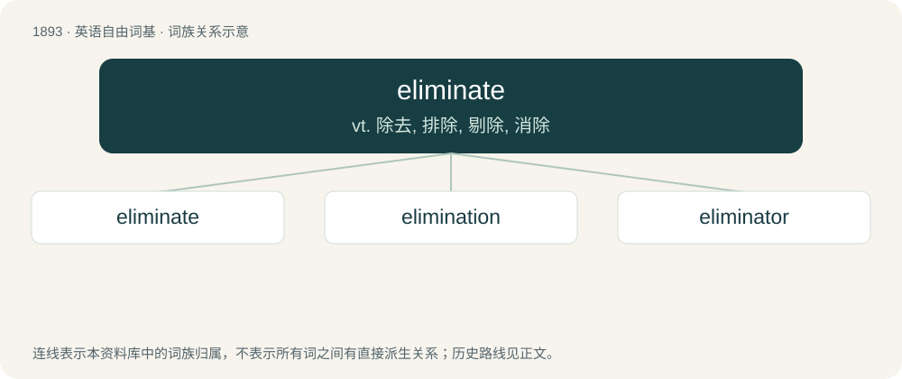

# 2003 · eliminate — vt. 除去, 排除, 剔除, 消除

[总目录](../00_总目录_按常用程度.md)

**类型**：英语自由词基　｜　**来源语言**：见词源记录

## 核心含义与来源

- 核心含义：vt. 除去, 排除, 剔除, 消除
- 英文含义：To completely remove, get rid of, put an end to.
- 词形：eliminate

**来源记录 1**（动词；To completely remove, get rid of, put an end to.）

Borrowed from Latin ēlīminātus, perfect passive participle of ēlīminō (“to turn out of doors, banish”), from ē- + līmen (“a threshold”, līmin- in compounds) + -ō (first conjugation verb-forming suffix) (see -ate (verb-forming suffix)), akin to Latin līmes (“a boundary”); see also English limit and limen.

## 词族图

## 单词速览（常用到不常用）

| 单词 | 音标 | 释义 |
|---|---|---|
| [eliminate](#w-1) | 英 /ɪˈlɪm.ɪ.neɪt/；美 /ɪˈlɪm.ɪ.neɪt/ | vt. 除去, 排除, 剔除, 消除 |
| [elimination](#w-2) | /ɪlɪmɪˈneɪʃ(ə)n/ | n. 除去, 消除, 消灭；\[化\] 消去; 脱去 |
| [eliminator](#w-3) | /iˈlimineitə/ | n. 排除者, 消除器；\[计\] 消除器, 抑制器, 限制器 |

## 逐词详解

### 1. eliminate

**词性**：动词　｜　**音标**：英 /ɪˈlɪm.ɪ.neɪt/；美 /ɪˈlɪm.ɪ.neɪt/

**中文释义**：vt. 除去, 排除, 剔除, 消除

**英文义项**：To completely remove, get rid of, put an end to. / To render (a facility) unusable, to destroy it; to disable (a soldier), make them unable to fight (typically but not necessarily by killing)

**词源与演化**：

Borrowed from Latin ēlīminātus, perfect passive participle of ēlīminō (“to turn out of doors, banish”), from ē- + līmen (“a threshold”, līmin- in compounds) + -ō (first conjugation verb-forming suffix) (see -ate (verb-forming suffix)), akin to Latin līmes (“a boundary”); see also English limit and limen.

**例句**：

> Let's eliminate the course on Akkadian hieroglyphics.

该用例对应义项：terminate, end, or take out

### 2. elimination

**词性**：名词　｜　**音标**：/ɪlɪmɪˈneɪʃ(ə)n/

**中文释义**：n. 除去, 消除, 消灭；\[化\] 消去; 脱去

**英文义项**：The act of eliminating, expelling or throwing off. / The act of excluding a losing contestant from a match, tournament, or other competition.

**构词拆分**：eliminate + -ion

**词源与演化**：

Borrowed from Latin ēliminātiō, from eliminate + -ion.

**例句**：

> Everton require at least 3 goals in the second leg to avoid elimination from the FA Cup.

该用例对应义项：The act of excluding a losing contestant from a match, tournament, or other competition.

### 3. eliminator

**词性**：名词　｜　**音标**：/iˈlimineitə/

**中文释义**：n. 排除者, 消除器；\[计\] 消除器, 抑制器, 限制器

**英文义项**：One who, or that which, eliminates.

**构词拆分**：From eliminate + -or.

**词源与演化**：

From eliminate + -or.
