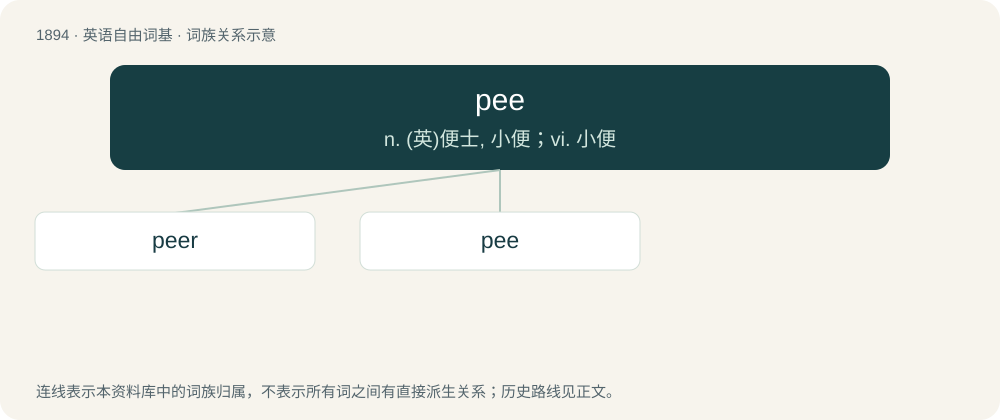

# 2004 · pee — n. (英)便士, 小便；vi. 小便

[总目录](../00_总目录_按常用程度.md)

**类型**：英语自由词基　｜　**来源语言**：见词源记录

## 核心含义与来源

- 核心含义：n. (英)便士, 小便；vi. 小便
- 英文含义：Urine.
- 词形：pee

**多个词源／构词路径**：同一拼写可能有不同来源；以下按词性和含义分别列出。

**来源记录 1**（名词；Urine.）

The initial letter of piss. Compare eff.

**来源记录 2**（名词；Pence; penny (a quantity of money)）

Spelling of the abbreviation p of pence.

**来源记录 3**（名词；The bill of an anchor.）

See peak.

## 词族图

## 单词速览（常用到不常用）

| 单词 | 音标 | 释义 |
|---|---|---|
| [peer](#w-1) | 英 /piː.ə/；美 /pi.ɚ/ | 【英文】Someone who pees, someone who urinates. |
| [pee](#w-2) | /ˈpiː/ | n. (英)便士, 小便；vi. 小便 |

## 逐词详解

### 1. peer

**词性**：名词　｜　**音标**：英 /piː.ə/；美 /pi.ɚ/

**英文义项**：Someone who pees, someone who urinates.

**构词拆分**：pee + -er

**词源与演化**：

pee + -er

### 2. pee

**词性**：名词　｜　**音标**：/ˈpiː/

**中文释义**：n. (英)便士, 小便；vi. 小便

**英文义项**：Urine. / An act of urination.

**词源与演化**：

The initial letter of piss. Compare eff.

**例句**：

> I have to go for an urgent pee.

该用例对应义项：An act of urination.
