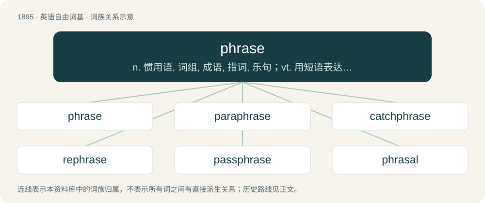

# 2006 · phrase — n. 惯用语, 词组, 成语, 措词, 乐句；vt. 用短语表达, 把(乐曲)分成短句；\[计\] 短语

[总目录](../00_总目录_按常用程度.md)

**类型**：英语自由词基　｜　**来源语言**：见词源记录

## 核心含义与来源

- 核心含义：n. 惯用语, 词组, 成语, 措词, 乐句；vt. 用短语表达, 把(乐曲)分成短句；\[计\] 短语
- 英文含义：A short written or spoken expression.
- 词形：phrase

**来源记录 1**（名词；A short written or spoken expression.）

Borrowed from Late Latin phrasis (“diction”), from Ancient Greek φράσις (phrásis, “manner of expression”), from φράζω (phrázō, “to tell, express”).

## 词族图

## 单词速览（常用到不常用）

| 单词 | 音标 | 释义 |
|---|---|---|
| [phrase](#w-1) | 英 /ˈfɹeɪ̯z/ | n. 惯用语, 词组, 成语, 措词, 乐句；vt. 用短语表达, 把(乐曲)分成短句；\[计\] 短语 |
| [paraphrase](#w-2) | /ˈpæɹəfɹeɪz/ | n. 释义, 解述, 改写；vt. 改写, 解述；vi. 释义, 意译 |
| [catchphrase](#w-3) | /ˈkætʃfreiz/ | n. 吸引人们注意的话/字句 |
| [rephrase](#w-4) | /riːˈfreiz/ | vt. 改述, 改撰 |
| [passphrase](#w-5) |  | n. 密码 |
| [phrasal](#w-6) | /ˈfɹeɪzəl/ | a. (含有)短语的, 成语的, 惯用语的, 用语上的, 乐句的 |

## 逐词详解

### 1. phrase

**词性**：名词　｜　**音标**：英 /ˈfɹeɪ̯z/

**中文释义**：n. 惯用语, 词组, 成语, 措词, 乐句；vt. 用短语表达, 把(乐曲)分成短句；\[计\] 短语

**英文义项**：A short written or spoken expression. / A word or, more commonly, a group of words that functions as a single unit in the syntax of a sentence, always containing an expressed or implied head (the principal word or subgroup, with core importance) and often consisting of a head plus some other elaborating words.

**词源与演化**：

Borrowed from Late Latin phrasis (“diction”), from Ancient Greek φράσις (phrásis, “manner of expression”), from φράζω (phrázō, “to tell, express”).

**例句**：

> I've made progress, but this is still, in Churchill's phrase, just "the end of the beginning."

该用例对应义项：A short written or spoken expression.

### 2. paraphrase

**词性**：名词　｜　**音标**：/ˈpæɹəfɹeɪz/

**中文释义**：n. 释义, 解述, 改写；vt. 改写, 解述；vi. 释义, 意译

**英文义项**：A restatement of a text in different words, often to clarify meaning or from memory rather than verbatim. / One of a certain number of Scripture passages turned into verse for use in the service of praise.

**构词拆分**：para- + phrase

**词源与演化**：

From Middle French paraphrase, from Latin paraphrasis, from Ancient Greek παράφρασις (paráphrasis), equivalent to para- + phrase. Doublet of paraphrasis.

**例句**：

> The article included a brief paraphrase of the speech.

该用例对应义项：A restatement of a text in different words, often to clarify meaning or from memory rather than verbatim.

### 3. catchphrase

**词性**：名词　｜　**音标**：/ˈkætʃfreiz/

**中文释义**：n. 吸引人们注意的话/字句

**英文义项**：A repeated expression, often originating in popular culture. / A signature phrase of a particular person or group.

**构词拆分**：catch + phrase

**词源与演化**：

From catch + phrase, from the notion that the phrase will catch in the mind of the user.

**例句**：

> You don't even have a catchphrase.

### 4. rephrase

**词性**：动词　｜　**音标**：/riːˈfreiz/

**中文释义**：vt. 改述, 改撰

**英文义项**：To say or write something with different wording.

**构词拆分**：re- + phrase

**词源与演化**：

From re- + phrase.

**例句**：

> Make sure to rephrase your thesis in your conclusion.

该用例对应义项：To say or write something with different wording.

### 5. passphrase

**词性**：名词

**中文释义**：n. 密码

**英文义项**：A password that comprises a whole phrase.

**构词拆分**：pass + phrase

**词源与演化**：

From pass + phrase.

### 6. phrasal

**词性**：形容词　｜　**音标**：/ˈfɹeɪzəl/

**中文释义**：a. (含有)短语的, 成语的, 惯用语的, 用语上的, 乐句的

**英文义项**：Relating to, or used in the manner of, a phrase. / Consisting of multiple words, but behaving as a single part of speech.

**构词拆分**：From phrase + -al.

**词源与演化**：

From phrase + -al.

**例句**：

> I can see why non-native speakers find phrasal verbs so frustrating.
