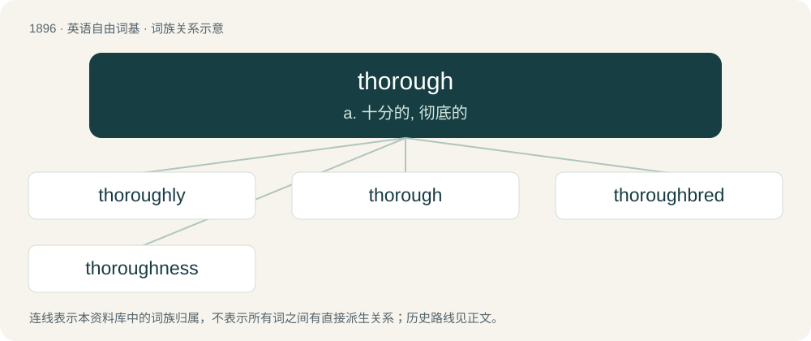

# 2007 · thorough — a. 十分的, 彻底的

[总目录](../00_总目录_按常用程度.md)

**类型**：英语自由词基　｜　**来源语言**：见词源记录

## 核心含义与来源

- 核心含义：a. 十分的, 彻底的
- 英文含义：Painstaking and careful not to miss or omit any detail.
- 词形：thorough

**来源记录 1**（形容词；Painstaking and careful not to miss or omit any detail.）

From Middle English thoruȝ, þoruȝ, from Old English þuruh, a byform of Old English þurh, whence comes English through. The adjective derives from the preposition and adverb. The word developed a syllabic form in cases where the word was fully stressed: when it was used as an adverb, adjective, or noun, and less commonly when used as a preposition.

## 词族图

## 单词速览（常用到不常用）

| 单词 | 音标 | 释义 |
|---|---|---|
| [thoroughly](#w-1) | 英 /ˈθʌɹ.ə.li/；/ˈθɜɹ.ə.li/ | adv. 彻底地, 绝对地, 透彻地, 详尽地, 周到地, 完全地, 完善地, 全面地 |
| [thorough](#w-2) | 英 /ˈθʌɹə/；美 /ˈθʌɹoʊ/ | a. 十分的, 彻底的 |
| [thoroughbred](#w-3) | /ˈθʌrəbred/ | a. 受过严格训练的, 良种的；n. 受过严格训练的人, 良种动物 |
| [thoroughness](#w-4) | 英 /ˈθʌɹənəs/；美 /ˈθʌɹoʊnəs/ | n. 十分, 完全；彻底 |

## 逐词详解

### 1. thoroughly

**词性**：副词　｜　**音标**：英 /ˈθʌɹ.ə.li/；/ˈθɜɹ.ə.li/

**中文释义**：adv. 彻底地, 绝对地, 透彻地, 详尽地, 周到地, 完全地, 完善地, 全面地

**英文义项**：In a thorough or complete manner.

**构词拆分**：thorough + -ly

**词源与演化**：

From thorough + -ly.

**例句**：

> The editor looked thoroughly for any mistakes in the paper.

该用例对应义项：In a thorough or complete manner.

### 2. thorough

**词性**：形容词　｜　**音标**：英 /ˈθʌɹə/；美 /ˈθʌɹoʊ/

**中文释义**：a. 十分的, 彻底的

**英文义项**：Painstaking and careful not to miss or omit any detail. / Utter; complete; absolute.

**词源与演化**：

From Middle English thoruȝ, þoruȝ, from Old English þuruh, a byform of Old English þurh, whence comes English through. The adjective derives from the preposition and adverb. The word developed a syllabic form in cases where the word was fully stressed: when it was used as an adverb, adjective, or noun, and less commonly when used as a preposition.

**例句**：

> The infested house needs a thorough cleansing before being inhabitable again.

该用例对应义项：Painstaking and careful not to miss or omit any detail.

### 3. thoroughbred

**词性**：名词　｜　**音标**：/ˈθʌrəbred/

**中文释义**：a. 受过严格训练的, 良种的；n. 受过严格训练的人, 良种动物

**英文义项**：Any purebred horse. / A person of uncommon strength or endurance (like that of a thoroughbred horse).

**构词拆分**：thorough + bred

**词源与演化**：

From thorough + bred.

**例句**：

> That athlete is a real thoroughbred.

该用例对应义项：A person of uncommon strength or endurance (like that of a thoroughbred horse).

### 4. thoroughness

**词性**：名词　｜　**音标**：英 /ˈθʌɹənəs/；美 /ˈθʌɹoʊnəs/

**中文释义**：n. 十分, 完全；彻底

**英文义项**：The state of being thorough. / Attention to detail.

**构词拆分**：thorough + -ness

**词源与演化**：

From thorough + -ness.

**例句**：

> I appreciate the thoroughness of your report.
