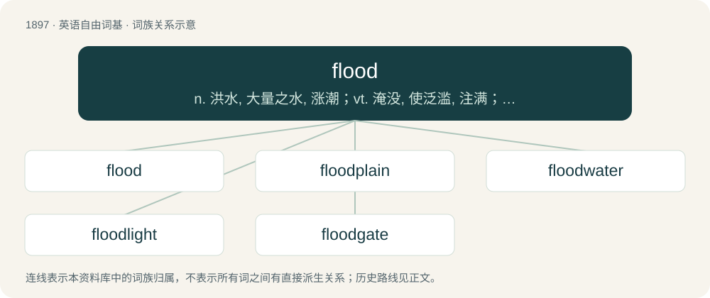

# 2009 · flood — n. 洪水, 大量之水, 涨潮；vt. 淹没, 使泛滥, 注满；vi. 被淹, 溢出, 涌进

[总目录](../00_总目录_按常用程度.md)

**类型**：英语自由词基　｜　**来源语言**：见词源记录

## 核心含义与来源

- 核心含义：n. 洪水, 大量之水, 涨潮；vt. 淹没, 使泛滥, 注满；vi. 被淹, 溢出, 涌进
- 英文含义：An overflow of a large amount of water (usually disastrous) from a lake or other body of water due to excessive rainfall or other input of water.
- 词形：flood

**来源记录 1**（名词；An overflow of a large amount of water (usually disastrous) from a lake or other body of water due to excessive rainfall or other input of water.）

Inherited from Middle English flod, from Old English flōd, from Proto-West Germanic \*flōdu, from Proto-Germanic \*flōduz, from Proto-Indo-European \*pleh₃(w)-. Cognate with Scots flude, fluid, Saterland Frisian Floud, Dutch vloed, German Flut, Danish, Norwegian Bokmål, Norwegian Nynorsk, and Swedish flod, Icelandic flóð, and Gothic 𐍆𐌻𐍉𐌳𐌿𐍃 (flōdus).

## 词族图

## 单词速览（常用到不常用）

| 单词 | 音标 | 释义 |
|---|---|---|
| [flood](#w-1) | /flʌd/ | n. 洪水, 大量之水, 涨潮；vt. 淹没, 使泛滥, 注满；vi. 被淹, 溢出, 涌进 |
| [floodplain](#w-2) | /ˈflʌdˌpleɪn/ | n. 泛滥平原 |
| [floodwater](#w-3) | /ˈflʌdwɒːtə/ | n. 洪水 |
| [floodlight](#w-4) | /ˈflʌdlait/ | n. 照明灯, 泛光；vt. 用泛光灯照亮 |
| [floodgate](#w-5) | /ˈflʌdˌɡeɪt/ | n. 水门, 水闸, 防潮水闸 |

## 逐词详解

### 1. flood

**词性**：名词　｜　**音标**：/flʌd/

**中文释义**：n. 洪水, 大量之水, 涨潮；vt. 淹没, 使泛滥, 注满；vi. 被淹, 溢出, 涌进

**英文义项**：An overflow of a large amount of water (usually disastrous) from a lake or other body of water due to excessive rainfall or other input of water. / A large number or quantity of anything appearing more rapidly than can easily be dealt with.

**词源与演化**：

Inherited from Middle English flod, from Old English flōd, from Proto-West Germanic \*flōdu, from Proto-Germanic \*flōduz, from Proto-Indo-European \*pleh₃(w)-. Cognate with Scots flude, fluid, Saterland Frisian Floud, Dutch vloed, German Flut, Danish, Norwegian Bokmål, Norwegian Nynorsk, and Swedish flod, Icelandic flóð, and Gothic 𐍆𐌻𐍉𐌳𐌿𐍃 (flōdus).

**用法示例／搭配（非完整句）**：

> a flood of complaints

该用例对应义项：A large number or quantity of anything appearing more rapidly than can easily be dealt with.

### 2. floodplain

**词性**：名词　｜　**音标**：/ˈflʌdˌpleɪn/

**中文释义**：n. 泛滥平原

**英文义项**：A low-lying plain adjacent to a river subject to flooding during periods of high rainfall or at high tide.

**构词拆分**：flood + plain

**词源与演化**：

From flood + plain.

**用法示例／搭配（非完整句）**：

> tidal floodplain

该用例对应义项：A low-lying plain adjacent to a river subject to flooding during periods of high rainfall or at high tide.

### 3. floodwater

**词性**：名词　｜　**音标**：/ˈflʌdwɒːtə/

**中文释义**：n. 洪水

**英文义项**：The water of a flood.

**构词拆分**：flood + water

**词源与演化**：

From flood + water.

**例句**：

> The levee kept the floodwater back.

### 4. floodlight

**词性**：名词　｜　**音标**：/ˈflʌdlait/

**中文释义**：n. 照明灯, 泛光；vt. 用泛光灯照亮

**英文义项**：A projector of a bright beam of light for use in theatres and studios; a flood / Powerful artificial illumination with a broad beam, especially in a series of units on pylons used to illuminate a sports ground.

**构词拆分**：From flood + light.

**词源与演化**：

From flood + light.

**例句**：

> The floodlights bathed her in a pool of light.

该用例对应义项：A projector of a bright beam of light for use in theatres and studios; a flood

### 5. floodgate

**词性**：名词　｜　**音标**：/ˈflʌdˌɡeɪt/

**中文释义**：n. 水门, 水闸, 防潮水闸

**英文义项**：An adjustable gate or valve used to control the flow of water through a sluice. / Anything that controls or limits an outpouring of people, emotion, etc.

**构词拆分**：flood + gate

**词源与演化**：

From Middle English flodegate, flodgate, flodeyate, floodȝate, flodȝete, equivalent to flood + gate.
