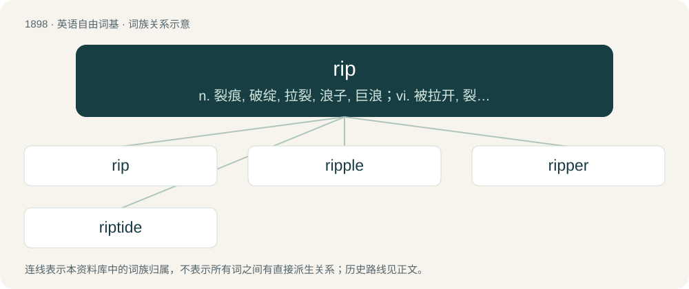

# 2011 · rip — n. 裂痕, 破绽, 拉裂, 浪子, 巨浪；vi. 被拉开, 裂开, 猛冲；vt. 撕, 扯, 劈

[总目录](../00_总目录_按常用程度.md)

**类型**：英语自由词基　｜　**来源语言**：见词源记录

## 核心含义与来源

- 核心含义：n. 裂痕, 破绽, 拉裂, 浪子, 巨浪；vi. 被拉开, 裂开, 猛冲；vt. 撕, 扯, 劈
- 英文含义：To divide or separate the parts of (especially something flimsy, such as paper or fabric), by cutting or tearing; to tear off or out by violence.
- 词形：rip

**多个词源／构词路径**：同一拼写可能有不同来源；以下按词性和含义分别列出。

**来源记录 1**（动词；To divide or separate the parts of (especially something flimsy, such as paper or fabric), by cutting or tearing; to tear off or out by violence.）

From Middle English rippen, from earlier ryppen (“to pluck”), ultimately from Proto-Germanic \*rupjaną, \*ruppōną, intensive of \*raupijaną, causative of Proto-Indo-European \*roub- ~ \*reub-, variant of \*Hrewp- (“to break”). See also West Frisian rippe, ripje, roppe, ropje (“to rip”), Dutch dialectal rippen, Low German ruppen, German Low German röpen, German rupfen, also Old English rīpan, rīepan (“to plunder”), West Frisian rippe (“to rip, tear”), German raufen (“to rip”); also Albanian rrabe ‘maquis’, possibly Latin rubus (“bramble”). More at reave, rob.

**来源记录 2**（名词；A worthless horse; a nag.）

Uncertain; perhaps a variant of rep (“reprobate”).

## 词族图

## 单词速览（常用到不常用）

| 单词 | 音标 | 释义 |
|---|---|---|
| [rip](#w-1) | /ɹɪp/ | n. 裂痕, 破绽, 拉裂, 浪子, 巨浪；vi. 被拉开, 裂开, 猛冲；vt. 撕, 扯, 劈 |
| [ripple](#w-2) | 英 /ˈɹɪp(ə)l/ | 【英文】To scratch, tear, or break slightly; graze |
| [ripper](#w-3) | 英 /ˈɹɪpə/；美 /ˈɹɪpɚ/ | n. 撕裂者 |
| [riptide](#w-4) | 英 /ˈɹɪp.taɪd/ | n. 洪涛, 急流, 激流 |

## 逐词详解

### 1. rip

**词性**：动词　｜　**音标**：/ɹɪp/

**中文释义**：n. 裂痕, 破绽, 拉裂, 浪子, 巨浪；vi. 被拉开, 裂开, 猛冲；vt. 撕, 扯, 劈

**英文义项**：To divide or separate the parts of (especially something flimsy, such as paper or fabric), by cutting or tearing; to tear off or out by violence. / To tear apart; to rapidly become two parts.

**词源与演化**：

From Middle English rippen, from earlier ryppen (“to pluck”), ultimately from Proto-Germanic \*rupjaną, \*ruppōną, intensive of \*raupijaną, causative of Proto-Indo-European \*roub- ~ \*reub-, variant of \*Hrewp- (“to break”). See also West Frisian rippe, ripje, roppe, ropje (“to rip”), Dutch dialectal rippen, Low German ruppen, German Low German röpen, German rupfen, also Old English rīpan, rīepan (“to plunder”), West Frisian rippe (“to rip, tear”), German raufen (“to rip”); also Albanian rrabe ‘maquis’, possibly Latin rubus (“bramble”). More at reave, rob.

**用法示例／搭配（非完整句）**：

> to rip a garment; to rip up a floor

该用例对应义项：To divide or separate the parts of (especially something flimsy, such as paper or fabric), by cutting or tearing; to tear off or out by violence.

### 2. ripple

**词性**：动词　｜　**音标**：英 /ˈɹɪp(ə)l/

**英文义项**：To scratch, tear, or break slightly; graze

**构词拆分**：rip + -le (frequentative suffix)

**词源与演化**：

From Middle English \*ripelen, repulen, equivalent to rip + -le (frequentative suffix).

### 3. ripper

**词性**：名词　｜　**音标**：英 /ˈɹɪpə/；美 /ˈɹɪpɚ/

**中文释义**：n. 撕裂者

**英文义项**：Something that rips something else. / Someone who rips something.

**构词拆分**：rip + -er

**词源与演化**：

From rip + -er; originated 1605–15.

**用法示例／搭配（非完整句）**：

> Jack the Ripper

该用例对应义项：A murderer who kills and often mutilates victims with a blade or similar sharp weapon.

### 4. riptide

**词性**：名词　｜　**音标**：英 /ˈɹɪp.taɪd/

**中文释义**：n. 洪涛, 急流, 激流

**英文义项**：A particularly strong tidal current. / A rip current which may carry a swimmer offshore.

**构词拆分**：rip + tide

**词源与演化**：

From rip + tide.

**例句**：

> This beach suffers from a riptide that can easily sweep you out to sea.

该用例对应义项：A rip current which may carry a swimmer offshore.
