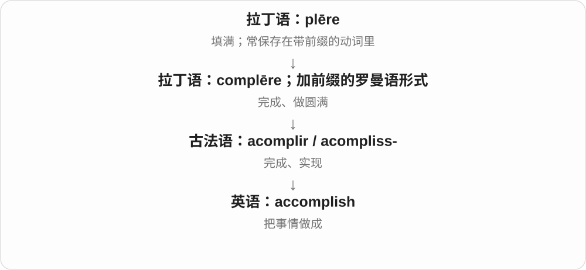
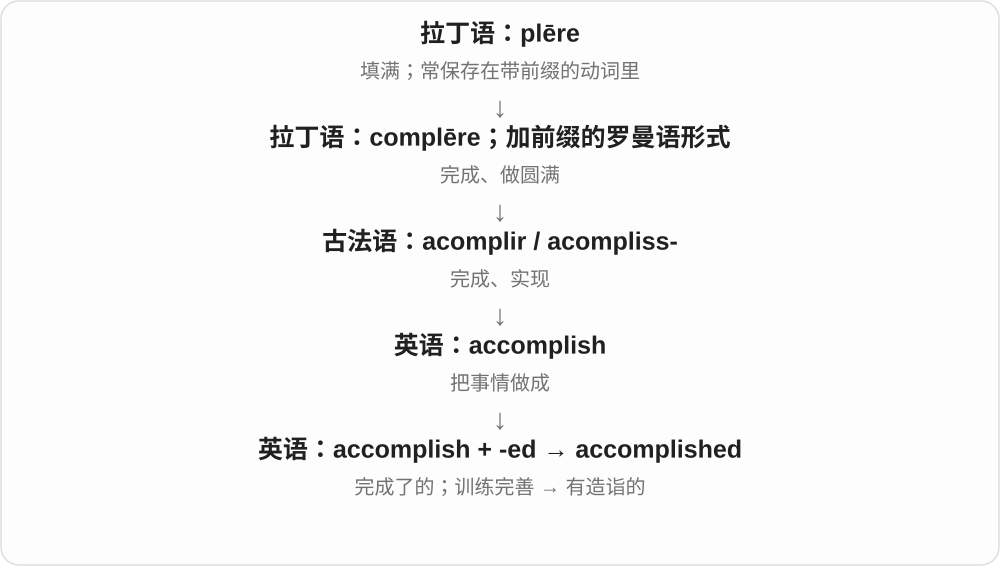
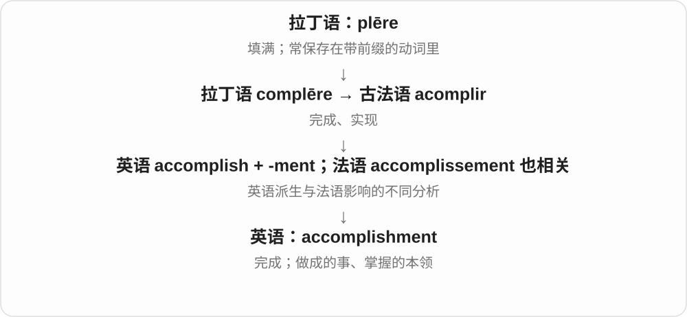

# 2014 · accomplish — 完成；达成；有造诣

[逐词精讲目录](../00_逐词精讲目录.md) · [总目录](../00_总目录_按常用程度.md)

## 核心词根与来源

accomplish 经法语联系拉丁完成、填满一支。accomplishment 可以是成就或技能，accomplished 除了完成的分词，还可说某人技艺熟练。

**ACCOMPLISH：把需要做的事情做到完成**

任务从未完成走到实现，能力也可以由长期练习达到熟练。

- **达成**：accomplish
- **成果和熟练程度**：accomplishment · accomplished

## 词形与演化规律

accomplish a task；accomplishment 作成就常可数；an accomplished musician 是有造诣的音乐家。

## 单词速览（按词族由简到繁）

同一基础词的相关扩展放在一起，先读基础形式，再读扩展；各组之间优先读常用的。具体词源关系见各词讲解。

| 单词 | 音标 | 核心意思 |
|---|---|---|
| [accomplish](#w-2) | 英 /əˈkʌmplɪʃ/；美 /əˈkɑːmplɪʃ/ | 完成；实现；办成 |
| [accomplished](#w-1) | 英 /əˈkʌmplɪʃt/；美 /əˈkɑːmplɪʃt/ | 技艺精湛的；有造诣的；完成了的 |
| [accomplishment](#w-3) | 英 /əˈkʌmplɪʃmənt/；美 /əˈkɑːmplɪʃmənt/ | 成就；完成；娴熟技能〔常用复数〕 |

## 逐词讲解

### 1. accomplish — 完成；实现；办成

**音标**：英 /əˈkʌmplɪʃ/；美 /əˈkɑːmplɪʃ/

**先抓住这个画面**

不只是忙过一阵子，而是真的把想办的事办成了。

**怎么拆**

经古法语 acomplir 的扩展词干 acompliss- 借入，前身是联系拉丁语 complēre 的罗曼语构词。-ish 延续古法语词干变化，不是现代表示“有点儿”的后缀。

**怎么变成今天的意思**

accomplish a task 是完成任务；accomplish a goal 是实现目标；accomplish nothing 是折腾一场却没办成事。通常接事情或目标，不接 to do。

**常见搭配与例句**

accomplish a task；accomplish a goal；accomplish a great deal。

> We accomplished more in one morning than we expected.

一个上午我们办成的事情比预想的还多。

> Arguing about blame will accomplish nothing.

争论该怪谁不会解决任何事情。

**别混淆**

finish 可只是活动结束；accomplish 更突出取得预期结果，常带努力后的完成感。

### 2. accomplished — 技艺精湛的；有造诣的；完成了的

**音标**：英 /əˈkʌmplɪʃt/；美 /əˈkɑːmplɪʃt/

**先抓住这个画面**

一个人经过训练，已经能把一门技艺做得很成熟，不再只是会一点。

**怎么拆**

accomplish + -ed；既是过去分词，也发展为形容词。历史上 accomplish 还有通过教育使人完善、熟练的用法。

**怎么变成今天的意思**

an accomplished pianist 是熟练出色的钢琴家；mission accomplished 是任务完成。人物形容词不表示这个人的人生已经结束。

**常见搭配与例句**

an accomplished musician；an accomplished writer；mission accomplished。

> She is an accomplished violinist as well as a careful teacher.

她既是技艺精湛的小提琴家，也是一位细心的老师。

> With the repairs finished, he could finally say, “Mission accomplished.”

维修结束后，他终于可以说：“任务完成。”

**别混淆**

talented 强调有天分；accomplished 强调已经展现出成熟的技艺。

### 3. accomplishment — 成就；完成；娴熟技能〔常用复数〕

**音标**：英 /əˈkʌmplɪʃmənt/；美 /əˈkɑːmplɪʃmənt/

**先抓住这个画面**

回头看见一件真的做成的事，心里有“我办到了”的实在感。

**怎么拆**

accomplish + -ment；英语词源也联系法语 accomplissement，不能排除借入或法语影响。

**怎么变成今天的意思**

a sense of accomplishment 是完成后很踏实的成就感；a major accomplishment 是一项重要成果。旧式或正式语境 accomplishments 也指音乐、语言等练成的技能。

**常见搭配与例句**

a sense of accomplishment；a remarkable accomplishment；the accomplishment of a task。

> Finishing the first chapter gave her a sense of accomplishment.

写完第一章让她很有成就感。

> Restoring the damaged archive was a remarkable accomplishment.

修复受损档案是一项了不起的成就。

**别混淆**

achievement 与它常重叠；accomplishment 很适合谈做成某事后的满足感，也可指修习的才艺。

## 这一组要分清什么

accomplished 不只是“已经完成的人”；它常赞扬在某个领域表现熟练。

## 串起来练习

The accomplished musician regarded the concert as an important accomplishment.

这位有造诣的音乐家把这场音乐会视为重要成就。
