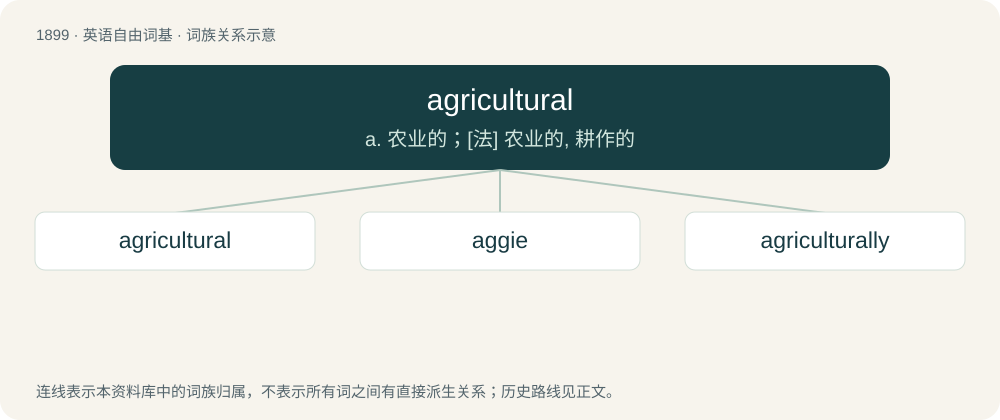

# 2014 · agricultural — a. 农业的；\[法\] 农业的, 耕作的

[总目录](../00_总目录_按常用程度.md)

**类型**：英语自由词基　｜　**来源语言**：见词源记录

## 核心含义与来源

- 核心含义：a. 农业的；\[法\] 农业的, 耕作的
- 英文含义：Of or pertaining to agriculture.
- 词形：agricultural

**来源记录 1**（形容词；Of or pertaining to agriculture.）

From agriculture + -al.

## 词族图

## 单词速览（常用到不常用）

| 单词 | 音标 | 释义 |
|---|---|---|
| [agricultural](#w-1) | 英 /ˌæɡ.ɹɪˈkʌl.tjʊə.ɹəl/；美 /ˌæɡ.ɹɪˈkʌl.tʃə.ɹəl/ | a. 农业的；\[法\] 农业的, 耕作的 |
| [aggie](#w-2) | 美 /ˈæ.ɡi/ | 【英文】An agricultural school, such as one of the state land-grant colleges. |
| [agriculturally](#w-3) |  | adv. 农业地 |

## 逐词详解

### 1. agricultural

**词性**：形容词　｜　**音标**：英 /ˌæɡ.ɹɪˈkʌl.tjʊə.ɹəl/；美 /ˌæɡ.ɹɪˈkʌl.tʃə.ɹəl/

**中文释义**：a. 农业的；\[法\] 农业的, 耕作的

**英文义项**：Of or pertaining to agriculture. / As if played with a scythe.

**构词拆分**：agriculture + -al

**词源与演化**：

From agriculture + -al.

**用法示例／搭配（非完整句）**：

> the agricultural class

该用例对应义项：Of or pertaining to agriculture.

### 2. aggie

**词性**：名词　｜　**音标**：美 /ˈæ.ɡi/

**英文义项**：An agricultural school, such as one of the state land-grant colleges. / A student or alumnus of such a school.

**构词拆分**：agricultural + -ie

**词源与演化**：

From agricultural + -ie.

### 3. agriculturally

**词性**：副词

**中文释义**：adv. 农业地

**英文义项**：In a manner pertaining to agriculture.

**构词拆分**：agricultural + -ly

**词源与演化**：

From agricultural + -ly.
