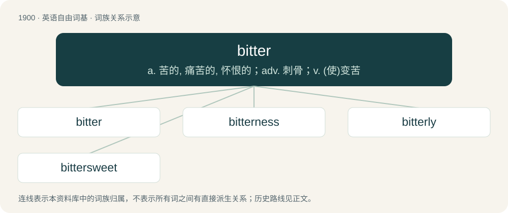

# 2015 · bitter — a. 苦的, 痛苦的, 怀恨的；adv. 刺骨；v. (使)变苦

[总目录](../00_总目录_按常用程度.md)

**类型**：英语自由词基　｜　**来源语言**：见词源记录

## 核心含义与来源

- 核心含义：a. 苦的, 痛苦的, 怀恨的；adv. 刺骨；v. (使)变苦
- 英文含义：Having an acrid taste (usually from a basic substance).
- 词形：bitter

**多个词源／构词路径**：同一拼写可能有不同来源；以下按词性和含义分别列出。

**来源记录 1**（形容词；Having an acrid taste (usually from a basic substance).）

From Middle English bitter, bittre, from Old English bitter, biter (“bitter”), from Proto-West Germanic \*bitr, from Proto-Germanic \*bitraz (“bitter”), equivalent to bite + -er (agent noun suffix) used attributively. Cognate with Saterland Frisian, West Frisian, Low German, Danish, Dutch, German, Norwegian Bokmål, Norwegian Nynorsk, and Swedish bitter, Icelandic bitur (all meaning “bitter”).

**来源记录 2**（名词；A hardware system whose architecture is based around units of the specified number of bits (binary digits).）

From bit + -er.

## 词族图

## 单词速览（常用到不常用）

| 单词 | 音标 | 释义 |
|---|---|---|
| [bitter](#w-1) | 英 /ˈbɪt.ə/；美 /ˈbɪ.tɚ/ | a. 苦的, 痛苦的, 怀恨的；adv. 刺骨；v. (使)变苦 |
| [bitterness](#w-2) | 英 /ˈbɪtənəs/ | n. 苦味, 悲痛, 怨恨 |
| [bitterly](#w-3) | 英 /ˈbɪtəli/；美 /ˈbɪtəɹli/ | adv. 怨恨地, 悲痛地, 残酷地 |
| [bittersweet](#w-4) | 美 /ˈbɪtɚˌswit/ | a. 又苦又甜的, 苦乐参半的；\[医\] 白英, 蜀羊泉 |

## 逐词详解

### 1. bitter

**词性**：形容词　｜　**音标**：英 /ˈbɪt.ə/；美 /ˈbɪ.tɚ/

**中文释义**：a. 苦的, 痛苦的, 怀恨的；adv. 刺骨；v. (使)变苦

**英文义项**：Having an acrid taste (usually from a basic substance). / Harsh, piercing, acerbic or stinging.

**构词拆分**：bite + -er (agent noun suffix)

**词源与演化**：

From Middle English bitter, bittre, from Old English bitter, biter (“bitter”), from Proto-West Germanic \*bitr, from Proto-Germanic \*bitraz (“bitter”), equivalent to bite + -er (agent noun suffix) used attributively. Cognate with Saterland Frisian, West Frisian, Low German, Danish, Dutch, German, Norwegian Bokmål, Norwegian Nynorsk, and Swedish bitter, Icelandic bitur (all meaning “bitter”).

**例句**：

> I've been bitter ever since that defeat.

该用例对应义项：Cynical and resentful.

### 2. bitterness

**词性**：名词　｜　**音标**：英 /ˈbɪtənəs/

**中文释义**：n. 苦味, 悲痛, 怨恨

**英文义项**：The quality of having a bitter taste. / The quality of feeling bitter; acrimony, resentment; the quality of exhibiting such feelings.

**构词拆分**：bitter + -ness

**词源与演化**：

From Middle English bitternesse, biternesse, from Old English biternes (“bitterness; grief”), equivalent to bitter + -ness.

**例句**：

> She kept her bitterness about her mistreatment for the rest of her life.

该用例对应义项：The quality of feeling bitter; acrimony, resentment; the quality of exhibiting such feelings.

### 3. bitterly

**词性**：副词　｜　**音标**：英 /ˈbɪtəli/；美 /ˈbɪtəɹli/

**中文释义**：adv. 怨恨地, 悲痛地, 残酷地

**英文义项**：In a bitter manner. / Extremely.

**构词拆分**：bitter + -ly

**词源与演化**：

From Middle English bitterli, biterli, biterliche, from Old English biterlīċe, bitterlīċe (“bitterly”), equivalent to bitter + -ly. Cognate with German Low German bitterlik (“bitterly”), German bitterlich (“bitterly”), Swedish bitterligen (“bitterly”).

**例句**：

> It was bitterly cold.

该用例对应义项：extremely and sharply

### 4. bittersweet

**词性**：形容词　｜　**音标**：美 /ˈbɪtɚˌswit/

**中文释义**：a. 又苦又甜的, 苦乐参半的；\[医\] 白英, 蜀羊泉

**英文义项**：Both bitter and sweet. / Expressing contrasting emotions of pain and pleasure.

**构词拆分**：bitter + sweet

**词源与演化**：

From Middle English bitterswete, biterswete, equivalent to bitter + sweet. Cognate with Saterland Frisian bitterswäit (“bittersweet”), West Frisian bittersoet (“bittersweet”), Dutch bitterzoet (“bittersweet”), German bittersüß (“bittersweet”), Danish bittersød (“bittersweet”), Swedish bittersöt (“bittersweet”).

**例句**：

> The break-up was very bittersweet; they both hurt to end it, but were glad it was over.

该用例对应义项：Expressing contrasting emotions of pain and pleasure.
