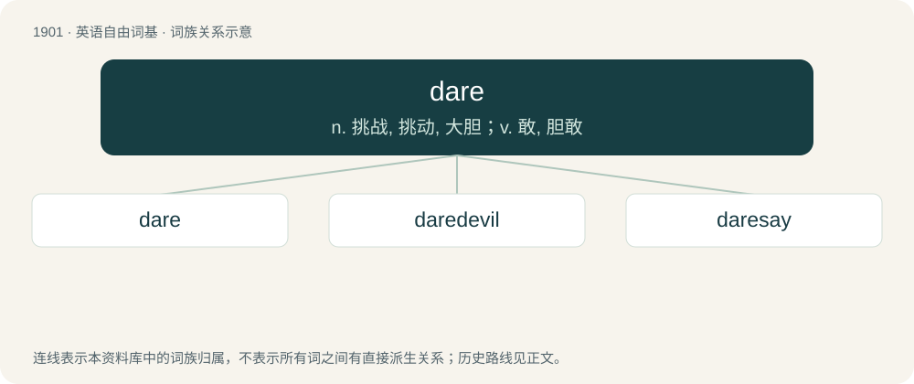

# 2016 · dare — n. 挑战, 挑动, 大胆；v. 敢, 胆敢

[总目录](../00_总目录_按常用程度.md)

**类型**：英语自由词基　｜　**来源语言**：见词源记录

## 核心含义与来源

- 核心含义：n. 挑战, 挑动, 大胆；v. 敢, 胆敢
- 英文含义：To have enough courage (to do something).
- 词形：dare

**来源记录 1**（动词；To have enough courage (to do something).）

From Middle English durren, from Old English durran, from Proto-West Germanic \*durʀan, from Proto-Germanic \*durzaną (“to dare”), from Proto-Indo-European \*dʰedʰórse (“to dare”), reduplicated stative of the root \*dʰers- (“to be bold, to dare”), an \*-s- extension of \*dʰer- (“to hold, support”). Cognates Cognate with Low German dören, Dutch durven, German thüren, Sanskrit दधर्ष (dadhárṣa), but also with Ancient Greek θρασύς (thrasús), Albanian nder, Lithuanian drįsti, Russian дерза́ть (derzátʹ).

## 词族图

## 单词速览（常用到不常用）

| 单词 | 音标 | 释义 |
|---|---|---|
| [dare](#w-1) | 英 /dɛə/；美 /dɛ(ə)ɹ/ | n. 挑战, 挑动, 大胆；v. 敢, 胆敢 |
| [daredevil](#w-2) | 英 /ˈdɛədɛvəl/ | n. 铤而走险的人, 蛮勇的人；a. 蛮勇的, 不怕死的 |
| [daresay](#w-3) | 英 /ˌdɛəˈseɪ/；美 /ˌdɛəɹˈseɪ/ | vi.vt. (仅用于主语为I时,后加宾语从句)(我)想, 也许 |

## 逐词详解

### 1. dare

**词性**：动词　｜　**音标**：英 /dɛə/；美 /dɛ(ə)ɹ/

**中文释义**：n. 挑战, 挑动, 大胆；v. 敢, 胆敢

**英文义项**：To have enough courage (to do something). / To defy or challenge (someone to do something).

**词源与演化**：

From Middle English durren, from Old English durran, from Proto-West Germanic \*durʀan, from Proto-Germanic \*durzaną (“to dare”), from Proto-Indo-European \*dʰedʰórse (“to dare”), reduplicated stative of the root \*dʰers- (“to be bold, to dare”), an \*-s- extension of \*dʰer- (“to hold, support”). Cognates Cognate with Low German dören, Dutch durven, German thüren, Sanskrit दधर्ष (dadhárṣa), but also with Ancient Greek θρασύς (thrasús), Albanian nder, Lithuanian drįsti, Russian дерза́ть (derzátʹ).

**例句**：

> No one dares (to) criticize his decisions.

该用例对应义项：To have enough courage (to do something).

### 2. daredevil

**词性**：名词　｜　**音标**：英 /ˈdɛədɛvəl/

**中文释义**：n. 铤而走险的人, 蛮勇的人；a. 蛮勇的, 不怕死的

**英文义项**：A person who engages in very risky behavior, especially one who is motivated by a craving for excitement or attention.

**构词拆分**：dare + devil

**词源与演化**：

From dare + devil; an exocentric compound, "one who dares the devil".

**例句**：

> Even as a youngster, Steven was a bit of a daredevil riding up homemade wooden ramps on his BMX.

该用例对应义项：A person who engages in very risky behavior, especially one who is motivated by a craving for excitement or attention.

### 3. daresay

**词性**：动词　｜　**音标**：英 /ˌdɛəˈseɪ/；美 /ˌdɛəɹˈseɪ/

**中文释义**：vi.vt. (仅用于主语为I时,后加宾语从句)(我)想, 也许

**英文义项**：Chiefly in the form I daresay: to venture to say (as the speaker believes something is likely to be the case); to think something probable; to presume.

**构词拆分**：dare (“to have enough courage (to do something)”) + say

**词源与演化**：

From dare say: dare (“to have enough courage (to do something)”) + say.

**例句**：

> Are you going to stay up all night? I daresay that I am.

该用例对应义项：Chiefly in the form I daresay: to venture to say (as the speaker believes something is likely to be the case); to think something probable; to presume.
