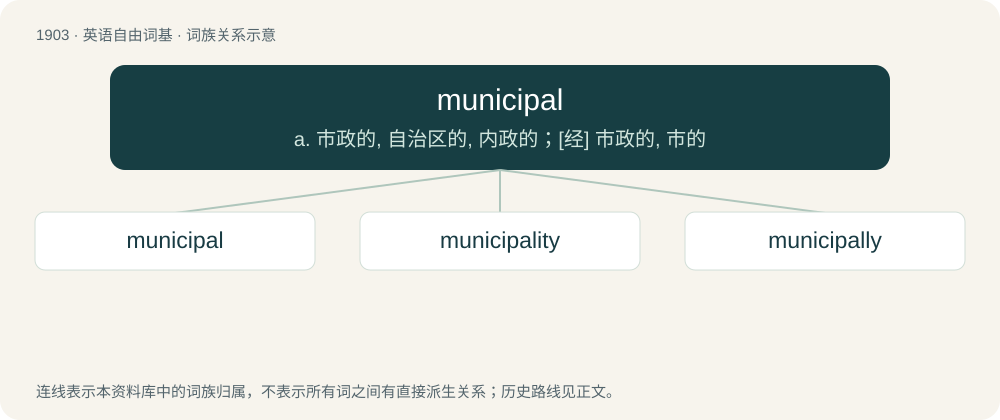

# 2017 · municipal — a. 市政的, 自治区的, 内政的；\[经\] 市政的, 市的

[总目录](../00_总目录_按常用程度.md)

**类型**：英语自由词基　｜　**来源语言**：见词源记录

## 核心含义与来源

- 核心含义：a. 市政的, 自治区的, 内政的；\[经\] 市政的, 市的
- 英文含义：Of or pertaining to a municipality (a city or a corporation having the right of administering local government).
- 词形：municipal

**来源记录 1**（形容词；Of or pertaining to a municipality (a city or a corporation having the right of administering local government).）

Borrowed from French municipal, from Latin mūnicipālis (“of or belonging to a citizen or a free town”), from mūniceps (“a citizen, an inhabitant of a free town”), from mūnus (“duty”) + capiō (“to take”).

## 词族图

## 单词速览（常用到不常用）

| 单词 | 音标 | 释义 |
|---|---|---|
| [municipal](#w-1) | /mjuˈnɪsɪpəl/ | a. 市政的, 自治区的, 内政的；\[经\] 市政的, 市的 |
| [municipality](#w-2) | 英 /mjʊˌnɪsɪˈpælɪti/ | n. 自治区, 市当局, 市民；\[法\] 市, 自治市, 自治地区 |
| [municipally](#w-3) | /mjuːˈnisipəli/ | adv. 市政方面 |

## 逐词详解

### 1. municipal

**词性**：形容词　｜　**音标**：/mjuˈnɪsɪpəl/

**中文释义**：a. 市政的, 自治区的, 内政的；\[经\] 市政的, 市的

**英文义项**：Of or pertaining to a municipality (a city or a corporation having the right of administering local government). / Of or pertaining to the internal affairs of a nation.

**词源与演化**：

Borrowed from French municipal, from Latin mūnicipālis (“of or belonging to a citizen or a free town”), from mūniceps (“a citizen, an inhabitant of a free town”), from mūnus (“duty”) + capiō (“to take”).

**例句**：

> International law...only authorizes a belligerent to punish a spy under its municipal law.

该用例对应义项：of or relating to the government of a municipality

### 2. municipality

**词性**：名词　｜　**音标**：英 /mjʊˌnɪsɪˈpælɪti/

**中文释义**：n. 自治区, 市当局, 市民；\[法\] 市, 自治市, 自治地区

**英文义项**：A district with a government that typically encloses no other governed districts; a borough, city, or incorporated town or village. / The governing body of such a district.

**构词拆分**：municipal + -ity

**词源与演化**：

Borrowed from French municipalité (Edmund Burke), from municipal + -ité, from Latin municipalis, from municipium (“free city, township”), from municeps (“citizen of a free city or township”), from mūnus (“duty, service”) + -ceps (“taker, catcher”). Equivalent to municipal + -ity.

**例句**：

> The municipality has recently imposed an overtaking ban for this road.

### 3. municipally

**词性**：副词　｜　**音标**：/mjuːˈnisipəli/

**中文释义**：adv. 市政方面

**英文义项**：In a municipal manner.

**构词拆分**：municipal + -ly

**词源与演化**：

From municipal + -ly.
