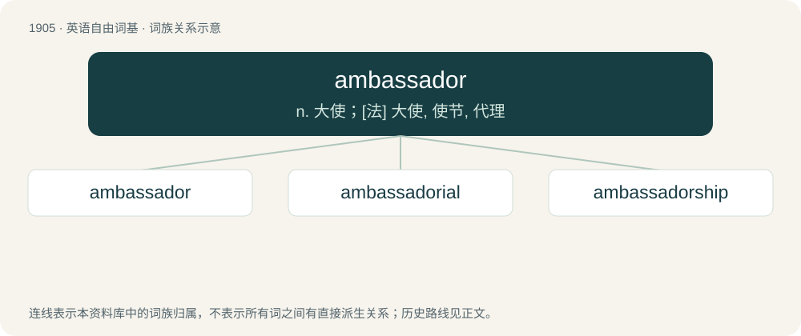

# 2019 · ambassador — n. 大使；\[法\] 大使, 使节, 代理

[总目录](../00_总目录_按常用程度.md)

**类型**：英语自由词基　｜　**来源语言**：见词源记录

## 核心含义与来源

- 核心含义：n. 大使；\[法\] 大使, 使节, 代理
- 英文含义：A diplomat of the highest rank sent to a foreign court to represent there their sovereign or country. (Sometimes called ambassador-in-residence)
- 词形：ambassador

**来源记录 1**（名词；A diplomat of the highest rank sent to a foreign court to represent there their sovereign or country. (Sometimes called ambassador-in-residence)）

From Middle English ambassadore, from Anglo-Norman ambassadeur, from Old Italian ambassadore, from Old Occitan ambaisador (“ambassador”), derivative of ambaissa (“service, mission, errand”), ultimately from Proto-Germanic \*ambahtaz (“servant”), from Gaulish ambaxtos, from Proto-Celtic \*ambaxtos, from Proto-Indo-European \*h₂m̥bʰi-h₂eǵ- (“drive around”), from \*h₂m̥bʰi- (“around”) + \*h₂eǵ- (“to drive”). Displaced native Old English ǣrendraca.

## 词族图

## 单词速览（常用到不常用）

| 单词 | 音标 | 释义 |
|---|---|---|
| [ambassador](#w-1) | 英 /æmˈbæs.ə.də(ɹ)/；美 /æmˈbæs.ə.dɚ/ | n. 大使；\[法\] 大使, 使节, 代理 |
| [ambassadorial](#w-2) | 美 /æm.bæs.əˈdɔɹ.iəl/ | a. 大使的, 大使一级的；\[法\] 大使的, 使节的 |
| [ambassadorship](#w-3) | /æmˈbæsədəʃip/ | n. 大使的职位 |

## 逐词详解

### 1. ambassador

**词性**：名词　｜　**音标**：英 /æmˈbæs.ə.də(ɹ)/；美 /æmˈbæs.ə.dɚ/

**中文释义**：n. 大使；\[法\] 大使, 使节, 代理

**英文义项**：A diplomat of the highest rank sent to a foreign court to represent there their sovereign or country. (Sometimes called ambassador-in-residence) / An official messenger and representative.

**词源与演化**：

From Middle English ambassadore, from Anglo-Norman ambassadeur, from Old Italian ambassadore, from Old Occitan ambaisador (“ambassador”), derivative of ambaissa (“service, mission, errand”), ultimately from Proto-Germanic \*ambahtaz (“servant”), from Gaulish ambaxtos, from Proto-Celtic \*ambaxtos, from Proto-Indo-European \*h₂m̥bʰi-h₂eǵ- (“drive around”), from \*h₂m̥bʰi- (“around”) + \*h₂eǵ- (“to drive”). Displaced native Old English ǣrendraca.

**例句**：

> As front hall porter, you are an ambassador for the hotel.

该用例对应义项：A corporate representative, often the public face of the company.

### 2. ambassadorial

**词性**：形容词　｜　**音标**：美 /æm.bæs.əˈdɔɹ.iəl/

**中文释义**：a. 大使的, 大使一级的；\[法\] 大使的, 使节的

**英文义项**：Of or pertaining to an ambassador.

**构词拆分**：ambassador + -ial

**词源与演化**：

From ambassador + -ial.

### 3. ambassadorship

**词性**：名词　｜　**音标**：/æmˈbæsədəʃip/

**中文释义**：n. 大使的职位

**英文义项**：The post or office of ambassador.

**构词拆分**：ambassador + -ship

**词源与演化**：

From ambassador + -ship.
