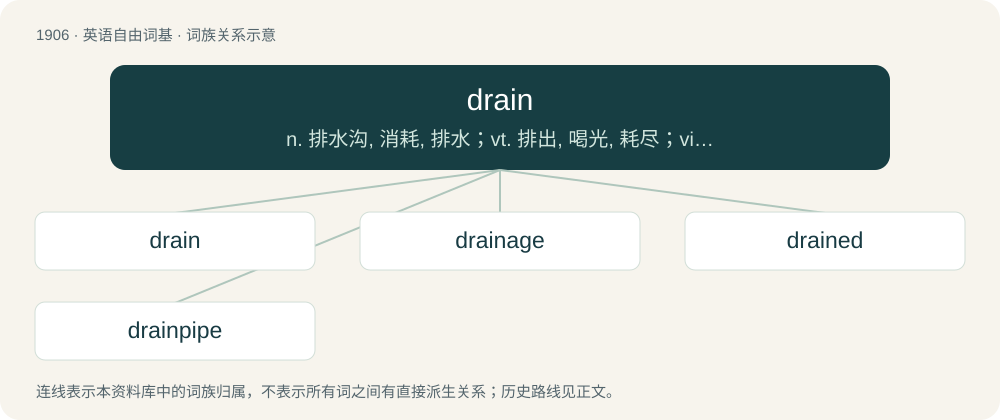

# 2020 · drain — n. 排水沟, 消耗, 排水；vt. 排出, 喝光, 耗尽；vi. 排水, 流干

[总目录](../00_总目录_按常用程度.md)

**类型**：英语自由词基　｜　**来源语言**：见词源记录

## 核心含义与来源

- 核心含义：n. 排水沟, 消耗, 排水；vt. 排出, 喝光, 耗尽；vi. 排水, 流干
- 英文含义：A conduit allowing liquid to flow out of an otherwise contained volume; a plughole (UK)
- 词形：drain

**来源记录 1**（名词；A conduit allowing liquid to flow out of an otherwise contained volume; a plughole (UK)）

Inherited from Middle English \*dreinen, from Old English drēahnian, from Proto-West Germanic \*drauhnōn, from Proto-Germanic \*drauhnōną, from \*draugiz, from Proto-Indo-European \*dʰrewgʰ-, from \*dʰer-. Akin to Old English drūgian (“to dry up”), Old English drūgaþ (“dryness, drought”), Old English drȳġe (“dry”). More at dry.

## 词族图

## 单词速览（常用到不常用）

| 单词 | 音标 | 释义 |
|---|---|---|
| [drain](#w-1) | 美 /dɹiːn/；/dɹeɪn/ | n. 排水沟, 消耗, 排水；vt. 排出, 喝光, 耗尽；vi. 排水, 流干 |
| [drainage](#w-2) | /ˈdɹeɪnəd͡ʒ/ | n. 排水；\[医\] 引流\[法\], 导液\[法\], 排水\[设备\] |
| [drained](#w-3) | /dɹeɪnd/ | v. （使）流干, （使）逐渐流走( drain的过去式和过去分词 ); 喝光, 喝干; 使（精力、金钱等）耗尽 |
| [drainpipe](#w-4) | 美 /ˈdɹeɪnˌpaɪp/ | n. 排水管 |

## 逐词详解

### 1. drain

**词性**：名词　｜　**音标**：美 /dɹiːn/；/dɹeɪn/

**中文释义**：n. 排水沟, 消耗, 排水；vt. 排出, 喝光, 耗尽；vi. 排水, 流干

**英文义项**：A conduit allowing liquid to flow out of an otherwise contained volume; a plughole (UK) / An access point or conduit for rainwater that drains directly downstream in a (drainage) basin without going through sewers or water treatment in order to prevent or belay floods.

**词源与演化**：

Inherited from Middle English \*dreinen, from Old English drēahnian, from Proto-West Germanic \*drauhnōn, from Proto-Germanic \*drauhnōną, from \*draugiz, from Proto-Indo-European \*dʰrewgʰ-, from \*dʰer-. Akin to Old English drūgian (“to dry up”), Old English drūgaþ (“dryness, drought”), Old English drȳġe (“dry”). More at dry.

**例句**：

> That rental property is a drain on our finances.

该用例对应义项：Something consuming resources and providing nothing in return.

### 2. drainage

**词性**：名词　｜　**音标**：/ˈdɹeɪnəd͡ʒ/

**中文释义**：n. 排水；\[医\] 引流\[法\], 导液\[法\], 排水\[设备\]

**英文义项**：A natural or artificial means for the removal of fluids from a given area by its draining away. / A system of drains.

**构词拆分**：drain + -age

**词源与演化**：

From drain + -age.

**例句**：

> The drainage systems are not able to handle the water pressure.

### 3. drained

**词性**：形容词　｜　**音标**：/dɹeɪnd/

**中文释义**：v. （使）流干, （使）逐渐流走( drain的过去式和过去分词 ); 喝光, 喝干; 使（精力、金钱等）耗尽

**英文义项**：Lacking motivation and energy; very tired; knackered. / Of a battery, empty of charge; discharged.

**构词拆分**：drain + -ed

**词源与演化**：

From drain + -ed.

**例句**：

> I felt so drained after that three-hour exam that I wanted to sleep for the next week.

该用例对应义项：Lacking motivation and energy; very tired; knackered.

### 4. drainpipe

**词性**：名词　｜　**音标**：美 /ˈdɹeɪnˌpaɪp/

**中文释义**：n. 排水管

**英文义项**：A verticle pipe carrying water from the roof gutter down the side of a building; downspout. / A conduit for carrying rainwater or flood water.

**构词拆分**：drain + pipe

**词源与演化**：

From drain + pipe.

**例句**：

> Rainwater flows from the gutter, down the drainpipe and into the sewer.
