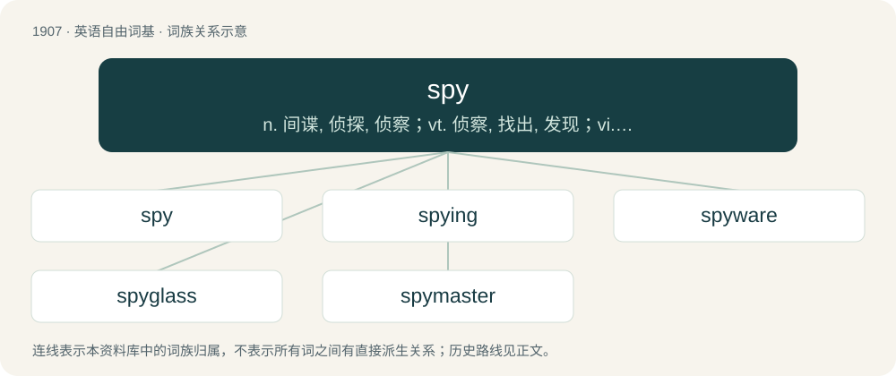

# 2022 · spy — n. 间谍, 侦探, 侦察；vt. 侦察, 找出, 发现；vi. 做密探, 侦查

[总目录](../00_总目录_按常用程度.md)

**类型**：英语自由词基　｜　**来源语言**：见词源记录

## 核心含义与来源

- 核心含义：n. 间谍, 侦探, 侦察；vt. 侦察, 找出, 发现；vi. 做密探, 侦查
- 英文含义：A person who secretly watches and examines the actions of other individuals or organizations and gathers information on them (usually to gain an advantage).
- 词形：spy

**来源记录 1**（名词；A person who secretly watches and examines the actions of other individuals or organizations and gathers information on them (usually to gain an advantage).）

From Middle English spien, aphetic variant of earlier espien (“to espy”), from Old French espier (“to spy”), from Frankish \*spehōn (“to spy”), from Proto-Germanic \*spehōną (“to see, look”), from Proto-Indo-European \*speḱ- (“to look”). Akin to German spähen (“to spy”), Dutch spieden (“to spy”). The noun displaced native Old English sċēawere (literally “watcher”), which was also the word for "mirror." In this sense, the verb displaced Old English sċēawian, which was also the word for "to watch" and became the Modern English word show. Distant cognate vie PIE with Latin speculātor, Ancient Greek κατάσκοπος (katáskopos). Compare typologically Russian согляда́тай (sogljadátaj) (akin to гляде́ть (gljadétʹ)).

## 词族图

## 单词速览（常用到不常用）

| 单词 | 音标 | 释义 |
|---|---|---|
| [spy](#w-1) | /spaɪ/ | n. 间谍, 侦探, 侦察；vt. 侦察, 找出, 发现；vi. 做密探, 侦查 |
| [spying](#w-2) | /ˈspaɪ.ɪŋ/ | \[法\] 间谍活动, 侦探 |
| [spyware](#w-3) |  | 间谍软件；后门程式 |
| [spyglass](#w-4) | 美 /ˈspaɪˌɡlæs/ | n. 小望远镜 |
| [spymaster](#w-5) | /ˈspai,mɑːstə(r); -,mæs-/ | n. 间谍组织的首脑 |

## 逐词详解

### 1. spy

**词性**：动词　｜　**音标**：/spaɪ/

**中文释义**：n. 间谍, 侦探, 侦察；vt. 侦察, 找出, 发现；vi. 做密探, 侦查

**英文义项**：To act as a spy. / To spot; to catch sight of; to espy.

**词源与演化**：

From Middle English spien, aphetic variant of earlier espien (“to espy”), from Old French espier (“to spy”), from Frankish \*spehōn (“to spy”), from Proto-Germanic \*spehōną (“to see, look”), from Proto-Indo-European \*speḱ- (“to look”). Akin to German spähen (“to spy”), Dutch spieden (“to spy”). The noun displaced native Old English sċēawere (literally “watcher”), which was also the word for "mirror." In this sense, the verb displaced Old English sċēawian, which was also the word for "to watch" and became the Modern English word show. Distant cognate vie PIE with Latin speculātor, Ancient Greek κατάσκοπος (katáskopos). Compare typologically Russian согляда́тай (sogljadátaj) (akin to гляде́ть (gljadétʹ)).

**例句**：

> During the Cold War, Russia and America would each spy on each other for recon.

该用例对应义项：To act as a spy.

### 2. spying

**词性**：名词　｜　**音标**：/ˈspaɪ.ɪŋ/

**中文释义**：\[法\] 间谍活动, 侦探

**英文义项**：espionage; the act of secretly gathering information

**构词拆分**：spy + -ing

**词源与演化**：

Inherited from Middle English spyinge, spiyng, spyeng, equivalent to spy + -ing.

**例句**：

> Some people use cameras for illegal purposes, such as spying on people.

### 3. spyware

**词性**：名词

**中文释义**：间谍软件；后门程式

**英文义项**：Programs that surreptitiously monitor and report the actions of a computer user.

**构词拆分**：spy + -ware

**词源与演化**：

From spy + -ware.

**例句**：

> Spyware can't distinguish between threatening letters and love letters.

### 4. spyglass

**词性**：名词　｜　**音标**：美 /ˈspaɪˌɡlæs/

**中文释义**：n. 小望远镜

**英文义项**：A small portable telescope. / A pair of binoculars.

**构词拆分**：spy + glass

**词源与演化**：

From spy + glass.

**例句**：

> Lend me the spyglass, that I may see better.

### 5. spymaster

**词性**：名词　｜　**音标**：/ˈspai,mɑːstə(r); -,mæs-/

**中文释义**：n. 间谍组织的首脑

**英文义项**：The leader of a group of spies.

**构词拆分**：spy + master

**词源与演化**：

From spy + master.
