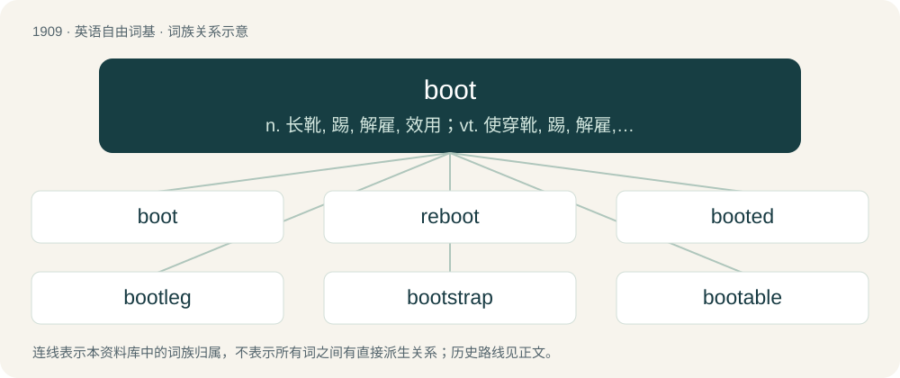

# 2024 · boot — n. 长靴, 踢, 解雇, 效用；vt. 使穿靴, 踢, 解雇, 有用；\[计\] 引导, 自举

[总目录](../00_总目录_按常用程度.md)

**类型**：英语自由词基　｜　**来源语言**：见词源记录

## 核心含义与来源

- 核心含义：n. 长靴, 踢, 解雇, 效用；vt. 使穿靴, 踢, 解雇, 有用；\[计\] 引导, 自举
- 英文含义：A heavy shoe that covers part of the leg.
- 词形：boot

**多个词源／构词路径**：同一拼写可能有不同来源；以下按词性和含义分别列出。

**来源记录 1**（名词；A heavy shoe that covers part of the leg.）

From Middle English boote, bote (“shoe”), from Old French bote (“a high, thick shoe”). Of obscure origin, but probably related to Old French bot (“club-foot”), bot (“fat, short, blunt”), from Old Frankish \*butt, from Proto-Germanic \*buttaz, \*butaz (“cut off, short, numb, blunt”), from Proto-Indo-European \*bʰewt-, \*bʰewd- (“to strike, push, shock”); if so, a doublet of butt. Compare Old Norse butt (“stump”), Low German butt (“blunt, plump”), Old English bytt (“small piece of land”), buttuc (“end”). More at buttock and debut.

**来源记录 2**（名词；Profit, plunder.）

From Middle English boote, bote, bot, from Old English bōt (“help, relief, advantage”), from Proto-West Germanic \*bōtu, from Proto-Germanic \*bōtō (“atonement, improvement”), from Proto-Indo-European \*bʰed- (“good”). Akin to Old Norse bót (“bettering, remedy”) (Danish bod), Gothic 𐌱𐍉𐍄𐌰 (bōta), German Buße. Doublet of bote (a borrowing from Middle English).

## 词族图

## 单词速览（常用到不常用）

| 单词 | 音标 | 释义 |
|---|---|---|
| [boot](#w-1) | 英 /buːt/；美 /but/ | n. 长靴, 踢, 解雇, 效用；vt. 使穿靴, 踢, 解雇, 有用；\[计\] 引导, 自举 |
| [reboot](#w-2) | /ˈɹiːbuːt/ | \[计\] 重新启动 |
| [booted](#w-3) | 英 /ˈbuːtɪd/；美 /ˈbutɪd/ | a. 穿靴的 |
| [bootleg](#w-4) | 美 /ˈbutˌlɛɡ/ | v. 私卖(酒) |
| [bootstrap](#w-5) | /ˈbuːtˌstɹæp/ | n. 解靴带；\[计\] 引导程序, 引导自举 |
| [bootable](#w-6) | /ˈbuːtəbl/ | a. \[计\]可启动的；可引导的 |

## 逐词详解

### 1. boot

**词性**：名词　｜　**音标**：英 /buːt/；美 /but/

**中文释义**：n. 长靴, 踢, 解雇, 效用；vt. 使穿靴, 踢, 解雇, 有用；\[计\] 引导, 自举

**英文义项**：A heavy shoe that covers part of the leg. / A kind of sports shoe worn by players of certain games such as cricket and football (historically in the form of boots, now shorter, but still called the same).

**词源与演化**：

From Middle English boote, bote (“shoe”), from Old French bote (“a high, thick shoe”). Of obscure origin, but probably related to Old French bot (“club-foot”), bot (“fat, short, blunt”), from Old Frankish \*butt, from Proto-Germanic \*buttaz, \*butaz (“cut off, short, numb, blunt”), from Proto-Indo-European \*bʰewt-, \*bʰewd- (“to strike, push, shock”); if so, a doublet of butt. Compare Old Norse butt (“stump”), Low German butt (“blunt, plump”), Old English bytt (“small piece of land”), buttuc (“end”). More at buttock and debut.

**例句**：

> We do not anticipate there will be US boots on the ground to help quell the violence.

该用例对应义项：A soldier, especially a footsoldier.

### 2. reboot

**词性**：动词　｜　**音标**：/ˈɹiːbuːt/

**中文释义**：\[计\] 重新启动

**英文义项**：To execute a computer's boot process, effectively resetting the computer and causing the operating system to reload, commonly after a system failure. / To start afresh.

**构词拆分**：re- + boot

**词源与演化**：

From re- + boot.

**例句**：

> They rebooted the TV series, but it's even worse than the original.

该用例对应义项：To start afresh.

### 3. booted

**词性**：形容词　｜　**音标**：英 /ˈbuːtɪd/；美 /ˈbutɪd/

**中文释义**：a. 穿靴的

**英文义项**：Wearing a boot or boots. / Having a wheel clamp, also known as a boot, on one or multiple tyres.

**构词拆分**：boot + -ed

**词源与演化**：

From boot + -ed.

**用法示例／搭配（非完整句）**：

> a booted foot

该用例对应义项：Wearing a boot or boots.

### 4. bootleg

**词性**：动词　｜　**音标**：美 /ˈbutˌlɛɡ/

**中文释义**：v. 私卖(酒)

**英文义项**：To engage in bootlegging. / To make, transport and/or sell illegal alcoholic liquor.

**构词拆分**：boot + leg

**词源与演化**：

From boot + leg. Originally a nickname given to smugglers in King George III's reign, derived from the smugglers' custom of hiding packages of valuables in their large sea-boots when dodging the king's coastguardsmen.

**例句**：

> In the 1930s, Grandpa used to bootleg whiskey from a still hidden in the backwoods.

该用例对应义项：To make, transport and/or sell illegal alcoholic liquor.

### 5. bootstrap

**词性**：名词　｜　**音标**：/ˈbuːtˌstɹæp/

**中文释义**：n. 解靴带；\[计\] 引导程序, 引导自举

**英文义项**：A loop (leather or other material) sewn at the side or top rear of a boot to help in pulling the boot on. / A means of advancing oneself or accomplishing something without aid.

**构词拆分**：boot + strap

**词源与演化**：

From boot + strap. The sense "pull up (without aid)" comes from the phrase pull oneself up by one's bootstraps.

**例句**：

> He used his business experience as a bootstrap to win voters.

该用例对应义项：A means of advancing oneself or accomplishing something without aid.

### 6. bootable

**词性**：形容词　｜　**音标**：/ˈbuːtəbl/

**中文释义**：a. \[计\]可启动的；可引导的

**英文义项**：That can be booted; from which one can boot the system.

**构词拆分**：boot + -able

**词源与演化**：

From boot + -able.
