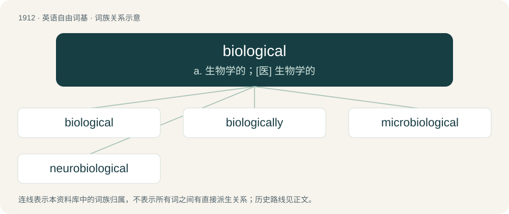

# 2025 · biological — a. 生物学的；\[医\] 生物学的

[总目录](../00_总目录_按常用程度.md)

**类型**：英语自由词基　｜　**来源语言**：见词源记录

## 核心含义与来源

- 核心含义：a. 生物学的；\[医\] 生物学的
- 英文含义：Of or relating to biology.
- 词形：biological

**来源记录 1**（形容词；Of or relating to biology.）

From biology + -ical.

## 词族图

## 单词速览（常用到不常用）

| 单词 | 音标 | 释义 |
|---|---|---|
| [biological](#w-1) | 英 /ˌbaɪ.ə(ʊ)ˈlɒd͡ʒ.ɪ.kəl/；美 /ˌbaɪ.əˈlɑ.d͡ʒɪ.kəl/ | a. 生物学的；\[医\] 生物学的 |
| [biologically](#w-2) |  | adv. 生物学, 生态学 |
| [microbiological](#w-3) |  | a. 微生物学的；\[医\] 微生物学的 |
| [neurobiological](#w-4) | /,njuərəu,baiəˈlɔdʒikəl/ | a. 神经生物学的 |

## 逐词详解

### 1. biological

**词性**：形容词　｜　**音标**：英 /ˌbaɪ.ə(ʊ)ˈlɒd͡ʒ.ɪ.kəl/；美 /ˌbaɪ.əˈlɑ.d͡ʒɪ.kəl/

**中文释义**：a. 生物学的；\[医\] 生物学的

**英文义项**：Of or relating to biology. / Relating to anatomy; anatomic, anatomical.

**构词拆分**：biology + -ical

**词源与演化**：

From biology + -ical.

**用法示例／搭配（非完整句）**：

> biological mother

该用例对应义项：Related by consanguinity, especially as to parents and children.

### 2. biologically

**词性**：副词

**中文释义**：adv. 生物学, 生态学

**英文义项**：In a biological manner. / With regard to biology.

**构词拆分**：biological + -ly

**词源与演化**：

From biological + -ly.

**例句**：

> Biologically, Central Park is home to an amazing assortment of plants and animals.

### 3. microbiological

**词性**：形容词

**中文释义**：a. 微生物学的；\[医\] 微生物学的

**英文义项**：Of or pertaining to microbiology.

**构词拆分**：micro- + biological

**词源与演化**：

From micro- + biological.

### 4. neurobiological

**词性**：形容词　｜　**音标**：/,njuərəu,baiəˈlɔdʒikəl/

**中文释义**：a. 神经生物学的

**英文义项**：Of or pertaining to neurobiology, the biological study of nerve and brain function.

**构词拆分**：neuro- + biological

**词源与演化**：

From neuro- + biological.
